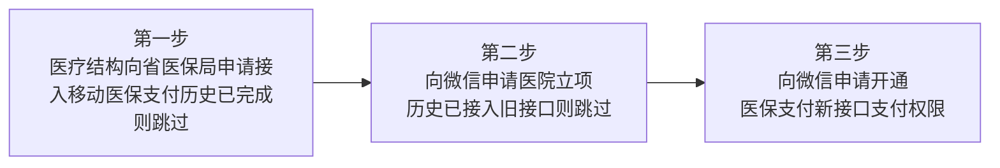

>更新时间：2026.10.20

## 概览

医疗机构接入微信移动医保支付，整体流程分为三大核心步骤：

1. 医疗机构申请接入省移动医保支付。若已完成申请，无需重复操作。

2. 向微信申请医院立项。若已完成立项（如历史上已接入微信医保支付旧接口），无需重复申请。

3. 向微信申请开通医保支付新接口的支付权限。

## 1、医疗机构申请接入省移动医保支付

### 1.1 概述

医疗机构申请接入省医保移动支付，需通过国家医保服务平台线上办理。申请分为测试环境与正式环境两个阶段：

- ​测试环境​：需先申请测试环境权限，完成联调测试并通过验收。

- 正式环境​：测试环境验收通过后，方可提交正式环境使用申请。

### 1.2 申请流程

详细流程见链接：[医药机构医保移动支付接入申请操作指南](https://docs.qq.com/pdf/DV3NuRkFEYXVFUWtz)

1.2.1. 登录[国家医保服务平台单位网厅](https://fuwu.nhsa.gov.cn)，点击【单位服务】栏目下的申报入口，或页面右上角【单位登录】，进入登录页面。按照对应的流程注册和登录，选择对应的服务进行申请。

1.2.2. 医保移动支付进行申请时，要填入申请的应用名称、线上业务类型、第三方渠道（微信）等信息进行在线申请。提交在线申请后，市-省-国家局进行审批通过后，下载反馈单，可获取到对应的业务参数机构渠道认证编码、线上业务类型编码（如果是支付使用，用04107）、第三方渠道应用名称、应用ID和应用密钥等。

## 2、医院立项

医院需通过邮件方式提交立项申请。具体请参见：[操作流程](https://docs.qq.com/doc/DV1BwTVZBQXNLSkpU)

在填写立项申请参数时，请注意以下事项：

- 服务范围​：若医院面向全省或全国用户提供医保移动支付服务，则省份填写“XX省全省”或“全国”。

- 支付模式选择​：如选择“通用医保码”模式，其实现方式为由医院生成二维码，用户主动扫码后获取待结算订单并完成支付。

- 医保支付场景​：门诊服务包含普通门诊和特门。若支持特门，请在“医保支付场景”中选择对应项；若暂不支持，则选择“诊间”场景。

## 3、申请接入微信移动医保支付

### 3.1 申请前请确认

- 医保支付权限：商户号主体已在医保局官网申请移动医保支付权限

- MA绑定关系：商户号与appid已绑定MA关系

- appid主体对应关系：申请拉起医保支付的appid（即小程序/公众号对应账号）需为对应医疗机构主体；若非对应医疗机构主体，请提供「当地卫健委或相关单位的说明」；

- 开户意愿确认：商户号已通过微信支付商户开户意愿确认；

- 商户号状态：申请商户号为医院正常收款商户号，不存在无法收款等情况。

### 3.2 申请流程

情况一：首次接入微信移动医保支付（历史未开通）

3.2.1 微信支付商户平台——产品中心——产品大全——普通商户移动医保支付——申请权限

3.2.2 填写/上传资料

- 商户号：商户号

- 商户简称：商户简称

- 商户全称：商户全称

以上商户信息均为系统自动拉取，无需填写，请核实是否准确

- APPID1：必填

- APPID2：选填，填写的APPID需与商户存在绑定关系（向医保局申请接入移动支付微信应用渠道对应的APPID）

- 医保审批证明：医保局申请单截图，大小小于5M，见示例

- 医药机构截图：医药机构公示截图，截图请务必与申请主体一致,大小小于5M

- 补充说明：选填，特殊情况在此说明

- 产品开通申请函：必填，需勾选后提交

3.2.3 提交后等待审批即可，请留意站内信通知

情况二：历史已接入微信医保支付，需迁移至新接口

邮件申请：

除邮件申请外，也可按情况一的方式在线提交权限申请，线上流程审批时效更快。区别在于邮件申请无需提交两张医保资质证明材料截图，线上申请需提交该材料。

| 邮件标题： | 【直连新接口】-接口迁移-商户名称-2026XXXX（申请日期） |
| --- | --- |
| 主送： | wxpay\_operation@tencent.com |
| 抄送： | caihangliu@tencent.com；xiaomaowang@tencent.com；yuxiwang@tencent.com； mikedu@tencent.com; shirlyychen@tencent.com; sanbaozhou@tencent.com; musksun@tencent.com; yukiyywan@tencent.com; joycehan@tencent.com; |
| 正文： | Hi ， 以下医疗机构历史已开通医保支付权限，申请开通直连移动医保支付新接口权限，辛苦配置，谢谢。 申请表（填写并复制申请表的内容到正文，请勿提供截图） |
| 附件： | 商户基本信息表： [商户基本信息表（独立模式）.xlsx](https://docs.qq.com/sheet/DRU9YTUpXV0RVaWdK?tab=BB08J2) |

情况三：权限变更，已接入微信医保支付新接口，需更改或新增商户号/APPID

| 邮件标题： | 【直连新接口】-商户号变更/新增appid申请-商户名称-2026XXXX（申请日期） |
| --- | --- |
| 主送： | wxpay\_operation@tencent.com |
| 抄送： | caihangliu@tencent.com；xiaomaowang@tencent.com；yuxiwang@tencent.com； mikedu@tencent.com; shirlyychen@tencent.com; sanbaozhou@tencent.com; musksun@tencent.com; yukiyywan@tencent.com; joycehan@tencent.com; |
| 正文： | Hi ， 以下医疗机构历史已开通医保支付新接口权限，申请更改或新增商户号/APPID，辛苦配置，谢谢。 申请表（填写并复制申请表的内容到正文，请勿提供截图） |
| 附件： | 商户基本信息表： [商户基本信息表（独立模式）.xlsx](https://docs.qq.com/sheet/DRU9YTUpXV0RVaWdK?tab=BB08J2) |

情况四：模式变更，已开通新接口权限，需变更接入模式（如服务商模式变更为独立模式）

| 邮件标题： | 【直连新接口】医保接入模式变更申请--商户名称--2025xxxx（申请日期） |
| --- | --- |
| 主送： | wxpay\_operation@tencent.com |
| 抄送： | caihangliu@tencent.com；xiaomaowang@tencent.com；yuxiwang@tencent.com； mikedu@tencent.com; shirlyychen@tencent.com; sanbaozhou@tencent.com; musksun@tencent.com; yukiyywan@tencent.com; joycehan@tencent.com; |
| 正文： | Hi ， 以下医疗机构历史已开通新接口医保支付权限，申请由\*\*模式变更至\*\*模式，辛苦配置，谢谢。 申请表（填写并复制申请表的内容到正文，请勿提供截图） |
| 附件： | 商户基本信息表： [商户基本信息表.xlsx](https://docs.qq.com/sheet/DRURkamN6VEVtaWZ6?tab=BB08J2) |