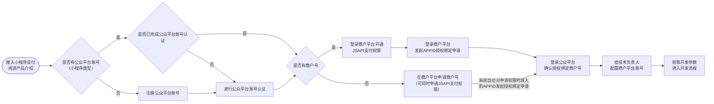

>更新时间：2026.10.16

接入流程说明

1、阅读[产品介绍文档](https://pay.weixin.qq.com/doc/v3/merchant/4012791894.md)，了解小程序支付产品特性

2、参考[公众平台账号（小程序类型）注册指引](https://kf.qq.com/faq/170109iQBJ3Q170109JbQfiu.html)注册公众平台账号；

3、参考[公众平台账号（小程序类型）认证指引](https://kf.qq.com/faq/170109by2mQB170109zUFfqe.html)完成公众平台账号认证，未认证的账号无法申请小程序支付权限；

JSAPI支付与小程序支付共享同一权限及下单接口，但调起方式不同：JSAPI需校验调起支付的域名/路径与商户平台配置的「JSAPI支付授权目录」是否一致，小程序不校验无需配置；

4、如果已有商户号，请超级管理员登录[商户平台](https://pay.weixin.qq.com/)，按照[已有商户号开通JSAPI支付权限流程(小程序支付场景)](https://pay.weixin.qq.com/doc/v3/merchant/4012791895.md#1%E3%80%81%E5%B7%B2%E6%9C%89%E5%95%86%E6%88%B7%E5%8F%B7%E7%94%B3%E8%AF%B7JSAPI%E6%94%AF%E4%BB%98%E4%BA%A7%E5%93%81%E6%9D%83%E9%99%90)申请权限，并[发起APPID的授权绑定](https://pay.weixin.qq.com/doc/v3/merchant/4013287504.md#2.2%E3%80%81%E7%99%BB%E5%BD%95%E5%95%86%E6%88%B7%E5%B9%B3%E5%8F%B0%E5%8F%91%E8%B5%B7APPID%E7%9A%84%E6%8E%88%E6%9D%83%E7%BB%91%E5%AE%9A%E7%94%B3%E8%AF%B7)申请；

如果还没有商户号，请参考[申请新商户号和JSAPI支付权限(小程序支付场景)](https://pay.weixin.qq.com/doc/v3/merchant/4012791895.md#2%E3%80%81%E7%94%B3%E8%AF%B7%E6%96%B0%E5%95%86%E6%88%B7%E5%8F%B7%E5%92%8CJSAPI%E6%94%AF%E4%BB%98%E4%BA%A7%E5%93%81%E6%9D%83%E9%99%90)，支持申请小程序支付权限的主体类型有：个体工商户、企业、事业单位、政府机关、社会组织，​​详见​​：[主体类型](https://kf.qq.com/faq/180910IBZVnQ180910naQ77b.html)介绍与[各主体权限对照说明](https://pay.weixin.qq.com/doc/v3/merchant/4015459054.md)，申请完成后，系统会自动对申请权限时填写的APPID发起授权绑定申请；

5、登录[公众平台](http://mp.weixin.qq.com/)，[确认授权绑定的商户号](https://pay.weixin.qq.com/doc/v3/merchant/4013287504.md#2.3.2%E3%80%81%E5%B0%8F%E7%A8%8B%E5%BA%8F)，完成商户号与公众平台APPID绑定；

6、超级管理员登录[商户平台](https://pay.weixin.qq.com/)，为技术负责人配置商户平台登录账号并设置为安全联系人，详见[配置技术负责人账号操作指引](https://pay.weixin.qq.com/doc/v3/merchant/4015423618.md)；

7、获取[开发参数](https://pay.weixin.qq.com/doc/v3/merchant/4013070756.md)，进入[开发流程](https://pay.weixin.qq.com/doc/v3/merchant/4012791911.md)（特别说明：在开发的过程中，请将应答的HTTP头Request-ID值打印到日志中。Request-ID作为[请求的唯一标识](https://pay.weixin.qq.com/doc/v3/merchant/4012081709.md#%E8%AF%B7%E6%B1%82%E7%9A%84%E5%94%AF%E4%B8%80%E6%A0%87%E8%AF%86)，在调用接口遇到问题时，可向微信侧提供该值用于快速定位到请求记录，协助排查问题原因）。

注意：若为交易类小程序，需要满足公众平台的[《交易类小程序运营规范》](https://developers.weixin.qq.com/miniprogram/product/jiaoyilei/yunyingguifan.html)，按照规范接入[订单发货管理功能](https://developers.weixin.qq.com/miniprogram/product/jiaoyilei/fahuoguanligongneng.html)，若不满足，可能被公众平台限制使用小程序进行支付的权限，无法在正式环境下调起小程序支付。