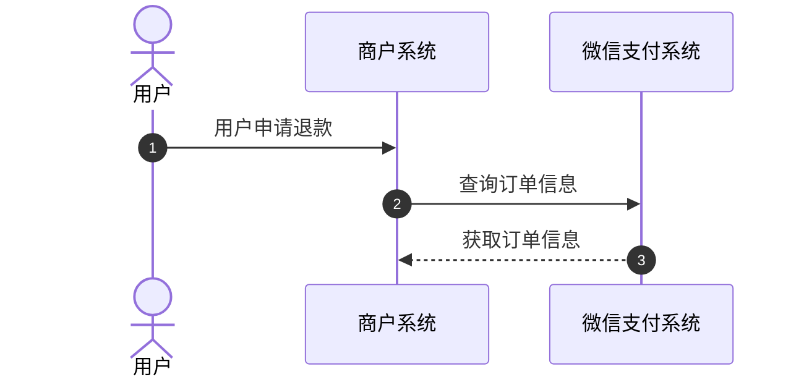
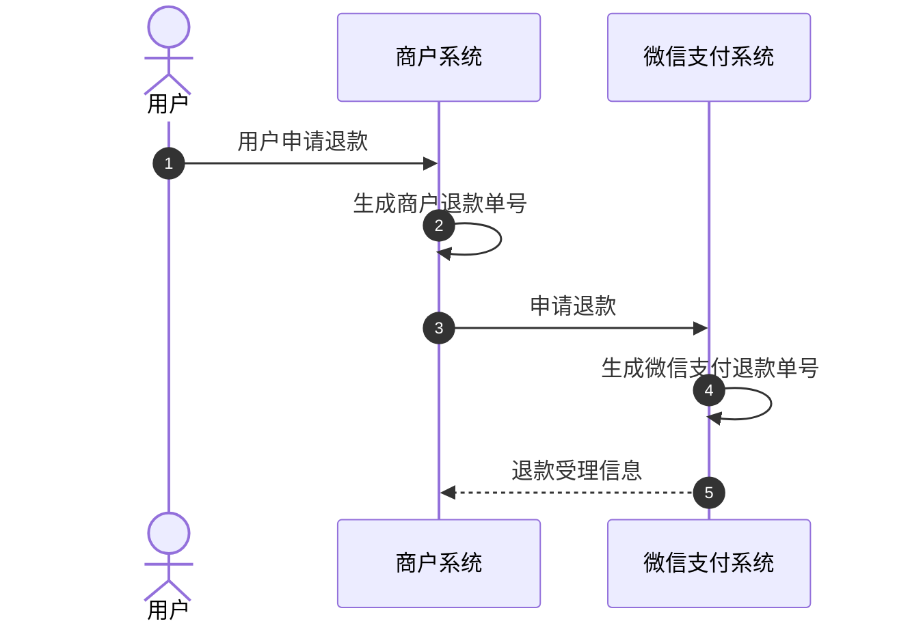
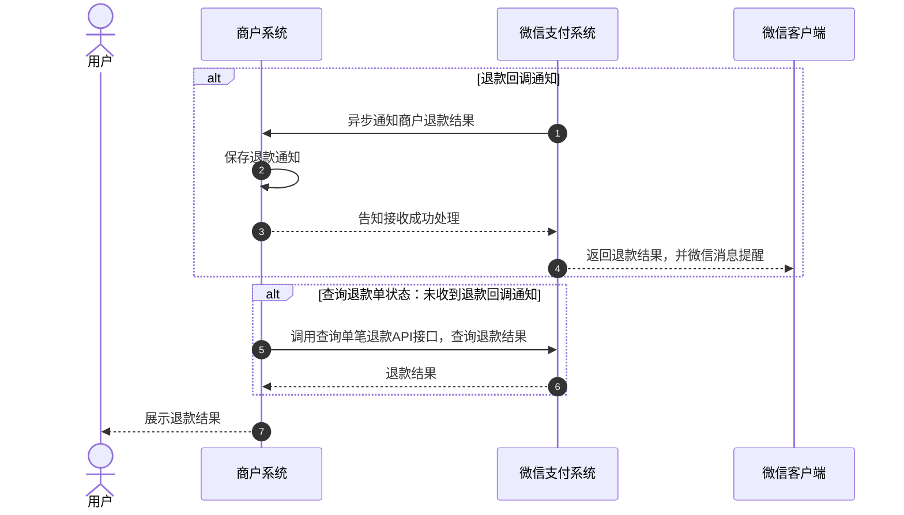
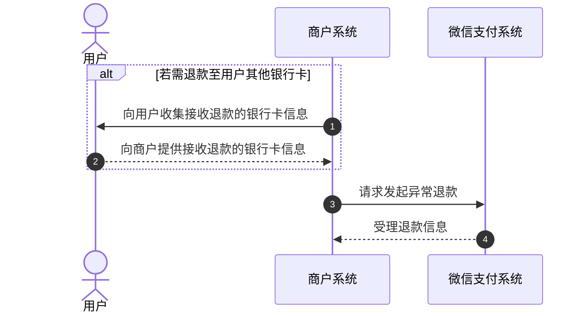
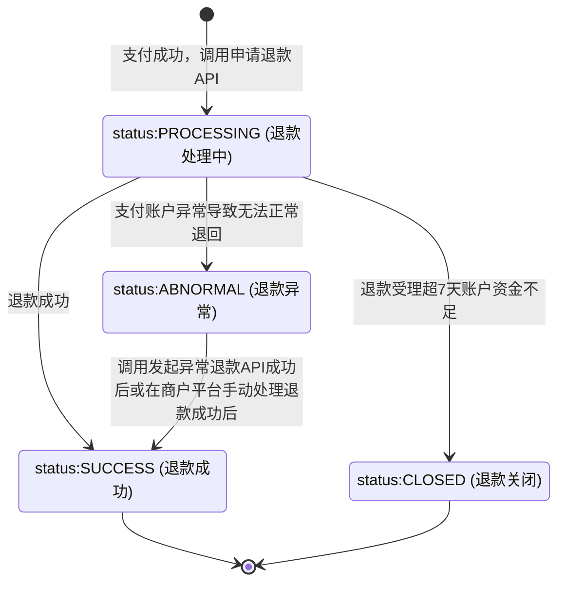

>更新时间：2026.10.13

## 1、整体业务开发流程概览

若存在退款需求，商户需先调用[查询订单状态](https://pay.weixin.qq.com/doc/v3/merchant/4013070356.md)接口以确认订单支付状态为已支付成功，随后调用[申请退款API](https://pay.weixin.qq.com/doc/v3/merchant/4013071036.md)创建退款单后，可通过[查询单笔退款信息](https://pay.weixin.qq.com/doc/v3/merchant/4013071041.md)或[退款回调通知](https://pay.weixin.qq.com/doc/v3/merchant/4013071196.md)以确认最终的退款结果。若退款状态为退款异常，则需调用[发起异常退款API](https://pay.weixin.qq.com/doc/v3/merchant/4013071193.md)进行退款操作。

## 2、详细步骤说明

### 2.1、查询订单状态

商户在退款之前调用[微信支付订单号查询订单API](https://pay.weixin.qq.com/doc/v3/merchant/4013070354.md)或[商户订单号查询订单API](https://pay.weixin.qq.com/doc/v3/merchant/4013070356.md)，确认订单支付状态，支付成功才可进行退款。

### 2.2、申请退款

商户调用[申请退款API](https://pay.weixin.qq.com/doc/v3/merchant/4013071036.md)创建退款单，退款单受理成功后，微信会从交易商户的基本账户内扣除需退款的资金，退款资金会进入到微信侧退款的中间账户，然后再退回给用户。

注意：

- 对于合单支付的订单，无法通过合单支付总单号 `combine_out_trade_no` 退款，只能根据单个子单进行退款。

- 若支付订单为分账订单，存在分账给其他商户号成功情况，退款不会自动回退分账金额，退款出资为商户基本账户可用余额。

- 可退款期限自支付成功时间起算，为 365 天。见 [申请退款](https://pay.weixin.qq.com/doc/v3/merchant/4013071036.md)。

- `amount.total` 填原支付交易的订单总金额，不是本次退款金额。

- 同一 `out_refund_no` 多次请求只退一笔。申请失败后重试，必须使用原商户退款单号。一笔订单最多 50 次部分退款；多次部分退款须更换商户退款单号，并间隔 1 分钟后再调用。

- 申请退款返回成功只表示退款单已受理，不等于退款成功。是否成功以退款结果通知和查询退款的返回为准。

- 退款结果回调地址至少配置一处：在申请退款传入 `notify_url`，或在商户平台「交易中心 —> 退款管理 —\> 退款配置」配置。接口传入 `notify_url` 后，商户平台配置的回调地址不再生效。两处都没有则收不到退款回调，只能靠查询退款确认结果。

申请退款接口需要注意的参数：

普通支付订单退款或合单支付订单退款时，需选择填写 `transaction_id` 或 `out_trade_no` 中的一个，普通支付订单退款按照API接口参数填写；合单支付订单退款需要特别注意以下参数字段：

`transaction_id`：填写原合单支付订单的 `sub_orders.transaction_id`【子单微信支付订单号】

`out_trade_no`：填写原合单支付订单的 `sub_orders.out_trade_no`【子单商户订单号】

### 2.3、确认退款结果

退款处理完成后，微信支付会将[退款结果通知](https://pay.weixin.qq.com/doc/v3/merchant/4013071196.md)发送到[申请退款](https://pay.weixin.qq.com/doc/v3/merchant/4013071036.md)时传递的【notify\_url】地址，通知内容需要使用APIV3密钥进行加密解密，所以需要提前设置APIV3密钥，设置指引：[APIv3密钥设置方法](https://pay.weixin.qq.com/doc/v3/merchant/4013053267.md)。

若未收到退款回调通知或商户希望主动获取退款状态时，可调用 [查询单笔退款（按商户退款单号）](https://pay.weixin.qq.com/doc/v3/merchant/4013071041.md)查询退款单信息，推荐申请退款后间隔1分钟调用该接口轮询一次退款状态，若超过5分钟仍是退款处理中状态，建议开始逐步衰减轮询频率(比如之后间隔5分钟、10分钟、20分钟、30分钟……轮询一次)。

退款状态：

SUCCESS—退款成功

CLOSED—退款关闭：此状态表明您的退款请求已经关闭。原因是退款单已经处于“退款处理中”的状态超过7天，并且在这段时间内，出资账户的余额不足以完成退款操作。可充值后生成新的商户退款单号，重新调用[退款申请API](https://pay.weixin.qq.com/doc/v3/merchant/4013071036.md)。

PROCESSING—退款处理中：可稍后再次调用[查询单笔退款（按商户退款单号）](https://pay.weixin.qq.com/doc/v3/merchant/4013071041.md)，确认最终退款结果。

ABNORMAL—退款异常：退款到银行发现用户的卡作废或者冻结了，导致原路退款银行卡失败，可前往[商户平台](https://pay.weixin.qq.com/)-交易中心，手动处理此笔退款。或调用[发起异常退款API](https://pay.weixin.qq.com/doc/v3/merchant/4013071193.md)接口处理异常退款。

注意：

退款有一定延时，零钱支付的订单退款一般5分钟内到账，银行卡支付的订单退款一般1-3个工作日到账，具体以[查询退款](https://pay.weixin.qq.com/doc/v3/merchant/4013071041.md)接口返回状态为准。

### 2.4、发起异常退款

提交退款申请后，若查询退款确认状态为退款异常，退款资金会停留在退款的中间账户内，商户可调用此接口发起异常退款，使退款资金从退款中间账户退到用户的银行卡，或退回交易商户基本账户的结算银行账户。

注意：

退款至用户时，仅支持以下银行的借记卡：招行、交通银行、农行、建行、工商、中行、平安、浦发、中信、光大、民生、兴业、广发、邮储、宁波银行。

发起异常退款关键参数：

`type`：可选择退款到用户银行卡，或退回到交易商户银行账户内。

若选择退款给用户银行卡，需在对收款银行卡号 `bank_account` 和收款用户姓名 `real_name` 进行[敏感信息加密](https://pay.weixin.qq.com/doc/v3/merchant/4013053257.md)。

## 3、退款单状态流转图

退款单状态流转说明

1、商户调用[退款申请](https://pay.weixin.qq.com/doc/v3/merchant/4013071036.md)接口受理成功后，可以调用[查询单笔退款（按商户退款单号）](https://pay.weixin.qq.com/doc/v3/merchant/4013071041.md)接口来确认退款单状态。

2、当退款单状态为退款处理中(status：PROCESSING)时，退款受理超过7天且账户资金不足时，退款单状态将流转为退款关闭(status：CLOSED)。

3、当退款单状态为退款处理中(status：PROCESSING)时，若因用户账户异常（例如银行卡作废或冻结）导致资金无法按原路退回，微信支付会优先尝试将退款金额转入用户的微信零钱。仅当用户的微信零钱账户也已注销时，退款单状态才会流转为退款异常(status：ABNORMAL)。

4、当退款成功时，退款单状态将从退款处理中(status：PROCESSING)流转为退款成功(status：SUCCESS)。

5、当退款单状态为退款异常(status：ABNORMAL)时，此时商户可以到【[商户平台](https://pay.weixin.qq.com/) —>交易中心】[手动处理退款](https://kf.qq.com/faq/140225MveaUz150107mAVz6F.html)或调用[发起异常退款](https://pay.weixin.qq.com/doc/v3/merchant/4013071193.md)接口处理异常退款，当退款成功后，退款单状态将流转为退款成功(status：SUCCESS)。

6、以下两个状态为终态

- status：SUCCESS

- status：CLOSED

## 4、单业务注意事项

| 事项 | 说明 |
| --- | --- |
| 接入退款时须完成申请、幂等、结果确认和状态持久化 | 同一 `out_refund_no` 多次请求只退一笔。退款申请返回成功只表示已受理，标为退款成功只依据回调 `REFUND.SUCCESS` 或查单 `status` 为 `SUCCESS`。见 [申请退款](https://pay.weixin.qq.com/doc/v3/merchant/4013071036.md) |
| 退款仅支持支付成功后 1 年内的订单 | 可退款期限自支付成功时间起算，为 365 天。超过该期限不支持发起退款。见 [申请退款](https://pay.weixin.qq.com/doc/v3/merchant/4013071036.md) |
| 退款申请超时或状态不明时须查询，重试须使用原退款单号 | 超时或返回 `SYSTEM_ERROR` 等状态未明时，调用查询单笔退款确认状态。重试须使用原 `out_refund_no`，更换退款单号可能导致重复退款。见 [查询单笔退款（通过商户退款单号）](https://pay.weixin.qq.com/doc/v3/merchant/4012791863.md) |
| 须处理全部退款结果， `ABNORMAL` 须调用发起异常退款 | `ABNORMAL` 表示原路退回银行卡失败，须调用发起异常退款。未调用时，资金停留在退款中间账户。见 [发起异常退款](https://pay.weixin.qq.com/doc/v3/merchant/4012791864.md) |
| 退款到账时间只用于向用户说明预期，不作为结单依据 | 退款有一定延时。零钱支付的订单退款一般 5 分钟内到账，银行卡支付的订单退款一般 1-3 个工作日到账。这是预计到账时间，只用来向用户说明，不能据此把退款标成成功。是否成功，以查询退款返回的 `status` 为准。 |
| 退款回调地址至少配置一处 | 可在退款申请传入 `notify_url`，或在商户平台配置退款回调，至少一处。接口传入 `notify_url` 后，商户平台配置的回调地址不再生效。见 [申请退款](https://pay.weixin.qq.com/doc/v3/merchant/4013071036.md) |