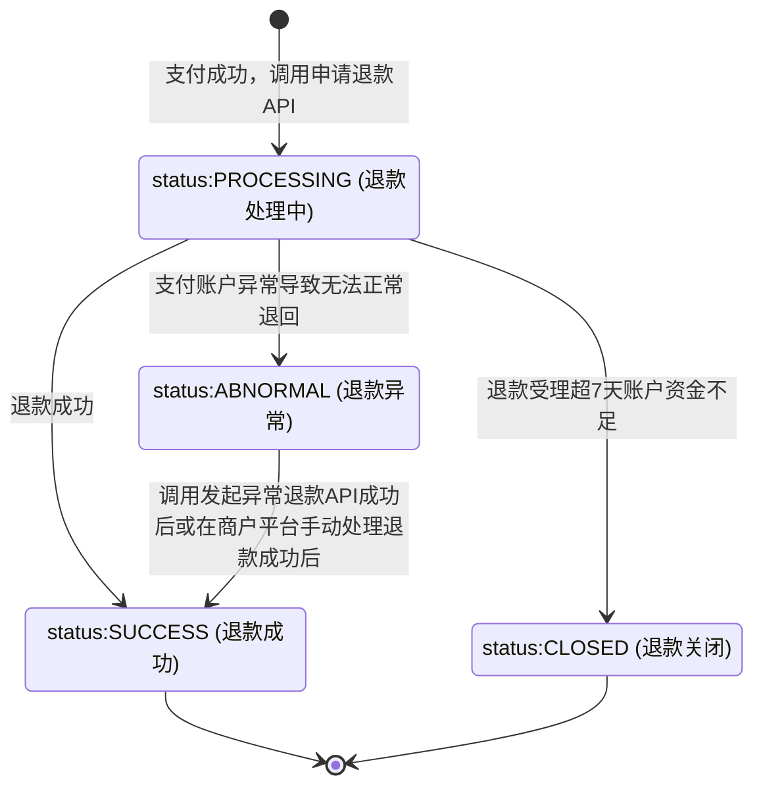

>更新时间：2026.06.10

## 一、概述

对微信支付订单退款，需严格遵循官方文档规范，确保资金安全。商户需通过回调通知和查询单笔退款接口获取退款单的最新状态，再根据获取的状态来做不同的业务逻辑处理。

## 二、退款处理流程

### 1、 前置条件校验

 只有通过[查询订单状态](https://pay.weixin.qq.com/doc/v3/merchant/4013070356.md)接口，查询到订单状态为“SUCCESS支付成功”时，才可发起退款。

 订单只能在支付后1年内(支付时间+365天)发起退款，超出时间的订单，无法退款；

 订单可选择全额退款或部分退款(最多支持50次部分退款)。

### 2、发起退款

调用[申请退款API](https://pay.weixin.qq.com/doc/v3/merchant/4013071036.md)，发起退款请求，若接口应答不为“200 OK”，需先调用[查询单笔退款](https://pay.weixin.qq.com/doc/v3/merchant/4013071041.md)接口确认退款单是否受理，再根据接口返回的错误码和错误码描述处理业务逻辑。

 若受理成功，查询单笔退款接口会返回微信支付退款单号等字段信息，再根据查询的状态来处理；（如果退款单不是CLOSED状态，则退款请求已经被受理）

 如受理失败，查询单笔退款接口会返回“RESOURCE\_NOT\_EXISTS 退款单不存在”，请使用原单原参数重试（原单不换参数重试，是安全且幂等的，不会发起重复退款）。

退款接口常见错误码：

|     |     |     |     |
| --- | --- | --- | --- |
| 状态码 | 错误码 | 描述 | 解决方案 |
| 400 | INVALID\_REQUEST | 请求参数符合参数格式，但不符合业务规则 | 此状态代表退款申请失败，商户可根据具体的错误提示做相应的处理 |
| 401 | SIGN\_ERROR | 签名错误 | 请检查签名参数和方法是否都符合签名算法要求，参考：[如何签名和验签](https://pay.weixin.qq.com/doc/v3/merchant/4012365342.md#2.-%E4%BB%80%E4%B9%88%E6%97%B6%E5%80%99%E9%9C%80%E8%A6%81%E9%AA%8C%E7%AD%BE%EF%BC%9F%E5%A6%82%E4%BD%95%E9%AA%8C%E7%AD%BE%EF%BC%9F) |
| 403 | NOT\_ENOUGH | 余额不足 | 此状态代表退款申请失败，商户账户余额不足，请充值后，原单原参数重试 |
| 403 | USER\_ACCOUNT\_ABNORMAL | 退款请求失败 | 用户账号注销，此状态代表退款申请失败，商户可自行处理退款 |
| 404 | MCH\_NOT\_EXISTS | MCHID不存在 | 请检查商户号是否正确，商户号获取方式请参考[开发必要参数说明](https://pay.weixin.qq.com/doc/v3/merchant/4013070756.md) |
| 404 | RESOURCE\_NOT\_EXISTS | 退款单不存在 | 请检查你的订单号是否正确且是否已支付，未支付的订单不能发起退款 |
| 429 | FREQUENCY\_LIMITED | 频率限制 | 该笔退款为受理中，请调用查单接口确认或降低频率原单重试，重试请勿更换单号 |
| 500 | SYSTEM\_ERROR | 系统超时 | 请使用原单原参数重试 |

注意：

当请求失败时，请根据实际返回的错误描述并结合相关解决方案进行判断和处理，应用程序不得依赖错误描述进行自动化处理（错误描述可能因业务调整而发生变更）

### 3、 确认退款结果

发起退款请求后，可通过以下两种方式确认退款状态：

 回调通知：退款处理完成后，微信支付会通过[回调通知](https://pay.weixin.qq.com/doc/v3/merchant/4013071196.md)返回退款结果。

 主动查询：若未收到回调， 推荐每间隔1分钟调用[查询单笔退款](https://pay.weixin.qq.com/doc/v3/merchant/4013071041.md)接口查询一次退款状态，若超过5分钟仍是退款处理中状态，建议开始逐步衰减查询频率(比如之后间隔5分钟、10分钟、20分钟、30分钟……查询一次)。

退款单状态，可以参考：

## 三、 退款异常处理流程

若用户账户异常（如银行卡冻结）会导致退款失败，[查询单笔退款](https://pay.weixin.qq.com/doc/v3/merchant/4013071041.md)接口会返回ABNORMAL(退款异常)。此时，商户可选择退款至用户其他银行账户或退款至交易商户银行账户，再由商户退款给用户。

 手动处理：登录【[商户平台](https://pay.weixin.qq.com/) -\> 交易中心】人工审核退款。参考：[平台退款指引](https://kf.qq.com/faq/140225MveaUz150107mAVz6F.html)

 接口调用： 通过[发起异常退款API](https://pay.weixin.qq.com/doc/v3/merchant/4013071193.md)接口处理异常退款。