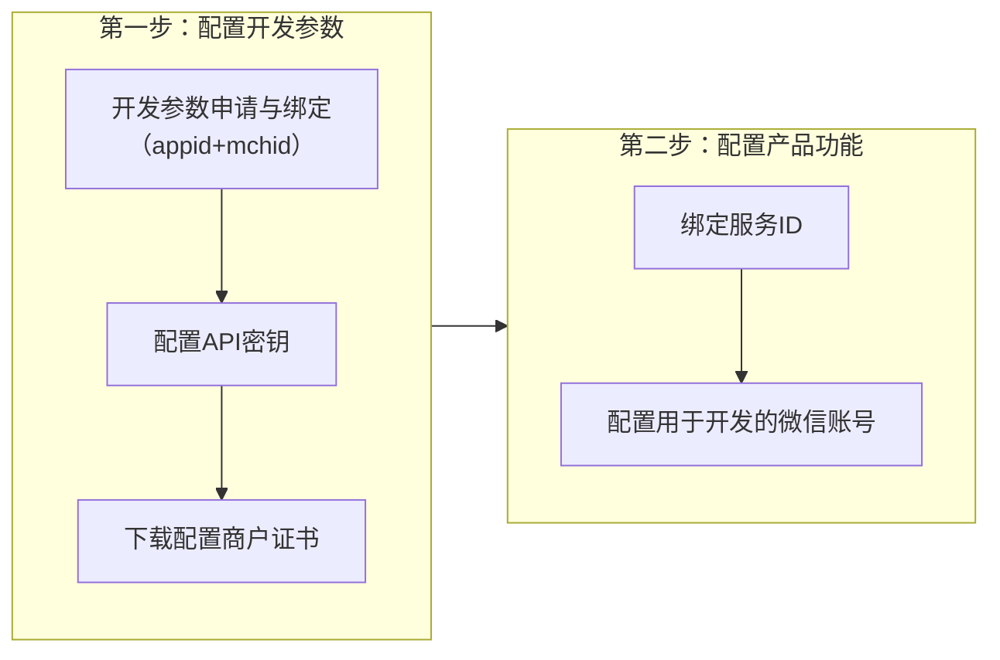
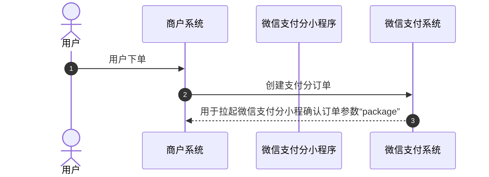
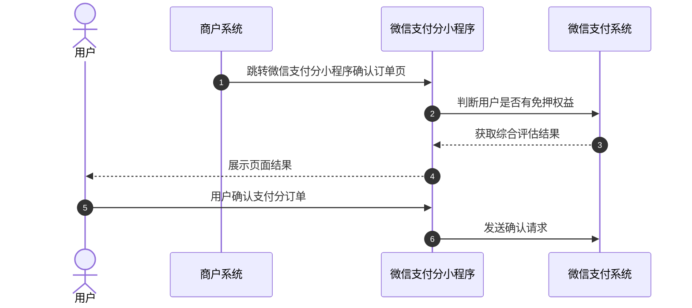
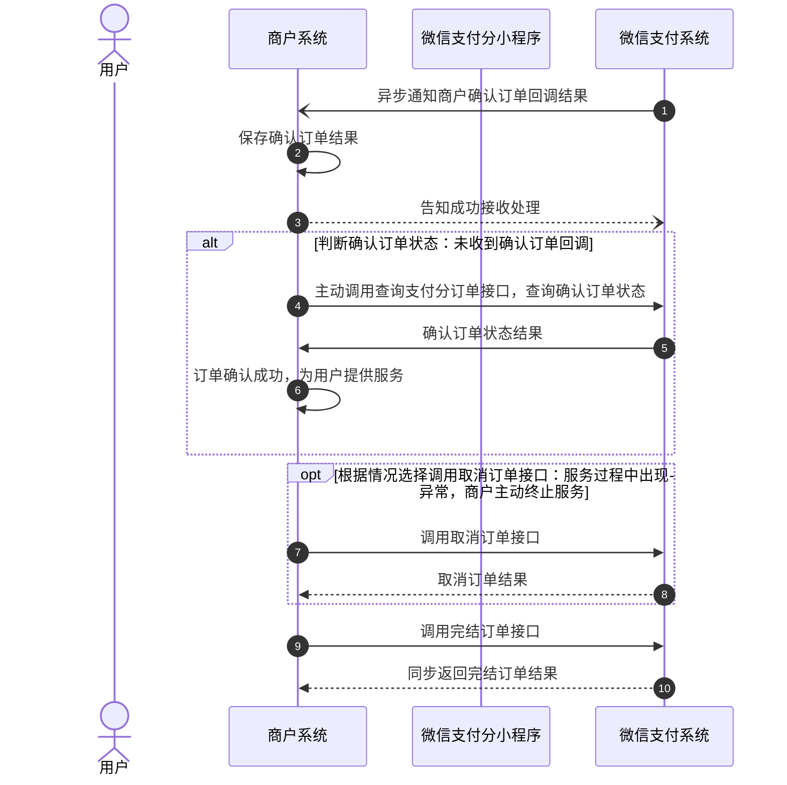
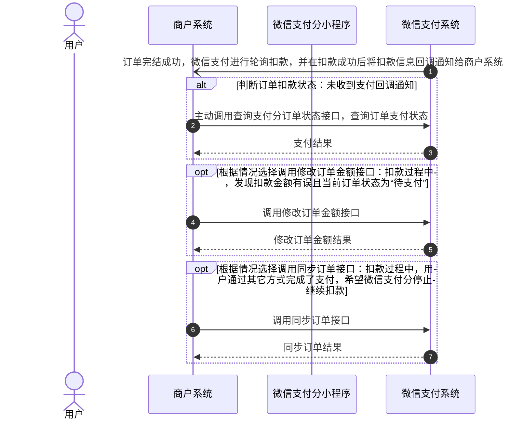
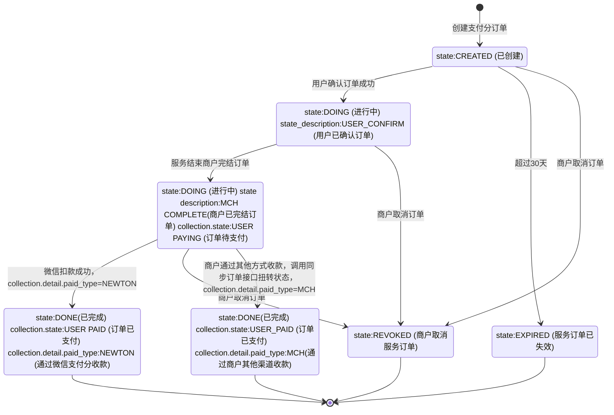

>更新时间：2026.10.19

## 1、开发前配置

开发前，开发者需要完成如下两个步骤：配置开发参数和配置产品功能。

### 1.1、配置开发参数

| 参数名 | 用途和申请说明 |
| --- | --- |
| mchid | 商户在微信侧入驻的商户号，在[商户平台](https://pay.weixin.qq.com/)申请。 |
| appid | 商户应用载体ID，可以是公众号/小程序/移动应用，在[开放平台](https://open.weixin.qq.com)(移动应用)和[公众平台](https://mp.weixin.qq.com/)(公众号/小程序)申请，商户号需要绑定appid才能在该载体中使用微信支付，详细请参考[微信支付普通商户与AppID账号关联管理](https://kf.qq.com/faq/1801116VJfua1801113QVNVz.html)。 |
| APIV2密钥 | 商户调用APIv2接口需使用该密钥签名验签，商户前端拉起支付分小程序需要用到API v2密钥生成签名，设置方式参考[APIv2密钥设置及修改方法](https://kf.qq.com/faq/180830UVRZR7180830Ij6ZZz.html)。 |
| APIV3密钥 | 商户接收APIv3回调密文后需使用该密钥解密，获取平台证书公钥也需要使用该密钥解密，设置方式参考[APIv3密钥设置方法](https://kf.qq.com/faq/180830E36vyQ180830AZFZvu.html)。 |
| 商户API证书 | 商户调用APIv3接口请求时需要使用该证书私钥生成请求签名，v2部分涉及资金操作接口(如退款/撤销/企业付款等)请求也需要携带该证书，获取方式参考[商户API证书获取方法及功能介绍](https://kf.qq.com/faq/161222NneAJf161222U7fARv.html) |
| 微信支付平台证书 | 商户调用APIv3接口返回时需要使用该证书公钥进行验签，v3部分含有敏感信息参数接口也需要使用平台证书公钥加密，获取方式参考[如何下载平台证书](https://pay.weixin.qq.com/doc/v3/merchant/4012551764.md)。 |

### 1.2、配置产品功能

| 步骤 | 说明 |
| --- | --- |
| 绑定服务ID | 支付分接入权限审核通过后，微信支付运营会向商户提供支付分服务ID，服务ID下默认绑定商户申请支付分时填写的商户号和appid，商户后续新增商户号或appid需联系微信支付运营同学绑定。 |
| 配置用于开发的微信号 | 支付分服务上线前无法开放给线上用户使用。为支持开发过程中的调试和测试，支付分提供了测试号白名单功能。上线前，仅白名单中的微信号用户可使用支付分服务。商户需登录[商户平台](https://pay.weixin.qq.com/)进行配置，具体参考[测试微信号配置指引](https://pay.weixin.qq.com/doc/v3/merchant/4012587248.md)。 |

注意

商户在联调或运营过程中如遇到权限类问题报错，可参考《[微信支付分权限类问题排查指南](https://pay.weixin.qq.com/doc/v3/merchant/4018398339.md)》，按文档指引逐步排查解决。

## 2、 详细开发指引

### 2.1、整体业务开发流程概览

- 当用户通过商户提供的入口申请使用服务后，商户系统同步创建微信支付分服务订单，商家再根据返回参数拉起支付分确定订单界面，用户确认订单后商家开始向用户提供服务。

- 服务结束后商户通过完结订单接口告知支付分需要收款，由支付分完成自动扣款，最后通过下载交易账单进行对账。特殊需要退款的服务订单，也可调用退款接口完成退款。

- 整个业务开发过程中的前端UI交互，需要满足[支付分合作品牌线上应用规范](https://pay.weixin.qq.com/doc/v3/merchant/4012587220.md)。

### 2.2、详细开发步骤说明

#### 2.2.1、商户创建支付分订单

当用户申请使用服务时，商户需调用[创建支付分订单API](https://pay.weixin.qq.com/doc/v3/merchant/4012587900.md)接口创建订单。在接口参数中，商户需要通过post\_payments字段，上传本笔订单的预估费用或计费规则等信息，不同的场景有不同的传值要求，详见：[post\_payments(后付费项目)字段传参说明](https://pay.weixin.qq.com/doc/v3/merchant/4012587259.md)

下单接口需要注意的参数：

service\_id：支付分服务ID，商户支付分服务的唯一标识，支付分产品权限申请审核通过后，微信支付运营同学会向商户提供支付分服务ID。

need\_user\_confirm：该参数表示这一笔服务订单，是否需要用户确认。需确认模式下，商户必须固定传"true"。

risk\_fund.name：服务风险金名称。

先免模式下，该参数只能传 押金\[DEPOSIT\]、预付款\[ADVANCE\]、保证金\[CASH\_DEPOSIT\] 中的一个值；

先享模式，该参数只能传 \[预估订单费用\]ESTIMATE\_ORDER\_COST。

risk\_fund.amount：服务风险金金额，不可超过服务ID风险金额上限，支付分运营同学提供service\_id时会告知服务ID风险金额上限。

先免模式下，传这笔服务单需要的押金、预付款、保证金数额。

先享模式，传这笔订单预估的实际费用。

time\_range：时间参数时需注意如果选用"yyyyMMddHHmmss"精确到秒格式，由于商户系统和微信支付分系统可能存在一定时差，导致API接口调用出现时间检验不通过失败情况，因此商户在传入时间参数时需预留一定误差时间。

package：创单成功后返回，有效期（1小时）内能够拉起支付分小程序确认订单页，一旦拉起支付分小程序的确认订单页，用户可在2小时内可进行订单确认操作，页面停留超过2小时将无法确认订单。

#### 2.2.2、用户确认支付分订单

商户调用[创建支付分订单API](https://pay.weixin.qq.com/doc/v3/merchant/4012587900.md)接口生成订单后，会获取到用于拉起支付分订单确认页面的关键参数"package"，商户根据自己使用支付分的载体选择对应API接口拉起支付分，移动应用类型使用[APP调起支付分订单确认页面](https://pay.weixin.qq.com/doc/v3/merchant/4012587909.md)，公众号类型使用[JSAPI调起支付分订单确认页面](https://pay.weixin.qq.com/doc/v3/merchant/4012587945.md)，小程序类型使用[小程序调起支付分订单确认页面](https://pay.weixin.qq.com/doc/v3/merchant/4012587949.md)。

#### 2.2.3、商户提供服务

- 用户确认订单后，微信支付会向商户发送[回调通知](https://pay.weixin.qq.com/doc/v3/merchant/4012587953.md)，告知用户已确认完成。商户也可通过[查询支付分订单API](https://pay.weixin.qq.com/doc/v3/merchant/4012587902.md)获取用户确认订单的状态(确认后state为DOING，未确认为CREATED)，用户确认订单后，商户可以开始向用户提供服务。

- 服务完成后，商户需调用[完结支付分订单API，](https://pay.weixin.qq.com/doc/v3/merchant/4012587955.md)通知微信支付服务已结束(collection.state参数变为USER\_PAYING状态，即用户待支付状态)。在接口参数中，商户需要通过post\_payments字段，上传本笔订单实际的付费项目明细，不同的场景有不同的传值要求，详见：[post\_payments(后付费项目)字段传参说明](https://pay.weixin.qq.com/doc/v3/merchant/4012587259.md)

- 订单完结后，支付分会持续自动扣款，无需重复调用完结接口。

完结订单接口需要注意的参数：

total\_amount：订单收款总金额，先免模式(订单收款总金额<=创单传的服务风险金额<=服务ID风险金额上限)，先享模式(订单收款总金额<=服务ID风险金额上限)，支付分运营同学在提供service\_id时会告知服务ID风险金额上限。

post\_payments：后付费项目，表示本次服务完成后，商家收取的服务费用项目。商户需要严格按照[post\_payments(后付费项目)字段传参说明](https://pay.weixin.qq.com/doc/v3/merchant/4012587259.md)传参，否则会导致支付分订单页无法正常展示后付费项目，影响验收上线。

time\_range：实际服务时间，该参数有三种参数格式，如果选用"yyyyMMddHHmmss"精确到秒格式，可能由于商户系统和微信支付分系统存在一定时差，导致API接口调用出现时间检验不通过失败情况，因此商户在传入时间参数时需预留一定误差时间。

注意

进行中订单是服务履约的核心阶段，衔接订单确认与收款环节，处理不当易引发订单滞留、扣款异常、对账混乱等问题，商户需做好以下措施来进行规避：

1、主动获取订单状态

对于 `DOING` 状态的订单，定时调用查询支付分订单接口获取订单状态，避免因回调丢失或网络异常导致状态不一致。

2、及时完结并重试失败订单

商户完成服务后即时完结订单，避免超期滞留风险，若调用完结接口时因网络、参数错误等原因失败，需先核查参数（金额、传参规范等），再原单重试。

#### 2.2.4、商户收款

商户调用[完结支付分订单API](https://pay.weixin.qq.com/doc/v3/merchant/4012587955.md)成功后，微信支付分就会对用户发起扣款，商户也可以[调起支付分小程序订单详情页](https://pay.weixin.qq.com/doc/v3/merchant/4012587984.md)引导用户主动支付，用户如果有满足核销条件的[代金券](https://pay.weixin.qq.com/doc/v3/merchant/4012084079.md)会自动使用(使用后，在[支付成功回调](https://pay.weixin.qq.com/doc/v3/merchant/4012587960.md)和[查询支付分订单](https://pay.weixin.qq.com/doc/v3/merchant/4012587902.md)接口的promotion\_detail字段会返回代金券信息)，目前支付分只支持全场券。若扣款成功，微信支付会给商户系统发送[支付成功回调通知](https://pay.weixin.qq.com/doc/v3/merchant/4012587960.md)，支付分订单结束。商户系统也通过调用[查询支付分订单API](https://pay.weixin.qq.com/doc/v3/merchant/4012587902.md)主动查询扣款情况。

下面介绍几种扣款过程中的异常处理情况：

- 如果订单在“待支付”状态下（collection.state: USER\_PAYING），若扣款金额有误可调用[修改订单金额API](https://pay.weixin.qq.com/doc/v3/merchant/4012587957.md)修改订单金额，系统将按照修改后的金额发起扣款(注意只能下调扣款金额)。

- 如果订单在“待支付”状态下（collection.state: USER\_PAYING），若不需要继续扣款，希望微信支付分停止继续扣款。可调用[取消支付分订单API](https://pay.weixin.qq.com/doc/v3/merchant/4012587905.md)取消待支付的支付分订单，支付分订单将变成已取消状态。

- 如果订单在“待支付”状态下（collection.state: USER\_PAYING），用户通过其他方式完成支付，商户可调用[同步订单信息API](https://pay.weixin.qq.com/doc/v3/merchant/4012587962.md)将订单支付成功状态同步给微信支付，后续微信支付将不再发起扣款，支付分订单将变成已完成状态。

#### 2.2.5、商户对账

商户可在次日上午10点后通过[商户平台](https://pay.weixin.qq.com/)手动下载交易账单文件进行对账，详见[如何在商户平台下载账单](https://kf.qq.com/faq/2011027BzIfY2011027faUF7.html)。另外，商户也可以通过[申请交易账单API](https://pay.weixin.qq.com/doc/v3/merchant/4013071227.md)请求账单，然后使用[下载账单API](https://pay.weixin.qq.com/doc/v3/merchant/4013071238.md)下载交易账单进行对账。

需要注意以下几点：

- 订单只有在支付成功后才会出现在交易账单中，未支付成功的订单不会显示在账单里。

- 主动支付完成的支付分订单账单的交易类型是JSAPI，而自动扣款完成的支付分订单账单的交易类型为AUTH。

- 在账单中，商户订单号并非支付分商户服务单号，而是在账单的商户数据包中（格式为wxzff\|微信服务单号\|商户服务单号）。

#### 2.2.6、订单退款

支付分订单支付后，若订单需要退款，商户可登录[商户平台](https://pay.weixin.qq.com/)手动操作提交退款，具体参考[交易退款方法介绍](https://kf.qq.com/faq/140225MveaUz150107mAVz6F.html)。

同时也可通过支付成功回调和查询订单获取微信交易单号（transaction\_id），然后使用申请退款API提交退款。提交退款后，可使用[查询单笔退款API](https://pay.weixin.qq.com/doc/v3/merchant/4012587973.md)查看当前退款状态，成功退款后将收到[退款结果通知](https://pay.weixin.qq.com/doc/v3/merchant/4012587976.md)。

### 2.3、订单状态流转图

1、当支付分订单状态为待支付(collection.state: USER\_PAYING)时，微信侧会定期轮询扣款，扣款失败时状态不变，扣款成功时订单状态才改变。

2、当支付分订单状态在待支付状态(collection.state: USER\_PAYING)下，商户可以调用接口修改订单金额，修改成功后微信侧将按新金额发起扣款。

3、当支付分订单状态为已创建(state:CREATED)和用户已确认订单(collection.state: USER\_CONFIRM)和待支付状态(collection.state: USER\_PAYING)下，商户可以调用取消服务订单接口，取消支付分服务订单。

4、以下三个状态为终态

- state：EXPIRED

- state：REVOKED

- state：DONE

### 2.4、开发验收

商户侧使用[测试微信号](https://pay.weixin.qq.com/doc/v3/merchant/4012587248.md)完成开发测试后，需按照以下流程进行验收和上线工作(验收审核通过后对应服务才能配置上线并开放用户使用)：

| 步骤 | 说明 |
| --- | --- |
| 1、提交资料 | 1、产品流程录屏： 第一人称视角手机录屏，清晰展示包含首页/商品介绍页面→ 微信支付分确认订单页面（含介绍、计费规则、下单确认）→ 使用微信支付分开通授权成功 → 扣款成功 → 商户侧订单详情 → 查看微信通知 → 查看微信支付分订单详情 注：微信支付分相关展示须符合[支付分合作品牌线上应用规范](https://pay.weixin.qq.com/doc/v3/merchant/4012587220.md) 2、第三方视角拍摄录屏： 线下场景第三方视角拍摄视频，清晰展示实体产品设备、使用微信支付分流程、实体设备360度全貌，清晰露出设备品牌名称，硬件说明文字等 3、微信支付分订单详情页面截图： 提供微信支付分进行中、已完成、已取消三个订单状态详情截图，须确保按以下回传规范传值[post\_payments(后付费项目)字段传参说明](https://pay.weixin.qq.com/doc/v3/merchant/4012587259.md) |
| 2、提供上线信息 | 正式service id（服务id）： 服务名称： 服务场景：如充电宝 商户号： 1、预计上线时间、放量计划： 2、上线计划： （1）上线城市和计划： （2）应急机制：若遇紧急情况是否支持随时隐藏支付分入口：支持（默认支持） |
| 3、上线完成 | 验收完成后，微信支付侧将完成服务配置，产品正式上线；上线后，双方将共同监控产品运行情况，确保稳定运行并满足用户需求。 |