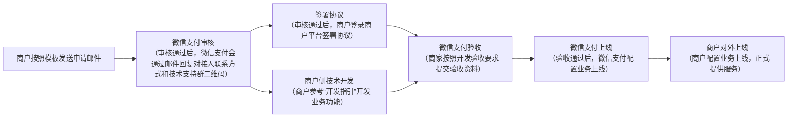

>更新时间：2026.10.19

## 1、 权限申请要求说明

- 商户营业执照的经营类目需包含申请使用支付分服务的相关类目，例如：

  - 【共享充电宝】业务接入微信支付分，商户营业执照的经营类目建议包括：手机充电服务、电子设备租赁、手机充电设备服务、电子产品租赁服务等。

  - 【无人零售】业务接入微信支付分，商户营业执照的经营类目建议包括：自动售货机、食品、食用农产品、预包装食品等。

  - 【充电桩】业务接入微信支付分，商户营业执照的经营类目建议包括：充电系统及设备、新能源发电及储能系统及设备、电能计量系统及设备等。
- 商户必须按照申请时的业务场景合规使用支付分功能，不可跨场景使用。例如，商户申请了【共享充电宝】业务接入微信支付分，则仅限用于共享充电宝相关业务，不可用于其他业务场景。

- 商户客服电话需要经过微信支付认证，并显示在账单详情页中，详细查看和认证方式，详见[电话认证指引](https://kf.qq.com/faq/1709123am2qa1709122mMR7N.html)。

- 申请接入支付分的商户，服务质量需达标（包括同一主体下的所有商户），同时还需确保商户主体没有任何违规行为。交易投诉查询和处理指引可参考：《[交易投诉运营规范](https://pay.weixin.qq.com/doc/v3/merchant/4012587539.md)》。

## 2、 申请流程

商户发送申请邮件，微信支付审核通过后邮件回复，商户可按邮件回复，添加对应联系方式并对接后续开通权限、签约、开发验收上线等流程。（具体流程如图示）

### 2.1、发送申请邮件

商户需严格按照规范发送邮件接入申请，微信侧将在10个工作日内进行评估并回复审核结果。

- 收件人： weixinpay\_scoreBD@tencent.com

- 邮件标题：【申请微信支付分】-业务内容-商户号-主体名称-商户类型-时间-是否需要人脸能力

邮件标题示例：【申请微信支付分】-共享充电宝-8888888-李四网络科技有限公司-普通服务商下子商户-2021.01.01-需人脸能力

- 邮件正文： 内容详见[支付分权限申请邮件模板](https://pay.weixin.qq.com/doc/v3/merchant/4012587233.md)

邮件正文示例：

### 2.2、签署使用协议

商户信息及业务场景审核通过后，会通过邮件告知审核结果，商户需要登陆商户平台协议签署。

协议签署路径：登陆[商户平台](https://pay.weixin.qq.com/) \-> 产品中心 \-> 支付拓展工具 \-> 微信支付分 \-\> 申请开通产品 \+ 签署协议

|     |     |
| --- | --- |
| 步骤一：点击微信支付分 | 步骤二：点击“开通申请” |
|  |  |
| 步骤三：点击“签署协议” | 步骤四：开通成功提示页 |
|  |  |

### 2.3、获取服务ID

在微信支付分业务中，服务ID(service\_id)是用于标识不同服务场景的唯一标识符，当申请流程结束后，微信支付的行业运营会在对接群里向商户提供该服务ID， 商户后续发起支付分API请求时，会要求传入该参数。