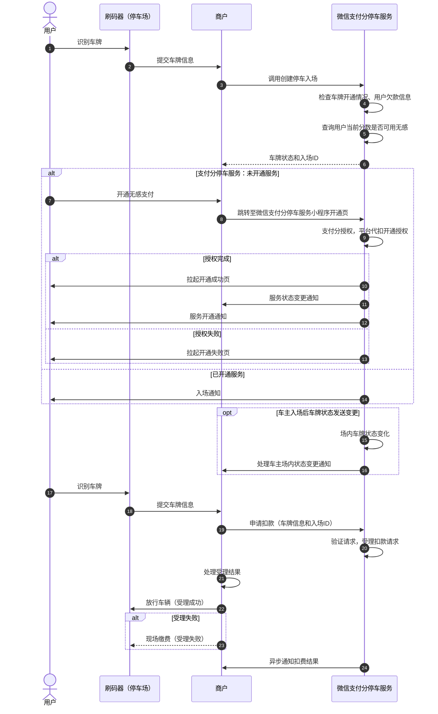

>更新时间：2026.10.19

## 1. 接口规则

为了在保证支付安全的前提下，带给商户简单、一致且易用的开发体验，我们推出了全新的微信支付APIv3接口。该版本API的具体规则请参考[APIv3接口规则](https://pay.weixin.qq.com/doc/v3/merchant/4012081606.md)。

## 2. 开发准备

### 2.1. 搭建和配置开发环境

开发者应当依据自身的编程语言来构建并配置相应的开发环境。

## 3. 快速接入

### 3.1. 业务流程图

重点步骤说明：

步骤1.3 用户入场时，调用[创建停车入场](https://pay.weixin.qq.com/doc/v3/merchant/4012533937.md)接口创建停车入场信息。商户根据返回的车牌状态判断用户是否开通支付分停车服务。

步骤1.6 如果用户未开通支付分服务，可调用[调起微信支付分停车服务开通页](https://pay.weixin.qq.com/doc/v3/merchant/4012284186.md)接口为微信支付分开通小程序，引导用户进行服务开通。

步骤1.15 场内车牌发送变化后，微信支付通过[停车入场状态变更通知](https://pay.weixin.qq.com/doc/v3/merchant/4012284177.md)接口将车主状态变化通知给商户。

步骤1.18 用户离场时，需调用[扣费受理](https://pay.weixin.qq.com/doc/v3/merchant/4012534352.md)接口完成订单受理，微信支付进行异步扣款，支付完成后，会将订单支付结果发送给商户。

## 4. 开发注意事项

### 4.1. 扣费受理API注意事项

必须确认扣费受理接口的交易状态返回“ACCEPTED”才能放行车辆，若未接收到该状态而放行车辆离场，造成的资金损失由商户侧自行承担。

### 4.2. 停车入场状态变更通知API注意事项

- 同样的通知可能会多次发送给商户系统。商户系统必须能够正确处理重复的通知。 推荐的做法是，当商户系统收到通知进行处理时，先检查对应业务数据的状态，并判断该通知是否已经处理。如果未处理，则再进行处理；如果已处理，则直接返回结果成功。在对业务数据进行状态检查和处理之前，要采用数据锁进行并发控制，以避免函数重入造成的数据混乱。

- 如果在所有通知频率后没有收到微信侧回调,商户应调用查询车牌服务开通信息确认车牌服务开通状态。

特别提醒： 商户系统对于支付成功通知的内容一定要做签名验证，并校验通知的信息是否与商户侧的信息一致，防止数据泄露导致出现“假通知”，造成资金损失。

### 4.3. 订单支付结果通知API注意事项

- 同样的通知可能会多次发送给商户系统。商户系统必须能够正确处理重复的通知。 推荐的做法是，当商户系统收到通知进行处理时，先检查对应业务数据的状态，并判断该通知是否已经处理。如果未处理，则再进行处理；如果已处理，则直接返回结果成功。在对业务数据进行状态检查和处理之前，要采用数据锁进行并发控制，以避免函数重入造成的数据混乱。

- 如果在所有通知频率后没有收到微信侧回调,商户应调用查询订单接口确认订单状态。

特别提醒： 商户系统对于支付成功通知的内容一定要做签名验证，并校验通知的信息是否与商户侧的信息一致，防止数据泄露导致出现“假通知”，造成资金损失。

### 4.4. 申请退款API

- 交易时间超过一年的订单无法提交退款

- 微信支付退款支持单笔交易分多次退款（不超50次），多次退款需要提交原支付订单的商户订单号和设置不同的退款单号。申请退款总金额不能超过订单金额。 一笔退款失败后重新提交，请不要更换退款单号，请使用原商户退款单号

- 错误或无效请求频率限制：6qps，即每秒钟异常或错误的退款申请请求不超过6次

- 每个支付订单的部分退款次数不能超过50次

- 如果同一个用户有多笔退款，建议分不同批次进行退款，避免并发退款导致退款失败

- 申请退款接口的返回仅代表业务的受理情况，具体退款是否成功，需要通过退款查询接口获取结果

- 一个月之前的订单申请退款频率限制为：5000/min

- 同一笔订单多次退款的请求需相隔1分钟

### 4.5. 退款结果通知API

对后台通知交互时，如果微信收到应答不是成功或超时，微信认为通知失败，微信会通过一定的策略定期重新发起通知，尽可能提高通知的成功率，但微信不保证通知最终能成功

- 同样的通知可能会多次发送给商户系统。商户系统必须能够正确处理重复的通知。 推荐的做法是，当商户系统收到通知进行处理时，先检查对应业务数据的状态，并判断该通知是否已经处理。如果未处理，则再进行处理；如果已处理，则直接返回结果成功。在对业务数据进行状态检查和处理之前，要采用数据锁进行并发控制，以避免函数重入造成的数据混乱。

- 如果在所有通知频率后没有收到微信侧回调。商户应调用查询订单接口确认订单状态。

特别提醒: 商户系统对于开启结果通知的内容一定要做签名验证，并校验通知的信息是否与商户侧的信息一致，防止数据泄露导致出现“假通知”，造成资金损失。