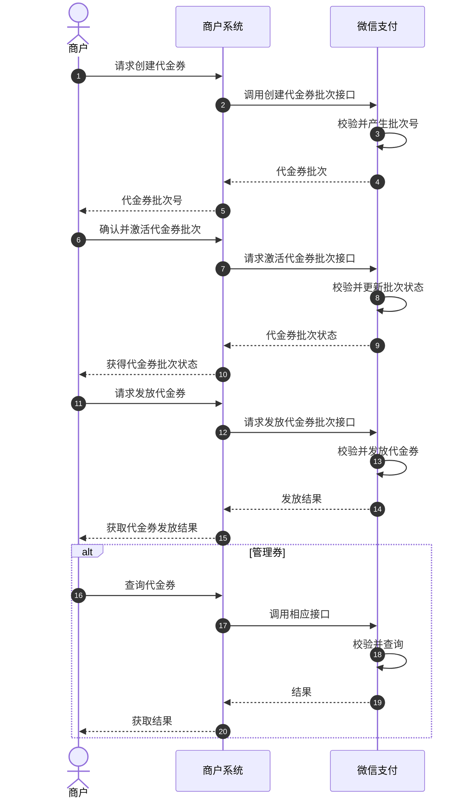

>更新时间：2026.10.26

## 1. 接口规则

为了在保证支付安全的前提下，带给商户简单、一致且易用的开发体验，我们推出了全新的微信支付APIv3接口。该版本API的具体规则请参考[APIv3接口规则](https://pay.weixin.qq.com/doc/v3/merchant/4012081606.md)。

## 2. 开发准备

### 2.1. 搭建和配置开发环境

开发者应当依据自身的编程语言来构建并配置相应的开发环境。

## 3. 快速接入

### 3.1. 业务流程图

#### 业务流程时序图



重点步骤说明：

步骤2 创建代金券：商户可通过[《创建代金券批次》](https://pay.weixin.qq.com/doc/v3/merchant/4012534633.md)接口创建代金券，微信支付生成代金券批次后并返回代金券批次号给到商户。

步骤7 激活代金券：商户获取到代金券批次号，需要确认并激活代金券，该批次代金券才能发放，需要调用[《激活代金券批次》](https://pay.weixin.qq.com/doc/v3/merchant/4012460137.md)接口来激活创建的代金券。

步骤12 发放代金券：已经激活的代金券，商户可调用微信支付[《发放指定批次的代金券》](https://pay.weixin.qq.com/doc/v3/merchant/4012463767.md)接口来进行代金券发放，并获取微信支付返回代金券发放结果。

步骤17 管理代金券：商户发券成功后，商户可通过[《查询批次详情》](https://pay.weixin.qq.com/doc/v3/merchant/4012460489.md)、[《查询代金券详情》](https://pay.weixin.qq.com/doc/v3/merchant/4012486942.md)等代金券管理接口进行券管理。

### 3.2. API接入（含示例代码）

文档展示了如何使用微信支付服务端 SDK 快速接入代金券产品，完成与微信支付对接的部分。

注意

- 文档中的代码示例是用来阐述 API 基本使用方法，代码中的示例参数需替换成商户自己账号及请求参数才能跑通。

- 以下接入步骤仅提供参考，请商户结合自身业务需求进行评估、修改。


#### 3.2.1. 【服务端】创建代金券批次

步骤说明： 通过创建代金券批次接口，可创建代金券的类型包含预充值和免充值两种类型。

- 预充值代金券适用于第三方出资策划的活动，例如：满100减10. 指订单金额100元，用户实付90元，商户实收100元。

- 免充值适用于商户策划的活动，例如：满100减10。 指订单金额100元，用户实付90元（用户领券后，在支付中直接核销10元），商户实收90元。


background\_color取值：


示例代码

JAVA

```
public void CreateCoupon() throws Exception{
    //请求URL
    HttpPost httpPost = new HttpPost("https://api.mch.weixin.qq.com/v3/marketing/favor/coupon-stocks");
    // 请求body参数
    String reqdata = "{"
            + "\"stock_name\":\"GD测批次4\","
            + "\"comment\":\"验证活动\","
            + "\"belong_merchant\":\"xx98568865xxxx\","
            + "\"available_begin_time\":\"2020-02-13T18:00:00.120+08:00\","
            + "\"available_end_time\":\"2020-02-20T23:59:59.120+08:00\","
            + "\"stock_use_rule\": {"
            + "\"max_coupons\":10,"
            + "\"max_amount\":100,"
            + "\"max_coupons_per_user\":10,"
            + "\"natural_person_limit\":false,"
            + "\"prevent_api_abuse\":false"
            + "},"
            + "\"coupon_use_rule\": {"
            + "\"fixed_normal_coupon\": {"
            + "\"coupon_amount\":10,"
            + "\"transaction_minimum\":10"
            + "},"
            + "\"available_merchants\": ["
            + "\"0\":\"209784532\","
            + "\"1\":\"221003827\""
            + "]"
            + "},"
            + "\"no_cash\":false,"
            + "\"stock_type\":\"NORMAL\","
            + "\"out_request_no\":\"207662xxxxxx\""
            + "}";
    StringEntity entity = new StringEntity(reqdata,"utf-8");
    entity.setContentType("application/json");
    httpPost.setEntity(entity);
    httpPost.setHeader("Accept", "application/json");
    //完成签名并执行请求
    CloseableHttpResponse response = httpClient.execute(httpPost);
    try {
        int statusCode = response.getStatusLine().getStatusCode();
        if (statusCode == 200) { //处理成功
            System.out.println("success,return body = " + EntityUtils.toString(response.getEntity()));
        } else if (statusCode == 204) { //处理成功，无返回Body
            System.out.println("success");
        } else {
            System.out.println("failed,resp code = " + statusCode+ ",return body = " + EntityUtils.toString(response.getEntity()));
            throw new IOException("request failed");
        }
    } finally {
        response.close();
    }
}
```

PHP

```
try {
    $resp = $client->request(
        'POST',
        'https://api.mch.weixin.qq.com/v3/marketing/favor/coupon-stocks', //请求URL
        [
            // JSON请求体
            'json' => [
                "stock_name" => "GD测批次4",
                "comment" => "验证活动",
                "belong_merchant" => "xxx98568865xxx",
                "available_begin_time" => "2020-02-13T18:00:00.120+08:00",
                "available_end_time" => "2020-02-20T23:59:59.120+08:00",
                "stock_use_rule" => [
                    "max_coupons" => 10,
                    "max_amount" => 100,
                    "max_coupons_per_user" => 10,
                    "natural_person_limit" => false,
                    "prevent_api_abuse" => false,
                ],
                "coupon_use_rule" => [
                    "fixed_normal_coupon" => [
                        "coupon_amount" => 10,
                        "transaction_minimum" => 10,
                    ],
                    "available_merchants" => [
                        "0" => "209784532",
                        "1" => "221003827",
                    ],
                ],
                "no_cash" => false,
                "stock_type" => "NORMAL",
                "out_request_no" => "207662xxxxxx",
            ],
            'headers' => [ 'Accept' => 'application/json' ]
        ]
    );
    $statusCode = $resp->getStatusCode();
    if ($statusCode == 200) { //处理成功
        echo "success,return body = " . $resp->getBody()->getContents()."\n";
    } else if ($statusCode == 204) { //处理成功，无返回Body
        echo "success";
    }
} catch (RequestException $e) {
    // 进行错误处理
    echo $e->getMessage()."\n";
    if ($e->hasResponse()) {
        echo "failed,resp code = " . $e->getResponse()->getStatusCode() . " return body = " . $e->getResponse()->getBody() . "\n";
    }
    return;
}
```

重要入参说明：

- out\_trade\_no： 商户创建批次凭据号（格式：商户ID+日期+流水号），可包含英文字母，数字，\|，\_，\*，-等内容，不允许出现其他不合法符号，商户侧需保持商户单据号全局唯一

- available\_begin\_time： 批次开始时间

  - 开始时间不可早于当前时间

  - 不能创建365天后开始的批次

  - 批次可用时间范围最长为90天
- stock\_name： 批次名称


校验规则：

- 批次名称最多9个中文汉字

- 批次名称最多20个字母

- 批次名称中不能包含不当内容和特殊字符 \_ , ; \|


更多参数、响应详情及错误码请参见[创建代金券批次](https://pay.weixin.qq.com/doc/v3/merchant/4012534633.md)接口文档

#### 3.2.2. 【服务端】激活代金券批次

步骤说明： 制券成功后，通过调用激活接口激活代金券批次。

- 说明： 如果是预充值代金券，激活时从商户账户余额中锁定本批次的营销资金。


示例代码

JAVA

```
public void ActiveCoupon() throws Exception{
    //请求URL
    HttpPost httpPost = new HttpPost("https://api.mch.weixin.qq.com/v3/marketing/favor/stocks/9856000/start");
    // 请求body参数
    String reqdata = "{"
            + "\"stock_creator_mchid\":\"8956000\""
            + "}";
    StringEntity entity = new StringEntity(reqdata,"utf-8");
    entity.setContentType("application/json");
    httpPost.setEntity(entity);
    httpPost.setHeader("Accept", "application/json");
    //完成签名并执行请求
    CloseableHttpResponse response = httpClient.execute(httpPost);
    try {
        int statusCode = response.getStatusLine().getStatusCode();
        if (statusCode == 200) { //处理成功
            System.out.println("success,return body = " + EntityUtils.toString(response.getEntity()));
        } else if (statusCode == 204) { //处理成功，无返回Body
            System.out.println("success");
        } else {
            System.out.println("failed,resp code = " + statusCode+ ",return body = " + EntityUtils.toString(response.getEntity()));
            throw new IOException("request failed");
        }
    } finally {
        response.close();
    }
}
```

PHP

```
try {
    $resp = $client->request(
        'POST',
        'https://api.mch.weixin.qq.com/v3/marketing/favor/stocks/9856000/start', //请求URL
        [
            // JSON请求体
            'json' => [
                "stock_creator_mchid" => "8956000",
            ],
            'headers' => [ 'Accept' => 'application/json' ]
        ]
    );
    $statusCode = $resp->getStatusCode();
    if ($statusCode == 200) { //处理成功
        echo "success,return body = " . $resp->getBody()->getContents()."\n";
    } else if ($statusCode == 204) { //处理成功，无返回Body
        echo "success";
    }
} catch (RequestException $e) {
    // 进行错误处理
    echo $e->getMessage()."\n";
    if ($e->hasResponse()) {
        echo "failed,resp code = " . $e->getResponse()->getStatusCode() . " return body = " . $e->getResponse()->getBody() . "\n";
    }
    return;
}
```

重要入参说明：

- stock\_creator\_mchid： 批次创建方商户号

- stock\_id： 微信为每个代金券批次分配的唯一ID。


更多参数、响应详情及错误码请参见[激活代金券批次](https://pay.weixin.qq.com/doc/v3/merchant/4012460137.md)接口文档

#### 3.2.3. 【服务端】发放代金券批次

步骤说明： 商户平台/API完成制券后，可使用发放代金券接口发券。通过调用此接口可发放指定批次给指定用户，发券场景可以是小程序、H5、App等。

示例代码

JAVA

```
public void SendCoupon() throws Exception{
    //请求URL
    HttpPost httpPost = new HttpPost("https://api.mch.weixin.qq.com/v3/marketing/favor/users/o4GgauInH_RCEdvrrNGrntXDu6D4/coupons");
    // 请求body参数
    String reqdata = "{"
            + "\"stock_id\":\"9856000\","
            + "\"out_request_no\":\"89560002019101000121\","
            + "\"appid\":\"wx233544546545989\","
            + "\"stock_creator_mchid\":\"8956000\""
            + "}";
    StringEntity entity = new StringEntity(reqdata,"utf-8");
    entity.setContentType("application/json");
    httpPost.setEntity(entity);
    httpPost.setHeader("Accept", "application/json");
    //完成签名并执行请求
    CloseableHttpResponse response = httpClient.execute(httpPost);
    try {
        int statusCode = response.getStatusLine().getStatusCode();
        if (statusCode == 200) { //处理成功
            System.out.println("success,return body = " + EntityUtils.toString(response.getEntity()));
        } else if (statusCode == 204) { //处理成功，无返回Body
            System.out.println("success");
        } else {
            System.out.println("failed,resp code = " + statusCode+ ",return body = " + EntityUtils.toString(response.getEntity()));
            throw new IOException("request failed");
        }
    } finally {
        response.close();
    }
}
```

PHP

```
try {
    $resp = $client->request(
        'POST',
        'https://api.mch.weixin.qq.com/v3/marketing/favor/users/o4GgauInH_RCEdvrrNGrntXDu6D4/coupons', //请求URL
        [
            // JSON请求体
            'json' => [
                "stock_id" => "9856000",
                "out_request_no" => "89560002019101000121",
                "appid" => "wx233544546545989",
                "stock_creator_mchid" => "8956000",
            ],
            'headers' => [ 'Accept' => 'application/json' ]
        ]
    );
    $statusCode = $resp->getStatusCode();
    if ($statusCode == 200) { //处理成功
        echo "success,return body = " . $resp->getBody()->getContents()."\n";
    } else if ($statusCode == 204) { //处理成功，无返回Body
        echo "success";
    }
} catch (RequestException $e) {
    // 进行错误处理
    echo $e->getMessage()."\n";
    if ($e->hasResponse()) {
        echo "failed,resp code = " . $e->getResponse()->getStatusCode() . " return body = " . $e->getResponse()->getBody() . "\n";
    }
    return;
}
```

重要入参说明：

- out\_trade\_no： 商户系统内部订单号，只能是数字、大小写字母\_-\*且在同一个商户号下唯一

- OpenID： OpenID是微信用户在AppID下的唯一用户标识（AppID不同，则获取到的OpenID就不同），可用于永久标记一个用户。OpenID获取方式请参考以下文档[小程序获取OpenID](https://developers.weixin.qq.com/miniprogram/dev/api/open-api/login/wx.login.html)、[公众号获取OpenID](https://developers.weixin.qq.com/doc/offiaccount/OA_Web_Apps/Wechat_webpage_authorization.html)、[App获取OpenID](https://developers.weixin.qq.com/doc/oplatform/Mobile_App/WeChat_Login/Authorized_API_call_UnionID.html)

- stock\_creator\_mchid： 批次创建方商户号

- stock\_id： 微信为每个代金券批次分配的唯一ID。


更多参数、响应详情及错误码请参见[发放指定批次的代金券](https://pay.weixin.qq.com/doc/v3/merchant/4012463767.md)接口文档。

#### 3.2.4. 【服务端】暂停代金券批次

步骤说明： 通过此接口可暂停指定代金券批次。暂停后，该代金券批次暂停发放，用户无法通过任何渠道再领取该批次的券。暂停接口的前提是批次处于激活状态。

示例代码

JAVA

```
public void PauseCoupon() throws Exception{
    //请求URL
    HttpPost httpPost = new HttpPost("https://api.mch.weixin.qq.com/v3/marketing/favor/stocks/9856000/pause");
    // 请求body参数
    String reqdata = "{"
            + "\"stock_creator_mchid\":\"8956000\""
            + "}";
    StringEntity entity = new StringEntity(reqdata,"utf-8");
    entity.setContentType("application/json");
    httpPost.setEntity(entity);
    httpPost.setHeader("Accept", "application/json");
    //完成签名并执行请求
    CloseableHttpResponse response = httpClient.execute(httpPost);
    try {
        int statusCode = response.getStatusLine().getStatusCode();
        if (statusCode == 200) { //处理成功
            System.out.println("success,return body = " + EntityUtils.toString(response.getEntity()));
        } else if (statusCode == 204) { //处理成功，无返回Body
            System.out.println("success");
        } else {
            System.out.println("failed,resp code = " + statusCode+ ",return body = " + EntityUtils.toString(response.getEntity()));
            throw new IOException("request failed");
        }
    } finally {
        response.close();
    }
}
```

PHP

```
try {
    $resp = $client->request(
        'POST',
        'https://api.mch.weixin.qq.com/v3/marketing/favor/stocks/9856000/pause', //请求URL
        [
            // JSON请求体
            'json' => [
                "stock_creator_mchid" => "8956000",
            ],
            'headers' => [ 'Accept' => 'application/json' ]
        ]
    );
    $statusCode = $resp->getStatusCode();
    if ($statusCode == 200) { //处理成功
        echo "success,return body = " . $resp->getBody()->getContents()."\n";
    } else if ($statusCode == 204) { //处理成功，无返回Body
        echo "success";
    }
} catch (RequestException $e) {
    // 进行错误处理
    echo $e->getMessage()."\n";
    if ($e->hasResponse()) {
        echo "failed,resp code = " . $e->getResponse()->getStatusCode() . " return body = " . $e->getResponse()->getBody() . "\n";
    }
    return;
}
```

重要入参说明：

- stock\_creator\_mchid： 批次创建方商户号

- stock\_id： 微信为每个代金券批次分配的唯一ID。


更多参数、响应详情及错误码请参见[暂停代金券批次](https://pay.weixin.qq.com/doc/v3/merchant/4012460305.md)接口文档

#### 3.2.5. 【服务端】重启代金券批次

步骤说明： 通过此接口可重启指定代金券批次。重启后，该代金券批次可以再次发放。重启接口的前提是批次处于暂停状态。

示例代码

JAVA

```
public void RestartCoupon() throws Exception{
    //请求URL
    HttpPost httpPost = new HttpPost("https://api.mch.weixin.qq.com/v3/marketing/favor/stocks/9856000/restart");
    // 请求body参数
    String reqdata = "{"
            + "\"stock_creator_mchid\":\"8956000\""
            + "}";
    StringEntity entity = new StringEntity(reqdata,"utf-8");
    entity.setContentType("application/json");
    httpPost.setEntity(entity);
    httpPost.setHeader("Accept", "application/json");
    //完成签名并执行请求
    CloseableHttpResponse response = httpClient.execute(httpPost);
    try {
        int statusCode = response.getStatusLine().getStatusCode();
        if (statusCode == 200) { //处理成功
            System.out.println("success,return body = " + EntityUtils.toString(response.getEntity()));
        } else if (statusCode == 204) { //处理成功，无返回Body
            System.out.println("success");
        } else {
            System.out.println("failed,resp code = " + statusCode+ ",return body = " + EntityUtils.toString(response.getEntity()));
            throw new IOException("request failed");
        }
    } finally {
        response.close();
    }
}
```

PHP

```
try {
    $resp = $client->request(
        'POST',
        'https://api.mch.weixin.qq.com/v3/marketing/favor/stocks/9856000/restart', //请求URL
        [
            // JSON请求体
            'json' => [
                "stock_creator_mchid" => "8956000",
            ],
            'headers' => [ 'Accept' => 'application/json' ]
        ]
    );
    $statusCode = $resp->getStatusCode();
    if ($statusCode == 200) { //处理成功
        echo "success,return body = " . $resp->getBody()->getContents()."\n";
    } else if ($statusCode == 204) { //处理成功，无返回Body
        echo "success";
    }
} catch (RequestException $e) {
    // 进行错误处理
    echo $e->getMessage()."\n";
    if ($e->hasResponse()) {
        echo "failed,resp code = " . $e->getResponse()->getStatusCode() . " return body = " . $e->getResponse()->getBody() . "\n";
    }
    return;
}
```

重要入参说明：

- stock\_creator\_mchid： 批次创建方商户号

- stock\_id： 微信为每个代金券批次分配的唯一ID。


更多参数、响应详情及错误码请参见[重启代金券批次](https://pay.weixin.qq.com/doc/v3/merchant/4012460411.md)接口文档

#### 3.2.6. 【服务端】条件查询批次列表

步骤说明： 通过此接口可查询多个批次的信息，包括批次的配置信息以及批次概况数据。

示例代码

JAVA

```
public void GetStocksList() throws Exception{
    //请求URL
    HttpGet httpGet = new HttpGet("https://api.mch.weixin.qq.com/v3/marketing/favor/stocks?offset=1&limit=10&stock_creator_mchid=9856888&create_start_time%3D2015-05-20T13%3A29%3A35.120%2B08%3A00%26create_end_time%3D2015-05-20T13%3A29%3A35.120%2B08%3A00&status=paused");
    httpGet.setHeader("Accept", "application/json");
    //完成签名并执行请求
    CloseableHttpResponse response = httpClient.execute(httpGet);
    try {
        int statusCode = response.getStatusLine().getStatusCode();
        if (statusCode == 200) { //处理成功
            System.out.println("success,return body = " + EntityUtils.toString(response.getEntity()));
        } else if (statusCode == 204) { //处理成功，无返回Body
            System.out.println("success");
        } else {
            System.out.println("failed,resp code = " + statusCode+ ",return body = " + EntityUtils.toString(response.getEntity()));
            throw new IOException("request failed");
        }
    } finally {
        response.close();
    }
}
```

PHP

```
try {
    $resp = $client->request(
        'GET',
        'https://api.mch.weixin.qq.com/v3/marketing/favor/stocks?offset=1&limit=10&stock_creator_mchid=9856888&create_start_time%3D2015-05-20T13%3A29%3A35.120%2B08%3A00%26create_end_time%3D2015-05-20T13%3A29%3A35.120%2B08%3A00&status=paused', //请求URL
        [
            'headers' => [ 'Accept' => 'application/json']
        ]
    );
    $statusCode = $resp->getStatusCode();
    if ($statusCode == 200) { //处理成功
        echo "success,return body = " . $resp->getBody()->getContents()."\n";
    } else if ($statusCode == 204) { //处理成功，无返回Body
        echo "success";
    }
} catch (RequestException $e) {
    // 进行错误处理
    echo $e->getMessage()."\n";
    if ($e->hasResponse()) {
        echo "failed,resp code = " . $e->getResponse()->getStatusCode() . " return body = " . $e->getResponse()->getBody() . "\n";
    }
    return;
}
```

重要入参说明：

- stock\_creator\_mchid： 批次创建方商户号

- status： 批次状态


更多参数、响应详情及错误码请参见[条件查询批次列表](https://pay.weixin.qq.com/doc/v3/merchant/4012460489.md)接口文档

#### 3.2.7. 【服务端】查询批次详情

步骤说明： 通过此接口可查询批次信息，包括批次的配置信息以及批次概况数据。

示例代码

JAVA

```
public void GetStocksInfo() throws Exception{
    //请求URL
    HttpGet httpGet = new HttpGet("https://api.mch.weixin.qq.com/v3/marketing/favor/stocks/9856888?stock_creator_mchid=123456");
    httpGet.setHeader("Accept", "application/json");
    //完成签名并执行请求
    CloseableHttpResponse response = httpClient.execute(httpGet);
    try {
        int statusCode = response.getStatusLine().getStatusCode();
        if (statusCode == 200) { //处理成功
            System.out.println("success,return body = " + EntityUtils.toString(response.getEntity()));
        } else if (statusCode == 204) { //处理成功，无返回Body
            System.out.println("success");
        } else {
            System.out.println("failed,resp code = " + statusCode+ ",return body = " + EntityUtils.toString(response.getEntity()));
            throw new IOException("request failed");
        }
    } finally {
        response.close();
    }
}
```

PHP

```
try {
    $resp = $client->request(
        'GET',
        'https://api.mch.weixin.qq.com/v3/marketing/favor/stocks/9856888?stock_creator_mchid=123456', //请求URL
        [
            'headers' => [ 'Accept' => 'application/json']
        ]
    );
    $statusCode = $resp->getStatusCode();
    if ($statusCode == 200) { //处理成功
        echo "success,return body = " . $resp->getBody()->getContents()."\n";
    } else if ($statusCode == 204) { //处理成功，无返回Body
        echo "success";
    }
} catch (RequestException $e) {
    // 进行错误处理
    echo $e->getMessage()."\n";
    if ($e->hasResponse()) {
        echo "failed,resp code = " . $e->getResponse()->getStatusCode() . " return body = " . $e->getResponse()->getBody() . "\n";
    }
    return;
}
```

重要入参说明：

- stock\_creator\_mchid： 批次创建方商户号

- stock\_id： 微信为每个代金券批次分配的唯一ID。


更多参数、响应详情及错误码请参见[查询批次详情](https://pay.weixin.qq.com/doc/v3/merchant/4012460489.md)接口文档

#### 3.2.8. 【服务端】查询代金券详情

步骤说明： 通过此接口可查询代金券信息，包括代金券的基础信息、状态。如代金券已核销，会包括代金券核销的订单信息（订单号、单品信息等）。

示例代码

JAVA

```
try {
    $resp = $client->request(
        'GET',
        'https://api.mch.weixin.qq.com/v3/marketing/favor/users/o4GgauInH_RCEdvrrNGrntXDu6D4/coupons/985688?appid=wx233544546545989', //请求URL
        [
            'headers' => [ 'Accept' => 'application/json']
        ]
    );
    $statusCode = $resp->getStatusCode();
    if ($statusCode == 200) { //处理成功
        echo "success,return body = " . $resp->getBody()->getContents()."\n";
    } else if ($statusCode == 204) { //处理成功，无返回Body
        echo "success";
    }
} catch (RequestException $e) {
    // 进行错误处理
    echo $e->getMessage()."\n";
    if ($e->hasResponse()) {
        echo "failed,resp code = " . $e->getResponse()->getStatusCode() . " return body = " . $e->getResponse()->getBody() . "\n";
    }
    return;
}
```

PHP

```
try {
    $resp = $client->request(
        'GET',
        'https://api.mch.weixin.qq.com/v3/marketing/favor/users/o4GgauInH_RCEdvrrNGrntXDu6D4/coupons/985688?appid=wx233544546545989', //请求URL
        [
            'headers' => [ 'Accept' => 'application/json']
        ]
    );
    $statusCode = $resp->getStatusCode();
    if ($statusCode == 200) { //处理成功
        echo "success,return body = " . $resp->getBody()->getContents()."\n";
    } else if ($statusCode == 204) { //处理成功，无返回Body
        echo "success";
    }
} catch (RequestException $e) {
    // 进行错误处理
    echo $e->getMessage()."\n";
    if ($e->hasResponse()) {
        echo "failed,resp code = " . $e->getResponse()->getStatusCode() . " return body = " . $e->getResponse()->getBody() . "\n";
    }
    return;
}
```

重要入参说明：

- OpenID： OpenID是微信用户在AppID下的唯一用户标识（AppID不同，则获取到的OpenID就不同），可用于永久标记一个用户。OpenID获取方式请参考以下文档[小程序获取OpenID](https://developers.weixin.qq.com/miniprogram/dev/api/open-api/login/wx.login.html)、[公众号获取OpenID](https://developers.weixin.qq.com/doc/offiaccount/OA_Web_Apps/Wechat_webpage_authorization.html)、[App获取OpenID](https://developers.weixin.qq.com/doc/oplatform/Mobile_App/WeChat_Login/Authorized_API_call_UnionID.html)

- coupon\_id： 微信为代金券唯一分配的ID。


更多参数、响应详情及错误码请参见[查询代金券详情](https://pay.weixin.qq.com/doc/v3/merchant/4012486942.md)接口文档

#### 3.2.9. 【服务端】查询代金券可用商户

步骤说明： 通过调用此接口可查询批次的可用商户号，判断券是否在某商户号可用，来决定是否展示。

示例代码

JAVA

```
public void GetConponMch() throws Exception{
    //请求URL
    HttpGet httpGet = new HttpGet("https://api.mch.weixin.qq.com/v3/marketing/favor/stocks/9865000/merchants?offset=10&limit=10&stock_creator_mchid=1900001111");
    httpGet.setHeader("Accept", "application/json");
    //完成签名并执行请求
    CloseableHttpResponse response = httpClient.execute(httpGet);
    try {
        int statusCode = response.getStatusLine().getStatusCode();
        if (statusCode == 200) { //处理成功
            System.out.println("success,return body = " + EntityUtils.toString(response.getEntity()));
        } else if (statusCode == 204) { //处理成功，无返回Body
            System.out.println("success");
        } else {
            System.out.println("failed,resp code = " + statusCode+ ",return body = " + EntityUtils.toString(response.getEntity()));
            throw new IOException("request failed");
        }
    } finally {
        response.close();
    }
}
```

PHP

```
try {
    $resp = $client->request(
        'GET',
        'https://api.mch.weixin.qq.com/v3/marketing/favor/stocks/9865000/merchants?offset=10&limit=10&stock_creator_mchid=1900001111', //请求URL
        [
            'headers' => [ 'Accept' => 'application/json']
        ]
    );
    $statusCode = $resp->getStatusCode();
    if ($statusCode == 200) { //处理成功
        echo "success,return body = " . $resp->getBody()->getContents()."\n";
    } else if ($statusCode == 204) { //处理成功，无返回Body
        echo "success";
    }
} catch (RequestException $e) {
    // 进行错误处理
    echo $e->getMessage()."\n";
    if ($e->hasResponse()) {
        echo "failed,resp code = " . $e->getResponse()->getStatusCode() . " return body = " . $e->getResponse()->getBody() . "\n";
    }
    return;
}
```

重要入参说明：

- stock\_creator\_mchid： 批次创建方商户号

- stock\_id： 微信为每个代金券批次分配的唯一ID。


更多参数、响应详情及错误码请参见[查询代金券可用商户](https://pay.weixin.qq.com/doc/v3/merchant/4012463358.md)接口文档

#### 3.2.10. 【服务端】查询代金券可用单品

步骤说明： 通过此接口可查询批次的可用商品编码，判断券是否可用于某些商品，来决定是否展示。

示例代码

JAVA

```
public void GetConponItem() throws Exception{
    //请求URL
    HttpGet httpGet = new HttpGet("https://api.mch.weixin.qq.com/v3/marketing/favor/stocks/9865000/items?offset=10&limit=10&stock_creator_mchid=9865000");
    httpGet.setHeader("Accept", "application/json");
    //完成签名并执行请求
    CloseableHttpResponse response = httpClient.execute(httpGet);
    try {
        int statusCode = response.getStatusLine().getStatusCode();
        if (statusCode == 200) { //处理成功
            System.out.println("success,return body = " + EntityUtils.toString(response.getEntity()));
        } else if (statusCode == 204) { //处理成功，无返回Body
            System.out.println("success");
        } else {
            System.out.println("failed,resp code = " + statusCode+ ",return body = " + EntityUtils.toString(response.getEntity()));
            throw new IOException("request failed");
        }
    } finally {
        response.close();
    }
}
```

PHP

```
try {
    $resp = $client->request(
        'GET',
        'https://api.mch.weixin.qq.com/v3/marketing/favor/stocks/9865000/items?offset=10&limit=10&stock_creator_mchid=9865000', //请求URL
        [
            'headers' => [ 'Accept' => 'application/json']
        ]
    );
    $statusCode = $resp->getStatusCode();
    if ($statusCode == 200) { //处理成功
        echo "success,return body = " . $resp->getBody()->getContents()."\n";
    } else if ($statusCode == 204) { //处理成功，无返回Body
        echo "success";
    }
} catch (RequestException $e) {
    // 进行错误处理
    echo $e->getMessage()."\n";
    if ($e->hasResponse()) {
        echo "failed,resp code = " . $e->getResponse()->getStatusCode() . " return body = " . $e->getResponse()->getBody() . "\n";
    }
    return;
}
```

重要入参说明：

- stock\_creator\_mchid： 批次创建方商户号

- stock\_id： 微信为每个代金券批次分配的唯一ID


更多参数、响应详情及错误码请参见[查询代金券可用单品](https://pay.weixin.qq.com/doc/v3/merchant/4012463442.md)接口文档

#### 3.2.11. 【服务端】根据商户号查用户的券

步骤说明： 可通过该接口查询用户在某商户号可用的全部券，可用于商户的小程序/H5中，用户"我的代金券"或"提交订单页"展示优惠信息。无法查询到微信支付立减金。本接口查不到用户的微信支付立减金（又称“全平台通用券”），即在所有商户都可以使用的券，例如：摇摇乐红包；当按可用商户号查询时，无法查询用户已经核销的券。

示例代码

JAVA

```
public void GetUserConpon() throws Exception{
    //请求URL
    HttpGet httpGet = new HttpGet("https://api.mch.weixin.qq.com/v3/marketing/favor/users/o4GgauInH_RCEdvrrNGrntXDu6D4/coupons?appid=wx233544546545989");
    httpGet.setHeader("Accept", "application/json");
    //完成签名并执行请求
    CloseableHttpResponse response = httpClient.execute(httpGet);
    try {
        int statusCode = response.getStatusLine().getStatusCode();
        if (statusCode == 200) { //处理成功
            System.out.println("success,return body = " + EntityUtils.toString(response.getEntity()));
        } else if (statusCode == 204) { //处理成功，无返回Body
            System.out.println("success");
        } else {
            System.out.println("failed,resp code = " + statusCode+ ",return body = " + EntityUtils.toString(response.getEntity()));
            throw new IOException("request failed");
        }
    } finally {
        response.close();
    }
}
```

PHP

```
try {
    $resp = $client->request(
        'GET',
        'https://api.mch.weixin.qq.com/v3/marketing/favor/users/o4GgauInH_RCEdvrrNGrntXDu6D4/coupons?appid=wx233544546545989', //请求URL
        [
            'headers' => [ 'Accept' => 'application/json']
        ]
    );
    $statusCode = $resp->getStatusCode();
    if ($statusCode == 200) { //处理成功
        echo "success,return body = " . $resp->getBody()->getContents()."\n";
    } else if ($statusCode == 204) { //处理成功，无返回Body
        echo "success";
    }
} catch (RequestException $e) {
    // 进行错误处理
    echo $e->getMessage()."\n";
    if ($e->hasResponse()) {
        echo "failed,resp code = " . $e->getResponse()->getStatusCode() . " return body = " . $e->getResponse()->getBody() . "\n";
    }
    return;
}
```

重要入参说明：

- stock\_creator\_mchid： 批次创建方商户号

- stock\_id： 微信为每个代金券批次分配的唯一ID。

- OpenID： OpenID是微信用户在AppID下的唯一用户标识（AppID不同，则获取到的OpenID就不同），可用于永久标记一个用户。OpenID获取方式请参考以下文档[小程序获取OpenID](https://developers.weixin.qq.com/miniprogram/dev/api/open-api/login/wx.login.html)、[公众号获取OpenID](https://developers.weixin.qq.com/doc/offiaccount/OA_Web_Apps/Wechat_webpage_authorization.html)、[App获取OpenID](https://developers.weixin.qq.com/doc/oplatform/Mobile_App/WeChat_Login/Authorized_API_call_UnionID.html)

- coupon\_id： 微信为代金券唯一分配的ID。


更多参数、响应详情及错误码请参见[根据商户号查用户的券](https://pay.weixin.qq.com/doc/v3/merchant/4012534690.md)接口文档

#### 3.2.12. 【服务端】下载批次核销明细

步骤说明： 可获取到某批次的核销明细数据，包括订单号、单品信息、银行流水号等，用于对账/数据分析。

示例代码

JAVA

```
public void UseBill() throws Exception{
  //请求URL
  HttpGet httpGet = new HttpGet("https://api.mch.weixin.qq.com/v3/marketing/favor/stocks/9865000/use-flow");
  httpGet.setHeader("Accept", "application/json");
  //完成签名并执行请求
  CloseableHttpResponse response = httpClient.execute(httpGet);
  try {
      int statusCode = response.getStatusLine().getStatusCode();
      if (statusCode == 200) { //处理成功
          System.out.println("success,return body = " + EntityUtils.toString(response.getEntity()));
      } else if (statusCode == 204) { //处理成功，无返回Body
          System.out.println("success");
      } else {
          System.out.println("failed,resp code = " + statusCode+ ",return body = " + EntityUtils.toString(response.getEntity()));
          throw new IOException("request failed");
      }
  } finally {
      response.close();
  }
}
```

PHP

```
try {
    $resp = $client->request(
        'GET',
        'https://api.mch.weixin.qq.com/v3/marketing/favor/stocks/9865000/use-flow', //请求URL
        [
            'headers' => [ 'Accept' => 'application/json']
        ]
    );
    $statusCode = $resp->getStatusCode();
    if ($statusCode == 200) { //处理成功
        echo "success,return body = " . $resp->getBody()->getContents()."\n";
    } else if ($statusCode == 204) { //处理成功，无返回Body
        echo "success";
    }
} catch (RequestException $e) {
    // 进行错误处理
    echo $e->getMessage()."\n";
    if ($e->hasResponse()) {
        echo "failed,resp code = " . $e->getResponse()->getStatusCode() . " return body = " . $e->getResponse()->getBody() . "\n";
    }
    return;
}
```

重要入参说明：

- stock\_id： 微信为每个代金券批次分配的唯一ID


更多参数、响应详情及错误码请参见[下载批次核销明细](https://pay.weixin.qq.com/doc/v3/merchant/4012463585.md)接口文档

#### 3.2.13. 【服务端】下载批次退款明细

步骤说明： 可获取到某批次的退款明细数据，包括订单号、单品信息、银行流水号等，用于对账/数据分析。

示例代码

JAVA

```
public void RefundBill() throws Exception{
  //请求URL
  HttpGet httpGet = new HttpGet("https://api.mch.weixin.qq.com/v3/marketing/favor/stocks/9865000/refund-flow");
  httpGet.setHeader("Accept", "application/json");
  //完成签名并执行请求
  CloseableHttpResponse response = httpClient.execute(httpGet);
  try {
      int statusCode = response.getStatusLine().getStatusCode();
      if (statusCode == 200) { //处理成功
          System.out.println("success,return body = " + EntityUtils.toString(response.getEntity()));
      } else if (statusCode == 204) { //处理成功，无返回Body
          System.out.println("success");
      } else {
          System.out.println("failed,resp code = " + statusCode+ ",return body = " + EntityUtils.toString(response.getEntity()));
          throw new IOException("request failed");
      }
  } finally {
      response.close();
  }
}
```

PHP

```
try {
    $resp = $client->request(
        'GET',
        'https://api.mch.weixin.qq.com/v3/marketing/favor/stocks/9865000/refund-flow', //请求URL
        [
            'headers' => [ 'Accept' => 'application/json']
        ]
    );
    $statusCode = $resp->getStatusCode();
    if ($statusCode == 200) { //处理成功
        echo "success,return body = " . $resp->getBody()->getContents()."\n";
    } else if ($statusCode == 204) { //处理成功，无返回Body
        echo "success";
    }
} catch (RequestException $e) {
    // 进行错误处理
    echo $e->getMessage()."\n";
    if ($e->hasResponse()) {
        echo "failed,resp code = " . $e->getResponse()->getStatusCode() . " return body = " . $e->getResponse()->getBody() . "\n";
    }
    return;
}
```

重要入参说明：

- stock\_id： 微信为每个代金券批次分配的唯一ID。


更多参数、响应详情及错误码请参见[下载批次退款明细](https://pay.weixin.qq.com/doc/v3/merchant/4012463523.md)接口文档

#### 3.2.14. 【服务端】设置消息通知地址

步骤说明： 用于设置接收营销事件通知的URL，可接收营销相关的事件通知，包括核销、发放、退款等。

示例代码

JAVA

```
public void SetCouponCallback() throws Exception{
    //请求URL
    HttpPost httpPost = new HttpPost("https://api.mch.weixin.qq.com/v3/marketing/favor/callbacks");
    // 请求body参数
    String reqdata = "{"
            + "\"mchid\":\"9856888\","
            + "\"notify_url\":\"https://pay.weixin.qq.com\""
            + "}";
    StringEntity entity = new StringEntity(reqdata,"utf-8");
    entity.setContentType("application/json");
    httpPost.setEntity(entity);
    httpPost.setHeader("Accept", "application/json");
    //完成签名并执行请求
    CloseableHttpResponse response = httpClient.execute(httpPost);
    try {
        int statusCode = response.getStatusLine().getStatusCode();
        if (statusCode == 200) { //处理成功
            System.out.println("success,return body = " + EntityUtils.toString(response.getEntity()));
        } else if (statusCode == 204) { //处理成功，无返回Body
            System.out.println("success");
        } else {
            System.out.println("failed,resp code = " + statusCode+ ",return body = " + EntityUtils.toString(response.getEntity()));
            throw new IOException("request failed");
        }
    } finally {
        response.close();
    }
}
```

PHP

```
try {
    $resp = $client->request(
        'POST',
        'https://api.mch.weixin.qq.com/v3/marketing/favor/callbacks', //请求URL
        [
            // JSON请求体
            'json' => [
                "mchid" => "9856888",
                "notify_url" => "https://pay.weixin.qq.com",
            ],
            'headers' => [ 'Accept' => 'application/json' ]
        ]
    );
    $statusCode = $resp->getStatusCode();
    if ($statusCode == 200) { //处理成功
        echo "success,return body = " . $resp->getBody()->getContents()."\n";
    } else if ($statusCode == 204) { //处理成功，无返回Body
        echo "success";
    }
} catch (RequestException $e) {
    // 进行错误处理
    echo $e->getMessage()."\n";
    if ($e->hasResponse()) {
        echo "failed,resp code = " . $e->getResponse()->getStatusCode() . " return body = " . $e->getResponse()->getBody() . "\n";
    }
    return;
}
```

重要入参说明：

- notify\_url： 必须为HTTPS协议。如果链接无法访问，商户将无法接收到微信通知。该回调地址只能通过API接口设置，无法通过商户平台手动设置。 通知URL必须为直接可访问的URL，不能携带参数。示例: https://pay.wechatpay.cn


更多参数、响应详情及错误码请参见[设置代金券消息通知地址](https://pay.weixin.qq.com/doc/v3/merchant/4012464198.md)接口文档

#### 3.2.15. 【服务端】核销事件回调通知

步骤说明： 用户使用券后，微信会把相关核销券信息发送给商户，商户需要接收处理，并按照文档规范返回应答。出于安全的考虑，我们对核销券信息数据进行了加密，商户需要先对通知数据进行解密，才能得到核销券信息数据。

注意

- 核销券信息通知是以POST 方法访问商户设置的通知URL，通知的数据以JSON 格式通过请求主体（BODY）传输。通知的数据包括了加密的支付结果详情

- 加密不能保证通知请求来自微信。微信会对发送给商户的通知进行签名，并将签名值放在通知的HTTP头Wechatpay-Signature。商户应当验证签名，以确认请求来自微信，而不是其他的第三方。签名验证的算法请参考 [《微信支付API v3签名验证》](https://pay.weixin.qq.com/doc/v3/merchant/4012365342.md#%E9%AA%8C%E8%AF%81%E7%AD%BE%E5%90%8D)。

- 支付通知HTTP应答码为200或204才会当作正常接收，当回调处理异常时，应答的HTTP状态码应为500，或者4xx

- 商户成功接收到回调通知后应返回成功的HTTP应答码为200或204

- 同样的通知可能会多次发送给商户系统。商户系统必须能够正确处理重复的通知。 推荐的做法是，当商户系统收到通知进行处理时，先检查对应业务数据的状态，并判断该通知是否已经处理。如果未处理，则再进行处理；如果已处理，则直接返回结果成功。在对业务数据进行状态检查和处理之前，要采用数据锁进行并发控制，以避免函数重入造成的数据混乱

- 对后台通知交互时，如果微信收到应答不是成功或超时，微信认为通知失败，微信会通过一定的策略定期重新发起通知，尽可能提高通知的成功率，但微信不保证通知最终能成功。（通知频率为1min1次，总计9次）


更多参数、响应详情及错误码请参见[核销事件回调通知](https://pay.weixin.qq.com/doc/v3/merchant/4012285250.md)支付通知API接口文档

## 4. 常见问题

### Q：创建代金券接口报错：“你配置的信息需要开通特殊权限”

A：请按以下步骤进行排查

1. stock\_name：最多可填写9个字

2. max\_coupons\_per\_user：单天发放个数上限不能为0

3. coupon\_amount：10<=coupon\_amount<=100000

4. available\_time\_after\_receive：可用时间：相对时间，按分钟设置，是否1min<=分钟范围<=1440min

5. transaction\_minimum校验规则：


   - 使用门槛-券面额>=0.01（门槛要大于面额）

   - 0.1元<=门槛<=100000
6. stock\_type：目前只支持NORMAL

7. out\_request\_no：校验规则：不可以重复

8. 开始时间结束时间控制在90天内

9. 不可使用的时间参数不可以传递


### Q：创建代金券报错“批次预算等于批次面额乘以发券数”

A：请按以下步骤进行排查

1. max\_amount需要等于coupon\_amount（面额） \* max\_coupons（发放总上限）

2. 核对最终请求数据，并查看是否存在遗漏数据，建议使用postman进行调试


### Q：创建代金券报错“活动未开始或已结束”

A：活动时间不能大于90天，请检查available\_begin\_time、available\_end\_time参数设置是否符合要求。

### Q：激活代金券API，如果大于1min或者更久还报错“系统繁忙”？

A：请检查单个可用商户号下正在运营的活动是否控制在500个以内，若超过500个活动可能导致新活动激活失败的情况。

### Q：设置消息通知地址报错“系统繁忙”

A：请按以下步骤进行排查

1. 请检查notify\_url设置是否正确，notify\_url必须为HTTPS

2. notify\_url地址为一个可访问的地址

3. notify\_url不能携带参数。示例：https://pay.wechatpay.cn/wxpay/pay.action