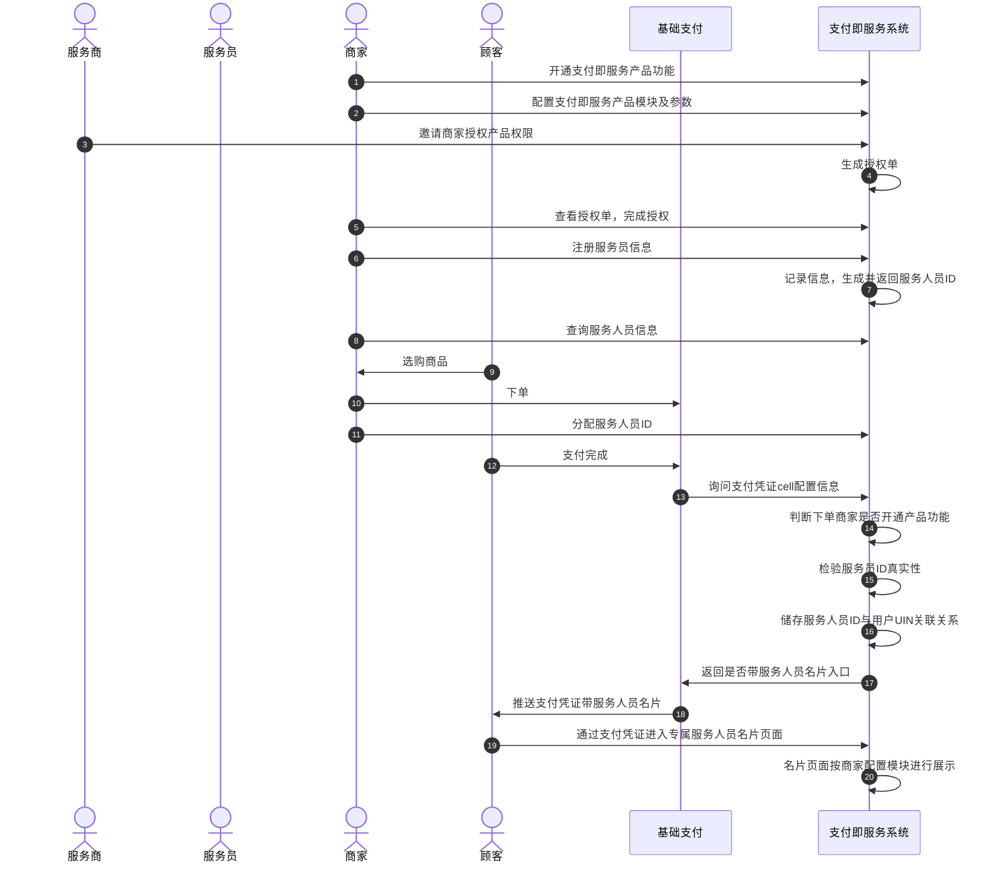

>更新时间：2026.06.09

## 1. 接口规则

为了在保证支付安全的前提下，带给商户简单、一致且易用的开发体验，我们推出了全新的微信支付APIv3接口。该版本API的具体规则请参考[APIv3接口规则](https://pay.weixin.qq.com/doc/v3/merchant/4012081606.md)。

## 2. 开发准备

### 2.1. 搭建和配置开发环境

开发者应当依据自身的编程语言来构建并配置相应的开发环境。

### 2.2. 业务开发配置

1. 登录【[微信支付服务商平台](https://pay.weixin.qq.com/partner/public/home)】后，通过路径【产品中心—>我的产品—>支付即服务—>产品设置】，即可开通支付即服务，开通后完成产品设置。


2. 【产品设置】页面如下图所示，具体内容包括上传商家logo、选择服务人员名称及选择名片功能模块。


## 3. 快速接入

### 3.1. 业务流程图



重点步骤说明：

步骤6： 使用企业微信的商户，通过《[服务人员注册API](https://pay.weixin.qq.com/doc/v3/merchant/4012535138.md)》接口传入服务人员信息进行注册，微信支付返回服务人员ID给到商户，商户需将服务人员注册信息和对应的服务人员ID进行妥善保存。

步骤11： 商户在下单时生成商户订单号，接着调用《[服务人员分配API](https://pay.weixin.qq.com/doc/v3/merchant/4012535161.md)》传入“商户订单号+服务人员ID”，随后按照原有流程和支付接口完成支付即可。

### 3.2. API接入（含示例代码）

文档展示了如何使用微信支付服务端 SDK 快速接入支付即服务产品，完成与微信支付对接的部分。

注意

- 文档中的代码示例是用来阐述 API 基本使用方法，代码中的示例参数需替换成商户自己账号及请求参数才能跑通。

- 以下接入步骤仅提供参考，请商户结合自身业务需求进行评估、修改。


### 3.2.1. 【服务端】服务人员注册

步骤说明： 商户开发者使用「服务人员注册接口」为商户注册服务人员。

注意

调用接口前商家需完成支付即服务产品的[开通和设置](https://pay.wechatpay.cn/index.php/public/product/detail?pid=109)。若普通服务商为特约商户调用接口，需在特约商户开通并完成产品设置后，与特约商户建立产品授权关系。

示例代码

JAVA

```
public void RegSmartGuide() throws Exception{
    //请求URL
    HttpPost httpPost = new HttpPost("https://api.mch.weixin.qq.com/v3/smartguide/guides");
    // 请求body参数
    String reqdata = "{"
            + "\"store_id\":1234,"
            + "\"corpid\":\"1234567890\","
            + "\"name\":\"pVd1HJ6v/69bDnuC4EL5Kz4jBHLiCa8MRtelw/wDa4SzfeespQO/0kjiwfqdfg==\","
            + "\"mobile\":\"pVd1HJ6v/69bDnuC4EL5Kz4jBHLiCa8MRtelw/wDa4SzfeespQO/0kjiwfqdfg==\","
            + "\"qr_code\":\"https://open.work.weixin.qq.com/wwopen/userQRCode?vcode=xxx\","
            + "\"avatar\":\"https://wx.qlogo.cn/mmopen/ajNVdqHZLLA3WJ6DSZUfiakYe37PKnQhBIeOQBO4czqrnZDS79FH5Wm5m4X69TBicnHFlhiafvDwklOpZeXYQQ2icg/0\","
            + "\"group_qrcode\":\"https://p.qpic.cn/wwhead/nMl9ssowtibVGyrmvBiaibzDtp/0\","
            + "\"userid\":\"robert\""
            + "}";
    StringEntity entity = new StringEntity(reqdata,"utf-8");
    entity.setContentType("application/json");
    httpPost.setEntity(entity);
    httpPost.setHeader("Accept", "application/json");

    //完成签名并执行请求
    CloseableHttpResponse response = httpClient.execute(httpPost);

    try {
        int statusCode = response.getStatusLine().getStatusCode();
        if (statusCode == 200) { //处理成功
            System.out.println("success,return body = " + EntityUtils.toString(response.getEntity()));
        } else if (statusCode == 204) { //处理成功，无返回Body
            System.out.println("success");
        } else {
            System.out.println("failed,resp code = " + statusCode+ ",return body = " + EntityUtils.toString(response.getEntity()));
            throw new IOException("request failed");
        }
    } finally {
        response.close();
    }
}
```

PHP

```
try {
    $resp = $client->request(
        'POST',
        'https://api.mch.weixin.qq.com/v3/smartguide/guides', //请求URL
        [
            // JSON请求体
            'json' => [
                "store_id" => 1234,
                "corpid" => "1234567890",
                "name" => "pVd1HJ6v/69bDnuC4EL5Kz4jBHLiCa8MRtelw/wDa4SzfeespQO/0kjiwfqdfg==",
                "mobile" => "pVd1HJ6v/69bDnuC4EL5Kz4jBHLiCa8MRtelw/wDa4SzfeespQO/0kjiwfqdfg==",
                "qr_code" => "https://open.work.weixin.qq.com/wwopen/userQRCode?vcode=xxx",
                "avatar" => "https://wx.qlogo.cn/mmopen/ajNVdqHZLLA3WJ6DSZUfiakYe37PKnQhBIeOQBO4czqrnZDS79FH5Wm5m4X69TBicnHFlhiafvDwklOpZeXYQQ2icg/0",
                "group_qrcode" => "https://p.qpic.cn/wwhead/nMl9ssowtibVGyrmvBiaibzDtp/0",
                "userid" => "robert",
            ],
            'headers' => [ 'Accept' => 'application/json' ]
        ]
    );
    $statusCode = $resp->getStatusCode();
    if ($statusCode == 200) { //处理成功
        echo "success,return body = " . $resp->getBody()->getContents()."\n";
    } else if ($statusCode == 204) { //处理成功，无返回Body
        echo "success";
    }
} catch (RequestException $e) {
    // 进行错误处理
    echo $e->getMessage()."\n";
    if ($e->hasResponse()) {
        echo "failed,resp code = " . $e->getResponse()->getStatusCode() . " return body = " . $e->getResponse()->getBody() . "\n";
    }
    return;
}

```

重要入参说明：

- store\_id： 门店在微信支付商户平台的唯一标识（查找路径：登录商户平台—>营销中心—>门店管理，若无门店则需先创建门店）。

- name： 员工在商户企业微信通讯录上的姓名，该字段需要使用微信支付公钥加密（推荐），请参考[获取微信支付公钥ID说明](https://pay.weixin.qq.com/doc/v3/merchant/4013038816.md#Q%3A-%E5%A6%82%E4%BD%95%E8%8E%B7%E5%8F%96%E5%BE%AE%E4%BF%A1%E6%94%AF%E4%BB%98%E5%85%AC%E9%92%A5ID%3F)以及[微信支付公钥加密敏感信息指引](https://pay.weixin.qq.com/doc/v3/merchant/4013053257.md)，也可以使用微信支付平台证书公钥加密，参考[获取平台证书序列号](https://pay.weixin.qq.com/doc/v3/merchant/4013053294.md)、[平台证书加密敏感信息指引](https://pay.weixin.qq.com/doc/v3/merchant/4013053264.md)。特殊规则：加密前字段长度限制为64个字节。


更多参数、响应详情及错误码请参见[服务人员注册API](https://pay.weixin.qq.com/doc/v3/merchant/4012535138.md)接口文档。

### 3.2.2. 【服务端】服务人员分配

步骤说明： 服务人员分配接口用于商户开发者在顾客下单后为顾客分配服务人员使用。

注意

调用服务人员分配接口需在完成支付之前，若分配服务人员晚于支付完成，则将无法在支付凭证上出现服务人员名片入口。

示例代码

JAVA

```
public void AssignGuide() throws Exception{
    //请求URL
    HttpPost httpPost = new HttpPost("https://api.mch.weixin.qq.com/v3/smartguide/guides/LLA3WJ6DSZUfiaZDS79FH5Wm5m4X69TBic/assign");
    // 请求body参数
    String reqdata = "{"
            + "\"out_trade_no\":\"20150806125346\""
            + "}";
    StringEntity entity = new StringEntity(reqdata,"utf-8");
    entity.setContentType("application/json");
    httpPost.setEntity(entity);
    httpPost.setHeader("Accept", "application/json");

    //完成签名并执行请求
    CloseableHttpResponse response = httpClient.execute(httpPost);

    try {
        int statusCode = response.getStatusLine().getStatusCode();
        if (statusCode == 200) { //处理成功
            System.out.println("success,return body = " + EntityUtils.toString(response.getEntity()));
        } else if (statusCode == 204) { //处理成功，无返回Body
            System.out.println("success");
        } else {
            System.out.println("failed,resp code = " + statusCode+ ",return body = " + EntityUtils.toString(response.getEntity()));
            throw new IOException("request failed");
        }
    } finally {
        response.close();
    }
}

```

PHP

```
try {
    $resp = $client->request(
        'POST',
        'https://api.mch.weixin.qq.com/v3/smartguide/guides/LLA3WJ6DSZUfiaZDS79FH5Wm5m4X69TBic/assign', //请求URL
        [
            // JSON请求体
            'json' => [
                "out_trade_no" => "20150806125346",
            ],
            'headers' => [ 'Accept' => 'application/json' ]
        ]
    );
    $statusCode = $resp->getStatusCode();
    if ($statusCode == 200) { //处理成功
        echo "success,return body = " . $resp->getBody()->getContents()."\n";
    } else if ($statusCode == 204) { //处理成功，无返回Body
        echo "success";
    }
} catch (RequestException $e) {
    // 进行错误处理
    echo $e->getMessage()."\n";
    if ($e->hasResponse()) {
        echo "failed,resp code = " . $e->getResponse()->getStatusCode() . " return body = " . $e->getResponse()->getBody() . "\n";
    }
    return;
}
```

重要入参说明：

- out\_trade\_no： 商户系统内部订单号，要求32个字符内，仅支持使用字母、数字、中划线-、下划线\_、竖线\|、星号\*这些英文半角字符的组合，请勿使用汉字或全角等特殊字符，且在同一个商户号下唯一。


更多参数、响应详情及错误码请参见[服务人员分配API](https://pay.weixin.qq.com/doc/v3/merchant/4012535161.md)接口文档。

### 3.2.3. 【服务端】服务人员查询

步骤说明： 服务人员查询接口用于商户开发者查询已注册的服务人员ID等信息。

注意

个人微信商家：

- 传入门店ID，查询该门店下的所有已注册服务人员的信息（每次查询不可超过10条）。

- 传入服务人员的工号（服务人员注册时填写）或手机号，查询单个服务人员的信息。


企业微信商家：

- 传入门店ID，查询该门店下的所有已注册服务人员的信息（每次查询不可超过10条）。

- 传入服务人员的企业微信员工ID或手机号，查询单个服务人员的信息。


服务人员注册API和查询API请求URL相同，区别主要是在body和query，请注意区分。

示例代码

JAVA

```
public void QueryGuide() throws Exception{
    //请求URL
    HttpGet httpGet = new HttpGet("https://api.mch.weixin.qq.com/v3/smartguide/guides?store_id=1234");
    httpGet.setHeader("Accept", "application/json");

    //完成签名并执行请求
    CloseableHttpResponse response = httpClient.execute(httpGet);

    try {
        int statusCode = response.getStatusLine().getStatusCode();
        if (statusCode == 200) { //处理成功
            System.out.println("success,return body = " + EntityUtils.toString(response.getEntity()));
        } else if (statusCode == 204) { //处理成功，无返回Body
            System.out.println("success");
        } else {
            System.out.println("failed,resp code = " + statusCode+ ",return body = " + EntityUtils.toString(response.getEntity()));
            throw new IOException("request failed");
        }
    } finally {
        response.close();
    }
}
```

PHP

```
try {
    $resp = $client->request(
        'GET',
        'https://api.mch.weixin.qq.com/v3/smartguide/guides?store_id=1234', //请求URL
        [
            'headers' => [ 'Accept' => 'application/json']
        ]
    );
    $statusCode = $resp->getStatusCode();
    if ($statusCode == 200) { //处理成功
        echo "success,return body = " . $resp->getBody()->getContents()."\n";
    } else if ($statusCode == 204) { //处理成功，无返回Body
        echo "success";
    }
} catch (RequestException $e) {
    // 进行错误处理
    echo $e->getMessage()."\n";
    if ($e->hasResponse()) {
        echo "failed,resp code = " . $e->getResponse()->getStatusCode() . " return body = " . $e->getResponse()->getBody() . "\n";
    }
    return;
}
```

重要入参说明：

- userid： 员工在商户企业微信通讯录使用的唯一标识，企业微信商家可传入该字段查询单个服务人员信息；不传则查询整个门店下的服务人员信息。


更多参数、响应详情及错误码请参见[服务人员查询API](https://pay.weixin.qq.com/doc/v3/merchant/4012535123.md)接口文档。

### 3.2.4. 【服务端】服务人员信息更新

步骤说明： 服务人员信息更新接口用于商户开发者为商户更新门店服务人员的姓名、头像等信息。

注意

个人微信商家、企业微信商家均支持服务人员信息更新。

示例代码

JAVA

```
public void UpdateGuide() throws Exception{
    //请求URL
    HttpPatch httpPatch = new HttpPatch("https://api.mch.weixin.qq.com/v3/smartguide/guides/LLA3WJ6DSZUfiaZDS79FH5Wm5m4X69TBic");
    // 请求body参数
    String reqdata = "{"
            + "\"name\":\"pVd1HJ6v/69bDnuC4EL5Kz4jBHLiCa8MRtelw/wDa4SzfeespQO/0kjiwfqdfg==\","
            + "\"mobile\":\"pVd1HJ6v/69bDnuC4EL5Kz4jBHLiCa8MRtelw/wDa4SzfeespQO/0kjiwfqdfg==\","
            + "\"qr_code\":\"https://open.work.weixin.qq.com/wwopen/userQRCode?vcode=xxx\","
            + "\"avatar\":\"https://wx.qlogo.cn/mmopen/ajNVdqHZLLA3WJ6DSZUfiakYe37PKnQhBIeOQBO4czqrnZDS79FH5Wm5m4X69TBicnHFlhiafvDwklOpZeXYQQ2icg/0\","
            + "\"group_qrcode\":\"https://p.qpic.cn/wwhead/nMl9ssowtibVGyrmvBiaibzDtp/0\""
            + "}";
    StringEntity entity = new StringEntity(reqdata,"utf-8");
    entity.setContentType("application/json");
    httpPatch.setEntity(entity);
    httpPatch.setHeader("Accept", "application/json");

    //完成签名并执行请求
    CloseableHttpResponse response = httpClient.execute(httpPatch);

    try {
        int statusCode = response.getStatusLine().getStatusCode();
        if (statusCode == 200) { //处理成功
            System.out.println("success,return body = " + EntityUtils.toString(response.getEntity()));
        } else if (statusCode == 204) { //处理成功，无返回Body
            System.out.println("success");
        } else {
            System.out.println("failed,resp code = " + statusCode+ ",return body = " + EntityUtils.toString(response.getEntity()));
            throw new IOException("request failed");
        }
    } finally {
        response.close();
    }
}
```

PHP

```
try {
    $resp = $client->request(
        'PATCH',
        'https://api.mch.weixin.qq.com/v3/smartguide/guides/LLA3WJ6DSZUfiaZDS79FH5Wm5m4X69TBic', //请求URL
        [
            // JSON请求体
            'json' => [
                "name" => "pVd1HJ6v/69bDnuC4EL5Kz4jBHLiCa8MRtelw/wDa4SzfeespQO/0kjiwfqdfg==",
                "mobile" => "pVd1HJ6v/69bDnuC4EL5Kz4jBHLiCa8MRtelw/wDa4SzfeespQO/0kjiwfqdfg==",
                "qr_code" => "https://open.work.weixin.qq.com/wwopen/userQRCode?vcode=xxx",
                "avatar" => "https://wx.qlogo.cn/mmopen/ajNVdqHZLLA3WJ6DSZUfiakYe37PKnQhBIeOQBO4czqrnZDS79FH5Wm5m4X69TBicnHFlhiafvDwklOpZeXYQQ2icg/0",
                "group_qrcode" => "https://p.qpic.cn/wwhead/nMl9ssowtibVGyrmvBiaibzDtp/0",
            ],
            'headers' => [ 'Accept' => 'application/json' ]
        ]
    );
    $statusCode = $resp->getStatusCode();
    if ($statusCode == 200) { //处理成功
        echo "success,return body = " . $resp->getBody()->getContents()."\n";
    } else if ($statusCode == 204) { //处理成功，无返回Body
        echo "success";
    }
} catch (RequestException $e) {
    // 进行错误处理
    echo $e->getMessage()."\n";
    if ($e->hasResponse()) {
        echo "failed,resp code = " . $e->getResponse()->getStatusCode() . " return body = " . $e->getResponse()->getBody() . "\n";
    }
    return;
}
```

重要入参说明：

- guide\_id： 务人员在支付即服务系统中的唯一标识。


更多参数、响应详情及错误码请参见[服务人员信息更新API](https://pay.weixin.qq.com/doc/v3/merchant/4012535160.md)接口文档。

## 4. 常见问题

### Q：企业微信的corpid如何获取？

A：获取corpid可进入企业微信的管理后台，查找路径：【我的企业->企业信息→查看“企业ID”】（需要有管理员权限）。


### Q：注册服务人员时必须传入门店ID吗？在哪里找这个门店ID

A：是的，注册时必须传入门店ID。该门店ID是微信支付门店系统的编码，查找路径：【登录商户平台->营销中心→门店管理】，门店管理页面下的门店编号即为需要填写的门店ID（该门店信息与企业微信的门店系统无关）。

若未创建门店，则需创建门店并通过腾讯地图审核后，方可使用门店ID进行注册。


### Q：调用服务人员分配接口是在支付前还是支付后？

A：支付前。建议当商家生成当前交易的“商户订单号”时，通过“服务人员分配API”将“服务人员ID+商户订单号”传给微信支付，并按照原有流程引导用户完成支付即可。若分配服务人员晚于支付完成，则将无法在支付凭证上出现服务人员名片入口。

### Q：服务人员分配应该采取什么样的分配机制？

A：使用服务人员分配API进行分配时，服务人员的分配机制由商家内部闭环，可以灵活掌控。在支付前调用分配接口时，商家可自行决定分配哪名服务人员，商家可选择随机分配、按时间段分配，或为某笔订单指定特定服务人员的分配方式（例如在线下门店支付时，可分配当前为该顾客提供服务的服务人员）。使用免开发版本时，商户号下的所有订单将随机分配给不同服务人员，商家可通过小程序调整服务人员分配的时间段，但是不能针对不同订单分配特定的服务人员。

### Q：为什么打开了免开发版本的自动分配按钮，支付凭证下还是没有出现服务人员的名片入口？

A：打开自动分配按钮时，还需为服务人员设置分配规则，只有设置了规则的服务人员才会被分配到指定时间段的订单中。若未给服务人员设置分配规则，则该服务人员不会实现自动分配。