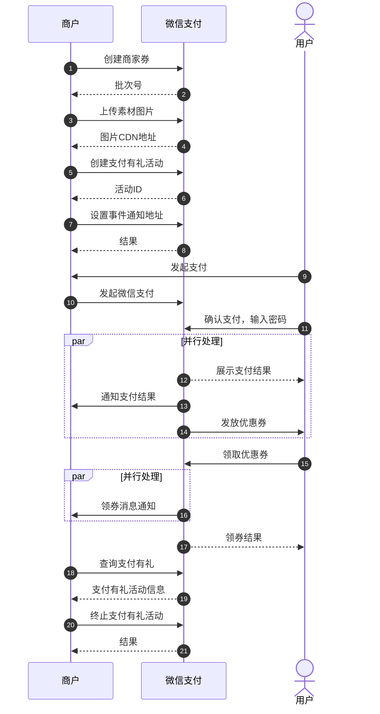

>更新时间：2026.06.09

## 1. 接口规则

为了在保证支付安全的前提下，带给商户简单、一致且易用的开发体验，我们推出了全新的微信支付APIv3接口。该版本API的具体规则请参考[APIv3接口规则](https://pay.weixin.qq.com/doc/v3/merchant/4012081606.md)。

## 2. 开发准备

### 2.1. 搭建和配置开发环境

开发者应当依据自身的编程语言来构建并配置相应的开发环境。

## 3. 快速接入

### 3.1. 业务流程图

#### 业务流程时序图



重点步骤说明：

步骤5 商户创建商家券后，可通过《[创建全场满额送活动](https://pay.weixin.qq.com/doc/v3/merchant/4012487898.md)》接口创建支付有礼活动，微信支付生成支付有礼活动并返回活动ID给到商户。

步骤20 支付有礼活动创建后，商户可通过《[获取活动详情接口](https://pay.weixin.qq.com/doc/v3/merchant/4012487971.md)》查询管理活动。

步骤22 活动创建后，如需结束活动，可通过《[终止活动](https://pay.weixin.qq.com/doc/v3/merchant/4012466523.md)》接口，结束活动。

### 3.2. API接入（含示例代码）

文档展示了如何使用微信支付服务端 SDK 快速接入支付有礼，完成与微信支付对接的部分。

注意

- 文档中的代码示例是用来阐述 API 基本使用方法，代码中的示例参数需替换成商户自己账号及请求参数才能跑通。

- 以下接入步骤仅提供参考，请商户结合自身业务需求进行评估、修改。


#### 3.2.1. 【服务端】创建全场满额送活动

步骤说明：商户可以创建满额送活动，用户支付后送全场券，提升交易额。

background\_color取值：


Java

```
示例代码
public void CreateActivity() throws Exception{
    //请求URL
    HttpPost httpPost = new HttpPost("https://api.mch.weixin.qq.com/v3/marketing/paygiftactivity/unique-threshold-activity");
    // 请求body参数
    String reqdata = "{"
            + "\"activity_base_info\": {"
            + "\"activity_name\":\"良品铺子回馈活动\","
            + "\"activity_second_title\":\"海飞丝的券\","
            + "\"merchant_logo_url\":\"https://tool.oschina.net/regex.jpg\","
            + "\"background_color\":\"COLOR010\","
            + "\"begin_time\":\"2015-05-20T13:29:35+08:00\","
            + "\"end_time\":\"2015-05-20T13:29:35+08:00\","
            + "\"available_periods\": {"
            + "\"available_time\": ["
            + "{"
            + "\"begin_time\":\"2015-05-20T00:00:00+08:00\","
            + "\"end_time\":\"2015-05-20T23:59:59+08:00\""
            + "}"
            + "],"
            + "\"available_day_time\": ["
            + "{"
            + "\"begin_day_time\":\"110000\","
            + "\"end_day_time\":\"135959\""
            + "}"
            + "]"
            + "},"
            + "\"out_request_no\":\"100002322019090134234sfdf\","
            + "\"delivery_purpose\":\"OFF_LINE_PAY\","
            + "\"mini_programs_appid\":\"wx23232232323\","
            + "\"mini_programs_path\":\"/path/index/index\""
            + "},"
            + "\"award_send_rule\": {"
            + "\"transaction_amount_minimum\":100,"
            + "\"send_content\":\"SINGLE_COUPON\","
            + "\"award_type\":\"BUSIFAVOR\","
            + "\"award_list\": ["
            + "{"
            + "\"stock_id\":\"98065001\","
            + "\"original_image_url\":\"https://tool.oschina.net/regex.jpg\","
            + "\"thumbnail_url\":\"https://tool.oschina.net/regex.jpg\""
            + "}"
            + "],"
            + "\"merchant_option\":\"MANUAL_INPUT_MERCHANT\","
            + "\"merchant_id_list\": ["
            + "\"0\":\"10000022\","
            + "\"1\":\"10000023\""
            + "]"
            + "},"
            + "\"advanced_setting\": {"
            + "\"delivery_user_category\":\"DELIVERY_MEMBER_PERSON\","
            + "\"merchant_member_appid\":\"34567890\","
            + "\"goods_tags\": ["
            + "\"0\":\"xxx\","
            + "\"1\":\"yyy\""
            + "]"
            + "}"
            + "}";
    StringEntity entity = new StringEntity(reqdata,"utf-8");
    entity.setContentType("application/json");
    httpPost.setEntity(entity);
    httpPost.setHeader("Accept", "application/json");
    //完成签名并执行请求
    CloseableHttpResponse response = httpClient.execute(httpPost);
    try {
        int statusCode = response.getStatusLine().getStatusCode();
        if (statusCode == 200) { //处理成功
            System.out.println("success,return body = " + EntityUtils.toString(response.getEntity()));
        } else if (statusCode == 204) { //处理成功，无返回Body
            System.out.println("success");
        } else {
            System.out.println("failed,resp code = " + statusCode+ ",return body = " + EntityUtils.toString(response.getEntity()));
            throw new IOException("request failed");
        }
    } finally {
        response.close();
    }
}
```

PHP

```
示例代码
try {
    $resp = $client->request(
        'POST',
        'https://api.mch.weixin.qq.com/v3/marketing/paygiftactivity/unique-threshold-activity', //请求URL
        [
            // JSON请求体
            'json' => [
                "activity_base_info" => [
                    "activity_name" => "良品铺子回馈活动",
                    "activity_second_title" => "海飞丝的券",
                    "merchant_logo_url" => "https://tool.oschina.net/regex.jpg",
                    "background_color" => "COLOR010",
                    "begin_time" => "2015-05-20T13:29:35+08:00",
                    "end_time" => "2015-05-20T13:29:35+08:00",
                    "available_periods" => [
                        "available_time" => [
                            [
                                "begin_time" => "2015-05-20T00:00:00+08:00",
                                "end_time" => "2015-05-20T23:59:59+08:00",
                            ],
                        ],
                        "available_day_time" => [
                            [
                                "begin_day_time" => "110000",
                                "end_day_time" => "135959",
                            ],
                        ],
                    ],
                    "out_request_no" => "100002322019090134234sfdf",
                    "delivery_purpose" => "OFF_LINE_PAY",
                    "mini_programs_appid" => "wx23232232323",
                    "mini_programs_path" => "/path/index/index",
                ],
                "award_send_rule" => [
                    "transaction_amount_minimum" => 100,
                    "send_content" => "SINGLE_COUPON",
                    "award_type" => "BUSIFAVOR",
                    "award_list" => [
                        [
                            "stock_id" => "98065001",
                            "original_image_url" => "https://tool.oschina.net/regex.jpg",
                            "thumbnail_url" => "https://tool.oschina.net/regex.jpg",
                        ],
                    ],
                    "merchant_option" => "MANUAL_INPUT_MERCHANT",
                    "merchant_id_list" => [
                        "0" => "10000022",
                        "1" => "10000023",
                    ],
                ],
                "advanced_setting" => [
                    "delivery_user_category" => "DELIVERY_MEMBER_PERSON",
                    "merchant_member_appid" => "34567890",
                    "goods_tags" => [
                        "0" => "xxx",
                        "1" => "yyy",
                    ],
                ]
            ],
            'headers' => [ 'Accept' => 'application/json' ]
        ]
    );
    $statusCode = $resp->getStatusCode();
    if ($statusCode == 200) { //处理成功
        echo "success,return body = " . $resp->getBody()->getContents()."\n";
    } else if ($statusCode == 204) { //处理成功，无返回Body
        echo "success";
    }
} catch (RequestException $e) {
    // 进行错误处理
    echo $e->getMessage()."\n";
    if ($e->hasResponse()) {
        echo "failed,resp code = " . $e->getResponse()->getStatusCode() . " return body = " . $e->getResponse()->getBody() . "\n";
    }
    return;
}
```

重要入参说明：

- activity\_name：活动名称

- activity\_second\_title：活动副标题

- merchant\_logo\_url：商户logo，送出优惠券时展示， 仅支持通过《[图片上传API](https://pay.weixin.qq.com/doc/v3/merchant/4012557248.md)》接口获取的图片URL地址。

- out\_request\_no：商户请求单号，商户创建批次凭据号（格式：商户ID+日期+流水号），商户侧需保持唯一性，可包含英文字母，数字，｜，\_，\*，-等内容，不允许出现其他不合法符号。

- delivery\_purpose：投放目的。枚举值：

   OFF\_LINE\_PAY：拉用户回店消费

    JUMP\_MINI\_APP：引导用户前往小程序消费

- send\_content：发放内容，可选单张券或礼包，选礼包时奖品限定3-5个。枚举值：

  SINGLE\_COUPON：单张券

  GIFT\_PACKAGE：礼包


更多参数、响应详情及错误码请参见[创建全场满额送活动](https://pay.weixin.qq.com/doc/v3/merchant/4012487898.md)接口文档

#### 3.2.2. 【服务端】查询活动详情接口

步骤说明：商户创建活动后，可以通过该接口查询支付有礼的活动详情，用于管理活动。

Java

```
示例代码
public void QueryActivity() throws Exception{
    //请求URL
    HttpGet httpGet = new HttpGet("https://api.mch.weixin.qq.com/v3/marketing/paygiftactivity/activities/10028001");
    httpGet.setHeader("Accept", "application/json");
    //完成签名并执行请求
    CloseableHttpResponse response = httpClient.execute(httpGet);
    try {
        int statusCode = response.getStatusLine().getStatusCode();
        if (statusCode == 200) { //处理成功
            System.out.println("success,return body = " + EntityUtils.toString(response.getEntity()));
        } else if (statusCode == 204) { //处理成功，无返回Body
            System.out.println("success");
        } else {
            System.out.println("failed,resp code = " + statusCode+ ",return body = " + EntityUtils.toString(response.getEntity()));
            throw new IOException("request failed");
        }
    } finally {
        response.close();
    }
}
```

PHP

```
示例代码
  try {
    $resp = $client->request(
        'GET',
        'https://api.mch.weixin.qq.com/v3/marketing/paygiftactivity/activities/10028001', //请求URL
        [
            'headers' => [ 'Accept' => 'application/json']
        ]
    );
    $statusCode = $resp->getStatusCode();
    if ($statusCode == 200) { //处理成功
        echo "success,return body = " . $resp->getBody()->getContents()."\n";
    } else if ($statusCode == 204) { //处理成功，无返回Body
        echo "success";
    }
} catch (RequestException $e) {
    // 进行错误处理
    echo $e->getMessage()."\n";
    if ($e->hasResponse()) {
        echo "failed,resp code = " . $e->getResponse()->getStatusCode() . " return body = " . $e->getResponse()->getBody() . "\n";
    }
    return;
}
```

重要入参说明：

- activity\_id：活动ID


更多参数、响应详情及错误码请参见[获取活动详情接口](https://pay.weixin.qq.com/doc/v3/merchant/4012487971.md)接口文档。

#### 3.2.3. 【服务端】获取活动发券商户号

步骤说明：商户创建活动后，可以通过该接口查询支付有礼的发券商户号，用于管理活动。

Java

```
示例代码
public void QueryActivityMch() throws Exception{
    //请求URL
    HttpGet httpGet = new HttpGet("https://api.mch.weixin.qq.com/v3/marketing/paygiftactivity/activities/10028001/merchants");
    httpGet.setHeader("Accept", "application/json");
    //完成签名并执行请求
    CloseableHttpResponse response = httpClient.execute(httpGet);
    try {
        int statusCode = response.getStatusLine().getStatusCode();
        if (statusCode == 200) { //处理成功
            System.out.println("success,return body = " + EntityUtils.toString(response.getEntity()));
        } else if (statusCode == 204) { //处理成功，无返回Body
            System.out.println("success");
        } else {
            System.out.println("failed,resp code = " + statusCode+ ",return body = " + EntityUtils.toString(response.getEntity()));
            throw new IOException("request failed");
        }
    } finally {
        response.close();
    }
}
```

PHP

```
示例代码
  try {
    $resp = $client->request(
        'GET',
        'https://api.mch.weixin.qq.com/v3/marketing/paygiftactivity/activities/10028001/merchants', //请求URL
        [
            'headers' => [ 'Accept' => 'application/json']
        ]
    );
    $statusCode = $resp->getStatusCode();
    if ($statusCode == 200) { //处理成功
        echo "success,return body = " . $resp->getBody()->getContents()."\n";
    } else if ($statusCode == 204) { //处理成功，无返回Body
        echo "success";
    }
} catch (RequestException $e) {
    // 进行错误处理
    echo $e->getMessage()."\n";
    if ($e->hasResponse()) {
        echo "failed,resp code = " . $e->getResponse()->getStatusCode() . " return body = " . $e->getResponse()->getBody() . "\n";
    }
    return;
}
```

重要入参说明：

- activity\_id：活动ID


更多参数、响应详情及错误码请参见[获取活动发券商户号](https://pay.weixin.qq.com/doc/v3/merchant/4012466149.md)接口文档。

#### 3.2.4. 【服务端】获取活动指定商品列表

步骤说明：商户创建活动后，可以通过该接口查询支付有礼的活动指定商品，用于管理活动。

Java

```
示例代码
public void QueryActivityGoods() throws Exception{
    //请求URL
    HttpGet httpGet = new HttpGet("https://api.mch.weixin.qq.com/v3/marketing/paygiftactivity/activities/10028001/goods");
    httpGet.setHeader("Accept", "application/json");
    //完成签名并执行请求
    CloseableHttpResponse response = httpClient.execute(httpGet);
    try {
        int statusCode = response.getStatusLine().getStatusCode();
        if (statusCode == 200) { //处理成功
            System.out.println("success,return body = " + EntityUtils.toString(response.getEntity()));
        } else if (statusCode == 204) { //处理成功，无返回Body
            System.out.println("success");
        } else {
            System.out.println("failed,resp code = " + statusCode+ ",return body = " + EntityUtils.toString(response.getEntity()));
            throw new IOException("request failed");
        }
    } finally {
        response.close();
    }
}
```

PHP

```
示例代码
  try {
    $resp = $client->request(
        'GET',
        'https://api.mch.weixin.qq.com/v3/marketing/paygiftactivity/activities/10028001/goods', //请求URL
        [
            'headers' => [ 'Accept' => 'application/json']
        ]
    );
    $statusCode = $resp->getStatusCode();
    if ($statusCode == 200) { //处理成功
        echo "success,return body = " . $resp->getBody()->getContents()."\n";
    } else if ($statusCode == 204) { //处理成功，无返回Body
        echo "success";
    }
} catch (RequestException $e) {
    // 进行错误处理
    echo $e->getMessage()."\n";
    if ($e->hasResponse()) {
        echo "failed,resp code = " . $e->getResponse()->getStatusCode() . " return body = " . $e->getResponse()->getBody() . "\n";
    }
    return;
}
```

重要入参说明：

- activity\_id：活动ID


更多参数、响应详情及错误码请参见[获取活动指定商品列表](https://pay.weixin.qq.com/doc/v3/merchant/4012466448.md)接口文档。

#### 3.2.5. 【服务端】终止活动

步骤说明：商户可通过该接口停止支付有礼活动。

Java

```
示例代码
public void TerminateActivity() throws Exception{
    //请求URL
    HttpPost httpPost = new HttpPost("https://api.mch.weixin.qq.com/v3/marketing/paygiftactivity/activities/10028001/terminate");
    // 请求body参数
    String reqdata ="";
    StringEntity entity = new StringEntity(reqdata,"utf-8");
    entity.setContentType("application/json");
    httpPost.setEntity(entity);
    httpPost.setHeader("Accept", "application/json");
    //完成签名并执行请求
    CloseableHttpResponse response = httpClient.execute(httpPost);
    try {
        int statusCode = response.getStatusLine().getStatusCode();
        if (statusCode == 200) { //处理成功
            System.out.println("success,return body = " + EntityUtils.toString(response.getEntity()));
        } else if (statusCode == 204) { //处理成功，无返回Body
            System.out.println("success");
        } else {
            System.out.println("failed,resp code = " + statusCode+ ",return body = " + EntityUtils.toString(response.getEntity()));
            throw new IOException("request failed");
        }
    } finally {
        response.close();
    }
}
```

PHP

```
示例代码
  try {
    $resp = $client->request(
        'POST',
        'https://api.mch.weixin.qq.com/v3/marketing/paygiftactivity/activities/10028001/terminate', //请求URL
         [
            'headers' => [
                'Accept' => 'application/json',
                'Content-Type'=>'application/json'
            ]
        ]
    );
    $statusCode = $resp->getStatusCode();
    if ($statusCode == 200) { //处理成功
        echo "success,return body = " . $resp->getBody()->getContents()."\n";
    } else if ($statusCode == 204) { //处理成功，无返回Body
        echo "success";
    }
} catch (RequestException $e) {
    // 进行错误处理
    echo $e->getMessage()."\n";
    if ($e->hasResponse()) {
        echo "failed,resp code = " . $e->getResponse()->getStatusCode() . " return body = " . $e->getResponse()->getBody() . "\n";
    }
    return;
}
```

重要入参说明：

- activity\_id：活动ID


更多参数、响应详情及错误码请参见[终止活动](https://pay.weixin.qq.com/doc/v3/merchant/4012466523.md)接口文档。

#### 3.2.6. 【服务端】新增活动发券商户号

步骤说明：商户创建活动后，可以通过该接口增加支付有礼的发券商户号，用于管理活动。

Java

```
示例代码
public void GetActivityList() throws Exception{
  // 加载商户私钥（privateKey：私钥字符串）
  PrivateKey merchantPrivateKey = PemUtil
          .loadPrivateKey(new ByteArrayInputStream(privateKey.getBytes("utf-8")));
  // 加载平台证书（mchId：商户号,mchSerialNo：商户证书序列号,apiV3Key：V3秘钥）
  AutoUpdateCertificatesVerifier verifier = new AutoUpdateCertificatesVerifier(
          new WechatPay2Credentials(mchId, new PrivateKeySigner(mchSerialNo, merchantPrivateKey)),apiV3Key.getBytes("utf-8"));
  CloseableHttpClient httpClient = HttpClients.createDefault();
  // 初始化httpClient
  httpClient = WechatPayHttpClientBuilder.create()
          .withMerchant(mchId, mchSerialNo, merchantPrivateKey)
          .withValidator(new WechatPay2Validator(verifier)).build();
  //请求URL
  HttpPost httpPost = new HttpPost("https://api.mch.weixin.qq.com/v3/marketing/paygiftactivity/activities/10028001/merchants/add");
  // 请求body参数
  String reqdata = "{"
          + "\"merchant_id_list\": ["
          + "\"100123456\","
          + "\"100123457\""
          + "],"
          + "\"add_request_no\":\"100002322019090134234sfdf\""
          + "}";
  StringEntity entity = new StringEntity(reqdata,"utf-8");
  entity.setContentType("application/json");
  httpPost.setEntity(entity);
  httpPost.setHeader("Accept", "application/json");
  //完成签名并执行请求
  CloseableHttpResponse response = httpClient.execute(httpPost);
  try {
      int statusCode = response.getStatusLine().getStatusCode();
      if (statusCode == 200) { //处理成功
          System.out.println("success,return body = " + EntityUtils.toString(response.getEntity()));
      } else if (statusCode == 204) { //处理成功，无返回Body
          System.out.println("success");
      } else {
          System.out.println("failed,resp code = " + statusCode+ ",return body = " + EntityUtils.toString(response.getEntity()));
          throw new IOException("request failed");
      }
  } finally {
      response.close();
  }
}
```

PHP

```
示例代码
  try {
    $resp = $client->request(
        'POST',
        'https://api.mch.weixin.qq.com/v3/marketing/paygiftactivity/activities/10028001/merchants/add', //请求URL
        [
            // JSON请求体
            'json' => [
                "merchant_id_list" => [
                    "0" => "100123456",
                    "1" => "100123457",
                ],
                "add_request_no" => "100002322019090134234sfdf",
            ],
            'headers' => [ 'Accept' => 'application/json' ]
        ]
    );
    $statusCode = $resp->getStatusCode();
    if ($statusCode == 200) { //处理成功
        echo "success,return body = " . $resp->getBody()->getContents()."\n";
    } else if ($statusCode == 204) { //处理成功，无返回Body
        echo "success";
    }
} catch (RequestException $e) {
    // 进行错误处理
    echo $e->getMessage()."\n";
    if ($e->hasResponse()) {
        echo "failed,resp code = " . $e->getResponse()->getStatusCode() . " return body = " . $e->getResponse()->getBody() . "\n";
    }
    return;
}
```

重要入参说明：

- activity\_id：活动ID

- add\_request\_no：请求业务单据号，商户添加发券商户号的凭据号，商户侧需保持唯一性


更多参数、响应详情及错误码请参见[新增活动发券商户号](https://pay.weixin.qq.com/doc/v3/merchant/4012466671.md)接口文档。

#### 3.2.7. 【服务端】获取支付有礼活动列表

步骤说明：商户根据一定过滤条件，查询已创建的支付有礼活动。

Java

```
示例代码
public void GetActivityList() throws Exception{
  // 加载商户私钥（privateKey：私钥字符串）
  PrivateKey merchantPrivateKey = PemUtil
          .loadPrivateKey(new ByteArrayInputStream(privateKey.getBytes("utf-8")));
  // 加载平台证书（mchId：商户号,mchSerialNo：商户证书序列号,apiV3Key：V3秘钥）
  AutoUpdateCertificatesVerifier verifier = new AutoUpdateCertificatesVerifier(
          new WechatPay2Credentials(mchId, new PrivateKeySigner(mchSerialNo, merchantPrivateKey)),apiV3Key.getBytes("utf-8"));
  CloseableHttpClient httpClient = HttpClients.createDefault();
  // 初始化httpClient
  httpClient = WechatPayHttpClientBuilder.create()
          .withMerchant(mchId, mchSerialNo, merchantPrivateKey)
          .withValidator(new WechatPay2Validator(verifier)).build();
  //请求URL
  HttpGet httpGet = new HttpGet("https://api.mch.weixin.qq.com/v3/marketing/paygiftactivity/activities?offset=0&limit=10&activity_status=ONGOING_ACT_STATUS");
  httpGet.setHeader("Accept", "application/json");
  //完成签名并执行请求
  CloseableHttpResponse response = httpClient.execute(httpGet);
  try {
      int statusCode = response.getStatusLine().getStatusCode();
      if (statusCode == 200) { //处理成功
          System.out.println("success,return body = " + EntityUtils.toString(response.getEntity()));
      } else if (statusCode == 204) { //处理成功，无返回Body
          System.out.println("success");
      } else {
          System.out.println("failed,resp code = " + statusCode+ ",return body = " + EntityUtils.toString(response.getEntity()));
          throw new IOException("request failed");
      }
  } finally {
      response.close();
  }
}
```

PHP

```
示例代码
  try {
    $resp = $client->request(
        'GET',
        'https://api.mch.weixin.qq.com/v3/marketing/paygiftactivity/activities?offset=0&limit=10&activity_status=ONGOING_ACT_STATUS', //请求URL
        [
            'headers' => [ 'Accept' => 'application/json']
        ]
    );
    $statusCode = $resp->getStatusCode();
    if ($statusCode == 200) { //处理成功
        echo "success,return body = " . $resp->getBody()->getContents()."\n";
    } else if ($statusCode == 204) { //处理成功，无返回Body
        echo "success";
    }
} catch (RequestException $e) {
    // 进行错误处理
    echo $e->getMessage()."\n";
    if ($e->hasResponse()) {
        echo "failed,resp code = " . $e->getResponse()->getStatusCode() . " return body = " . $e->getResponse()->getBody() . "\n";
    }
    return;
}
```

重要入参说明：

- offset：分页页码，页面从0开始

- limit：分页大小。特殊规则：最大取值为100，最小为1


更多参数、响应详情及错误码请参见[获取支付有礼活动列表](https://pay.weixin.qq.com/doc/v3/merchant/4012489126.md)接口文档。

#### 3.2.8. 【服务端】删除活动发券商户号

步骤说明：商户创建活动后，可以通过该接口删除支付有礼的发券商户号，用于管理活动。

Java

```
示例代码
public void DelActivityMch() throws Exception{
  // 加载商户私钥（privateKey：私钥字符串）
  PrivateKey merchantPrivateKey = PemUtil
          .loadPrivateKey(new ByteArrayInputStream(privateKey.getBytes("utf-8")));
  // 加载平台证书（mchId：商户号,mchSerialNo：商户证书序列号,apiV3Key：V3秘钥）
  AutoUpdateCertificatesVerifier verifier = new AutoUpdateCertificatesVerifier(
          new WechatPay2Credentials(mchId, new PrivateKeySigner(mchSerialNo, merchantPrivateKey)),apiV3Key.getBytes("utf-8"));
  CloseableHttpClient httpClient = HttpClients.createDefault();
  // 初始化httpClient
  httpClient = WechatPayHttpClientBuilder.create()
          .withMerchant(mchId, mchSerialNo, merchantPrivateKey)
          .withValidator(new WechatPay2Validator(verifier)).build();
  //请求URL
  HttpPost httpPost = new HttpPost("https://api.mch.weixin.qq.com/v3/marketing/paygiftactivity/activities/126002309/merchants/delete");
  // 请求body参数
  String reqdata = "{"
          + "\"merchant_id_list\": ["
          + "\"100123456\","
          + "\"100123457\""
          + "],"
          + "\"delete_request_no\":\"100002322019090134234sfdf\""
          + "}";
  StringEntity entity = new StringEntity(reqdata,"utf-8");
  entity.setContentType("application/json");
  httpPost.setEntity(entity);
  httpPost.setHeader("Accept", "application/json");
  //完成签名并执行请求
  CloseableHttpResponse response = httpClient.execute(httpPost);
  try {
      int statusCode = response.getStatusLine().getStatusCode();
      if (statusCode == 200) { //处理成功
          System.out.println("success,return body = " + EntityUtils.toString(response.getEntity()));
      } else if (statusCode == 204) { //处理成功，无返回Body
          System.out.println("success");
      } else {
          System.out.println("failed,resp code = " + statusCode+ ",return body = " + EntityUtils.toString(response.getEntity()));
          throw new IOException("request failed");
      }
  } finally {
      response.close();
  }
}
```

PHP

```
示例代码
  try {
    $resp = $client->request(
        'POST',
        'https://api.mch.weixin.qq.com/v3/marketing/paygiftactivity/activities/126002309/merchants/delete', //请求URL
        [
            // JSON请求体
            'json' => [
                "merchant_id_list" => [
                    "0" => "100123456",
                    "1" => "100123457",
                ],
                "delete_request_no" => "100002322019090134234sfdf",
            ],
            'headers' => [ 'Accept' => 'application/json' ]
        ]
    );
    $statusCode = $resp->getStatusCode();
    if ($statusCode == 200) { //处理成功
        echo "success,return body = " . $resp->getBody()->getContents()."\n";
    } else if ($statusCode == 204) { //处理成功，无返回Body
        echo "success";
    }
} catch (RequestException $e) {
    // 进行错误处理
    echo $e->getMessage()."\n";
    if ($e->hasResponse()) {
        echo "failed,resp code = " . $e->getResponse()->getStatusCode() . " return body = " . $e->getResponse()->getBody() . "\n";
    }
    return;
}
```

重要入参说明：

- activity\_id：活动ID


更多参数、响应详情及错误码请参见[删除活动发券商户号](https://pay.weixin.qq.com/doc/v3/merchant/4012466787.md)接口文档。

## 4. 常见问题

### Q：支付有礼创建全场满额送活动API返回“发券商户号校验失败，请核实是否满足同品牌等规则”

A：支付有礼活动的曝光商户号必须是商家券归属商户号的同品牌。同品牌商户号是指同一企业/集团/品牌/公司旗下，如果存在多个微信支付商户号，该企业/集团/品牌/公司可以授权财付通支付科技有限公司将其旗下的多个商户号创建为同品牌商户号组合。主要用于更便利使用免充值营销产品功能，包括开通产品权限、配置组合内商户号为可用商户、配置活动后可用商户免审核等。

### Q：支付有礼创建全场满额送活动API返回“商家券信息不满足活动规则，请核实券有效期或code”

A：支付有礼中投放批次的校验，请按照以下几点排查。

1. 单张券/券包中所有的券开始时间需早于支付有礼活动的开始时间，结束时间需晚于支付有礼的结束时间；

2. 如果批次为上传code模式，需先上传code再投放到支付有礼  ；

3. 添加券包时，库存、限领和归属商户号需要保持一致；

4. 曝光商户号、批次的归属商户号需要全部为同品牌。


### Q：支付有礼创建全场满额送活动API，开始时间和结束时间描述的“最长可以配置1年内的活动”中的“1年”如何计算？

A：间隔需要小于31536000s，即需要小于365天。

### Q：支付有礼创建全场满额送活动API上传了merchant\_id\_list字段，接着调用了获取支付有礼活动列表API，并没有merchant\_id\_list返回，该字段在什么情况下才返回？

A：查询活动发券商户号API才会有这个字段返回，请参考[获取活动发券商户号](https://pay.weixin.qq.com/doc/v3/merchant/4012466149.md)文档。

### Q：支付有礼发放商家券，用户领券没有收到领券事件通知OpenID

A：请检查对应的批次，调用创建商家券接口时是否有设置事件通知AppID参数（notify\_appid）。

### Q：配置使用「立即使用」跳转商家小程序的能力时，有什么需要注意的地方？

A：在小程序支付场景下，当用户从支付有礼活动落地页点击「立即使用」跳转至商家小程序时，建议不处理小程序调起支付的回调结果。