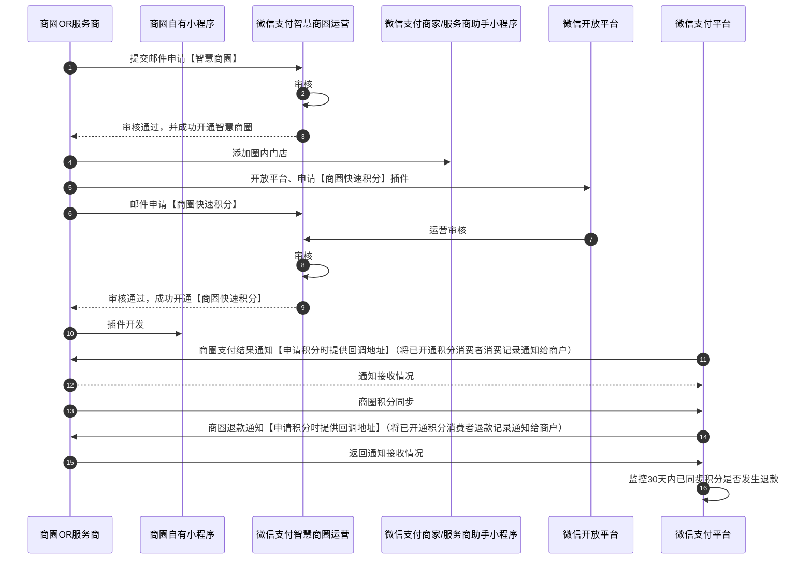

>更新时间：2026.06.09

## 1. 接口规则

为了在保证支付安全的前提下，带给商户简单、一致且易用的开发体验，我们推出了全新的微信支付APIv3接口。该版本API的具体规则请参考[APIv3接口规则](https://pay.weixin.qq.com/doc/v3/merchant/4012081606.md)。

## 2. 开发准备

### 2.1. 搭建和配置开发环境

开发者应当依据自身的编程语言来构建并配置相应的开发环境。

## 3. 快速接入

### 3.1. 业务流程图



重点步骤说明：

智慧商圈接入前需先邮件申请接入权限，申请发放具体可查看[开发接入准备](https://pay.weixin.qq.com/doc/v3/merchant/4012068068.md)，小程序插件可参考：[小程序插件开发文档](https://developers.weixin.qq.com/miniprogram/dev/framework/plugin/)。

步骤10[商圈会员场内支付结果通知](https://pay.weixin.qq.com/doc/v3/merchant/4012285856.md)（已开通积分功能的用户，在场内发生交易时，会将交易信息返回至开通时提交的回调地址）。

步骤12[商圈积分通知回调](https://pay.weixin.qq.com/doc/v3/merchant/4012534698.md)（只有接入该接口，才会获取到退款信息）。

步骤13[商圈会员场内退款结果通知](https://pay.weixin.qq.com/doc/v3/merchant/4012285869.md)（对已同步过积分的交易，监控30天内的退款情况，若发生退款，则会把相关退款通知发送给商圈商户，商户的回调地址同支付结果回调地址保持一致）。

### 3.2. API接入（含示例代码）

文档展示了如何使用微信支付服务端 SDK 快速接入智慧商圈产品，完成与微信支付对接的部分。

注意

- 文档中的代码示例是用来阐述 API 基本使用方法，代码中的示例参数需替换成商户自己账号及请求参数才能跑通。

- 以下接入步骤仅提供参考，请商户结合自身业务需求进行评估、修改。


#### 3.2.1. 【客户端】商圈快速积分小程序插件

微信支付智慧商圈，需先接入商圈快速积分小程序插件。小程序插件可参考：[小程序插件开发文档](https://developers.weixin.qq.com/miniprogram/dev/framework/plugin/)。

#### 3.2.2. 【服务端】接收商圈支付结果通知

步骤说明：当用户完成支付，微信会把相关支付结果将通过异步回调的方式通知商户，商户需要接收处理，并按文档规范返回应答。

注意

- 支付结果通知是以POST 方法访问商户设置的通知URL，通知的数据以JSON 格式通过请求主体（BODY）传输。通知的数据包括了加密的支付结果详情。

- 加密不能保证通知请求来自微信。微信会对发送给商户的通知进行签名，并将签名值放在通知的HTTP头Wechatpay-Signature。商户应当验证签名，以确认请求来自微信，而不是其他的第三方。签名验证的算法请参考 [《微信支付API v3签名验证》](https://pay.weixin.qq.com/doc/v3/merchant/4012365342.md#%E9%AA%8C%E8%AF%81%E7%AD%BE%E5%90%8D)。

- 支付通知HTTP应答码为200或204才会当作正常接收，当回调处理异常时，应答的HTTP状态码应为500，或者4xx。

- 商户成功接收到回调通知后应返回成功的HTTP应答码为200或204。

- 同样的通知可能会多次发送给商户系统。商户系统必须能够正确处理重复的通知。 推荐的做法是，当商户系统收到通知进行处理时，先检查对应业务数据的状态，并判断该通知是否已经处理。如果未处理，则再进行处理；如果已处理，则直接返回结果成功。在对业务数据进行状态检查和处理之前，要采用数据锁进行并发控制，以避免函数重入造成的数据混乱。

- 对后台通知交互时，如果微信收到商户的应答不符合规范或超时，微信认为通知失败，微信会通过一定的策略定期重新发起通知，尽可能提高通知的成功率，但微信不保证通知最终能成功。（通知频率为15s/15s/30s/3m/10m/20m/30m/30m/30m/60m/3h/3h/3h/6h/6h - 总计 24h4m）。


接入顺序：

1. [“商圈会员快速积分”小程序插件开发文档](https://mp.weixin.qq.com/wxopen/plugindevdoc?appid=wxfab2bf944bfc4da6&token=1213946737&lang=zh_CN)。

2. [商圈会员积分服务授权结果通知](https://pay.weixin.qq.com/doc/v3/merchant/4012285836.md)（用户在商圈小程序完成会员积分服务授权后，会将用户的授权情况发送至开通时配置的会员积分服务开通回调地址）。

3. [商圈会员场内支付结果通知](https://pay.weixin.qq.com/doc/v3/merchant/4012285856.md)（已授权商圈会员积分服务的用户，在场内发生微信支付交易时，会将消费信息发送至开通时配置的用户消费回调地址）。

4. [商圈积分通知回调](https://pay.weixin.qq.com/doc/v3/merchant/4012534698.md)（只有接入该接口，才会获取到退款信息）。

5. [商圈会员场内退款通知](https://pay.weixin.qq.com/doc/v3/merchant/4012285869.md)（对已同步过积分的会员消费，监控30天内的退款情况，若发生退款，会将退款信息发送至开通时配置的用户消费回调地址）。

6. [商圈积分授权查询](https://pay.weixin.qq.com/doc/v3/merchant/4012534848.md) （可通过此API查询已授权过商圈会员积分服务用户的最新授权状态）。

7. [查询商圈会员待积分状态](https://pay.weixin.qq.com/doc/v3/merchant/4012534994.md)（可通过此API查询已授权商圈会员积分服务的用户当天是否有待积分的消费，并可在商圈小程序任意页面引导用户前往“商圈会员快速积分”插件提交积分申请）。

8. [更新商圈会员停车状态](https://pay.weixin.qq.com/doc/v3/merchant/4012535502.md)（可通过此API同步会员停车到场状态给微信支付，对用会员的商场内门店消费可100%自动积分）。


更多参数、响应详情及错误码请参见 [商圈支付结果通知](https://pay.weixin.qq.com/doc/v3/merchant/4012534698.md)API接口文档。

#### 3.2.3. 【服务端】商圈积分同步

步骤说明：商圈服务商针对微信支付前序推送给商圈系统的顾客商圈内交易通知，告知微信支付系统该笔交易的积分情况。

java

```
示例代码
public void SyncPoints() throws Exception{
    //请求URL
    HttpPost httpPost = new HttpPost("https://api.mch.weixin.qq.com/v3/businesscircle/points/notify");
    // 请求body参数
    String reqdata = "{"
            + "\"transaction_id\":\"4200000533202000000000000000\","
            + "\"appid\":\"wx8828b70xxxxxxx8\","
            + "\"openid\":\"otPAN5xxxxxxxxrOEG6lUv_pzacc\","
            + "\"earn_points\":true,"
            + "\"increased_points\":100,"
            + "\"points_update_time\":\"2020-05-20T13:29:35.120+08:00\","
            + "\"total_points\":888888"
            + "}";
    StringEntity entity = new StringEntity(reqdata,"utf-8");
    entity.setContentType("application/json");
    httpPost.setEntity(entity);
    httpPost.setHeader("Accept", "application/json");
    //完成签名并执行请求
    CloseableHttpResponse response = httpClient.execute(httpPost);
    try {
        int statusCode = response.getStatusLine().getStatusCode();
        if (statusCode == 200) { //处理成功
            System.out.println("success,return body = " + EntityUtils.toString(response.getEntity()));
        } else if (statusCode == 204) { //处理成功，无返回Body
            System.out.println("success");
        } else {
            System.out.println("failed,resp code = " + statusCode+ ",return body = " + EntityUtils.toString(response.getEntity()));
            throw new IOException("request failed");
        }
    } finally {
        response.close();
    }
}
```

PHP

```
示例代码
  try {
    $resp = $client->request(
        'POST',
        'https://api.mch.weixin.qq.com/v3/businesscircle/points/notify', //请求URL
        [
            // JSON请求体
            'json' => [
                "transaction_id" => "4200000533202000000000000000",
                "appid" => "wx8828b70xxxxxxx8",
                "openid" => "otPAN5xxxxxxxxrOEG6lUv_pzacc",
                "earn_points" => true,
                "increased_points" => 100,
                "points_update_time" => "2020-05-20T13:29:35.120+08:00",
                "total_points" => 888888,
            ],
            'headers' => [ 'Accept' => 'application/json' ]
        ]
    );
    $statusCode = $resp->getStatusCode();
    if ($statusCode == 200) { //处理成功
        echo "success,return body = " . $resp->getBody()->getContents()."\n";
    } else if ($statusCode == 204) { //处理成功，无返回Body
        echo "success";
    }
} catch (RequestException $e) {
    // 进行错误处理
    echo $e->getMessage()."\n";
    if ($e->hasResponse()) {
        echo "failed,resp code = " . $e->getResponse()->getStatusCode() . " return body = " . $e->getResponse()->getBody() . "\n";
    }
    return;
}
```

重要入参说明:

- transaction\_id：微信支付推送的商圈内交易通知里携带的微信订单号。

- earn\_points：用于标明此单是否获得积分，true为获得积分，false为未获得。

- increased\_points：顾客此笔交易新增的积分值。


更多参数、响应详情及错误码请参见[商圈积分同步](https://pay.weixin.qq.com/doc/v3/merchant/4012534698.md)接口文档。

## 4. 常见问题

### Q：一个商圈拥有多个小程序，是否可以在多个小程序中都嵌入“商圈快速积分插件”？

A：可以。 若一个商圈拥有多个小程序，且在多个小程序场景里都适合引导会员开通【智慧商圈支付即积分】能力，请在提交支付即积分申请时，提交对应的多个小程序的AppID，目前最多支持5个。

### Q：是否必须使用微信支付会员卡能力，才能使用【智慧商圈支付即积分】能力？

A：建议使用微信支付会员卡能力，来提升会员开卡的体验，但是若未使用微信支付会员卡能力，一样可以使用【智慧商圈支付即积分】能力。

【智慧商圈支付即积分】能力的实现非常灵活，使用插件形式，嵌入商圈自有小程序中，由商圈自行进行会员身份判断，若判断是会员则可进入“商圈快速积分插件”，引导用户开通【智慧商圈支付即积分】能力。

### Q：提交积分申请时提示“网络错误，请稍后重试”

A：该问题可通过商圈自行解决，登录商圈小程序后台，更新插件版本。

### Q：提交积分申请时提示“270924805”

A：该问题可通过商圈自行解决：

- 确认是服务商模式还是商圈直连模式（登录商户平台确认证书配置）：

  - 若是服务商模式，则需要为服务商商户号配置API-V3证书。

  - 若是商圈直连模式，则需要为商圈商户号配置API-V3证书。
- 按照接口文档进行API证书配置，[积分信息回调](https://pay.weixin.qq.com/doc/v3/merchant/4012285856.md)接口文档， [API证书配置](https://pay.weixin.qq.com/doc/v3/merchant/4012072428.md)。


### Q：用户未自动获取到积分（商圈未收到回调信息）

A：该问题可以通过商圈自检解决：

- 用户插件页检查。

  - 用户通过小程序进入插件页面，查看是否有交易但未提交。若有，则证明提前未签到，直接点击提交即可获取积分（注：插件页只能展示当天的场内消费信息，通过交易单号可识别是否为当天交易）;若无，则进行商圈可积分门店检查。
- 若用户插件页无交易-商圈可积分门店检查。

  - 该门店未添加进商圈内（可能原门店的商户号变更），自检方式：使用用户交易单号在小程序添加该门店，查看是否可添加，并且该门店已开启“支持积分”（若用户消费前，该门店未被圈入商圈，则该笔交易订单不会自动推送，用户可在商圈圈店后进入插件页手动推送）。

  - 用户未在门店消费。