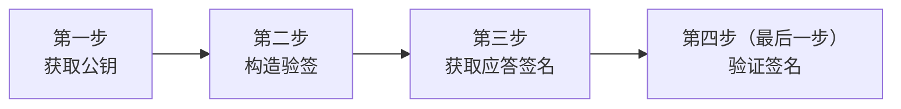

>更新时间：2024.11.20

注意：

本文档中的示例不可直接使用，需将示例中的内容替换为真实请求的信息

请参考本章节，只需4步，完成微信支付公钥对接




## 1. 获取微信支付公钥

超级管理员或者安全联系人登录商户平台，进入账户中心-API安全页面，点击申请公钥后，可下载微信支付公钥

| （1）帐户中心->API安全 | （2）微信支付公钥入口页面 | （3）微信支付公钥详情页（点击下载公钥后，可看到公钥id） |
| --- | --- | --- |
|  |  |  |

## 2. 构造验签串

以某次native下单接口的应答为例

```
Content-Type: application/json; charset=utf-8
Content-Length: 52
Connection: keep-alive
Keep-Alive: timeout=8
Cache-Control: no-cache, must-revalidate
X-Content-Type-Options: nosniff
Request-ID: 08F5B8C2B506102C18FDDFEEA30620BE821E28EDC405-0
Content-Language: zh-CN
Wechatpay-Nonce: d824f2e086d3c1df967785d13fcd22ef
Wechatpay-Signature: mfI1CPqvBrgcXfgXMFjdNIhBf27ACE2YyeWsWV9ZI7T7RU0vHvbQpu9Z32ogzc+k8ZC5n3kz7h70eWKjgqNdKQF0eRp8mVKlmfzMLBVHbssB9jEZEDXThOX1XFqX7s7ymia1hoHQxQagPGzkdWxtlZPZ4ZPvr1RiqkgAu6Is8MZgXXrRoBKqjmSdrP1N7uxzJ/cjfSiis9FiLjuADoqmQ1P7p2N876YPAol7Rn0+GswwAwxldbdLrmVSjfytfSBJFqTMHn4itojgxSWWN1byuckQt8hSTEv/Lg97QoeGniYP17T80pJeQyL3b+295FPHSO2AtvCgyIbKMZ0BALilAA==
Wechatpay-Timestamp: 1722850421
Wechatpay-Serial: PUB_KEY_ID_0000000000000024101100397200000006
Wechatpay-Signature-Type: WECHATPAY2-SHA256-RSA2048
```

```
{"code_url":"weixin://wxpay/bizpayurl?pr=JyC91EIz1"}
```

（1）请从应答或通知回调中获取以下信息：

- HTTP 头 Wechatpay-Timestamp 中的应答时间戳

- HTTP 头 Wechatpay-Nonce 中的应答随机串

- 应答报文主体（Response Body），请使用原始报文主体执行验签。如果您使用了某个框架，要确保它不会篡改报文主体。对报文主体的任何篡改都会导致验证失败。


（2）然后，请按照以下规则构造应答的验签名串。签名串共有三行，行尾以\\n 结束，包括最后一行。\\n 为换行符（ASCII 编码值为 0x0A）。若应答报文主体为空（如 HTTP 状态码为 204 No Content），最后一行仅为一个 \\n 换行符。

```
应答时间戳\n
应答随机串\n
应答报文主体\n
```

则验签名串为

```
1722850421\n
d824f2e086d3c1df967785d13fcd22ef\n
{"code_url":"weixin://wxpay/bizpayurl?pr=JyC91EIz1"}\n
```

## 3. 获取应答签名

微信支付的应答签名通过 HTTP 头 Wechatpay-Signature 传递。（请注意，示例可能存在换行，实际数据应在一行）

```
Wechatpay-Signature: mfI1CPqvBrgcXfgXMFjdNIhBf27ACE2YyeWsWV9ZI7T7RU0vHvbQpu9Z32ogzc+k8ZC5n3kz7h70eWKjgqNdKQF0eRp8mVKlmfzMLBVHbssB9jEZEDXThOX1XFqX7s7ymia1hoHQxQagPGzkdWxtlZPZ4ZPvr1RiqkgAu6Is8MZgXXrRoBKqjmSdrP1N7uxzJ/cjfSiis9FiLjuADoqmQ1P7p2N876YPAol7Rn0+GswwAwxldbdLrmVSjfytfSBJFqTMHn4itojgxSWWN1byuckQt8hSTEv/Lg97QoeGniYP17T80pJeQyL3b+295FPHSO2AtvCgyIbKMZ0BALilAA==
```

提示

某些代理服务器或 CDN 服务提供商，在转发时可能会“过滤”微信支付扩展的 HTTP 头，导致应用层无法获取微信支付的签名信息。商户遇到这种情况时，我们建议尝试调整代理服务器配置，或者通过直连的方式访问微信支付的服务器和接收通知回调。

## 4. 验证签名

很多编程语言的签名验证函数支持对验签名串和签名进行签名验证。强烈建议商户调用该类函数，使用微信支付公钥对验签名串和签名进行 SHA256 with RSA 签名验证。

下面展示使用命令行演示如何进行验签。假设我们已经获取了微信支付公钥并保存为 `1900009191_wxp_pub.pem`。内容如下：

```
$ cat 1900009191_wxp_pub.pem
-----BEGIN PUBLIC KEY-----
MIIBIjANBgkqhkiG9w0BAQEFAAOCAQ8AMIIBCgKCAQEA4zej1cqugGQtVSY2Ah8RMCKcr2UpZ8Npo+5Ja9xpFPYkWHaF1Gjrn3d5kcwAFuHHcfdc3yxDYx6+9grvJnCA2zQzWjzVRa3BJ5LTMj6yqvhEmtvjO9D1xbFTA2m3kyjxlaIar/RYHZSslT4VmjIatW9KJCDKkwpM6x/RIWL8wwfFwgz2q3Zcrff1y72nB8p8P12ndH7GSLoY6d2Tv0OB2+We2Kyy2+QzfGXOmLp7UK/pFQjJjzhSf9jxaWJXYKIBxpGlddbRZj9PqvFPTiep8rvfKGNZF9Q6QaMYTpTp/uKQ3YvpDlyeQlYe4rRFauH3mOE6j56QlYQWivknDX9VrwIDAQAB
-----END PUBLIC KEY-----
```

（2）使用 base64 解码应答签名，将保存为文件 signature.txt 。（以下命令行均在一行）

```
$ openssl base64 -d <<< \ 'mfI1CPqvBrgcXfgXMFjdNIhBf27ACE2YyeWsWV9ZI7T7RU0vHvbQpu9Z32ogzc+k8ZC5n3kz7h70eWKjgqNdKQF0eRp8mVKlmfzMLBVHbssB9jEZEDXThOX1XFqX7s7ymia1hoHQxQagPGzkdWxtlZPZ4ZPvr1RiqkgAu6Is8MZgXXrRoBKqjmSdrP1N7uxzJ/cjfSiis9FiLjuADoqmQ1P7p2N876YPAol7Rn0+GswwAwxldbdLrmVSjfytfSBJFqTMHn4itojgxSWWN1byuckQt8hSTEv/Lg97QoeGniYP17T80pJeQyL3b+295FPHSO2AtvCgyIbKMZ0BALilAA==' > signature.txt
```

（3）最后，验证签名，得到验签结果，请确认你的结果和文档的结果一致，如果验签结果是Verification Failure，请确认是否获取到了正确的微信支付公钥或者验签串是否有严格按照文档格式换行

```
$ openssl dgst -sha256 -verify 1900009191_wxp_pub.pem -signature signature.txt << EOF
1722850421
d824f2e086d3c1df967785d13fcd22ef
{"code_url":"weixin://wxpay/bizpayurl?pr=JyC91EIz1"}
EOF
```

得到的结果为如下verified ok 则表示验签通过

```
Verified OK
```

## 5. 注意事项

### （1）请合理应对签名探测流量

为了确保商户系统的安全，微信支付会在极少数应答或通知回调中生成错误签名，以探测商户系统是否正确地验证了签名。

商户系统不应对探测流量进行特殊处理，而应将其视为正常的应答或通知回调，并对其签名进行验证。在排查问题时，您可以通过查看签名值中的 WECHATPAY/SIGNTEST/ 前缀快速判断是否为探测流量。所有用于探测目的的签名值都会包含此前缀。

在验签失败的情况下，我们建议商户系统采取以下措施：

- 如果应答的签名验证失败，商户系统应舍弃该应答。为了提高用户体验，商户系统可以适当地重试，或者让用户重新发起请求。微信支付不会针对重试请求发起探测。

- 若通知回调的签名验证失败，商户系统应返回失败（即应答 4xx 或 5xx 的状态码），等待微信支付携带正确签名重新发送通知回调。


如果你有关于签名探测任何疑问，请通过[在线技术咨询](https://support.pay.weixin.qq.com/aidevhelper)联系我们的技术支持。

### （2）文件/图片下载接口验签说明

文件下载接口需要跳过验签流程，以下载账单接口为例，下载账单分三步：

第一步，请求下载账单接口，微信支付返回一个下载账单的URL

第二步，商户通过第一步获取的url 去下载账单，下载账单返回的是账单文件，响应的信息请求头中不包含微信接口响应的签名值，因此需要跳过验签的流程

第三步，商户将实际账单文件的哈希值和之前从接口获取到的哈希值进行比对，以确认数据的完整