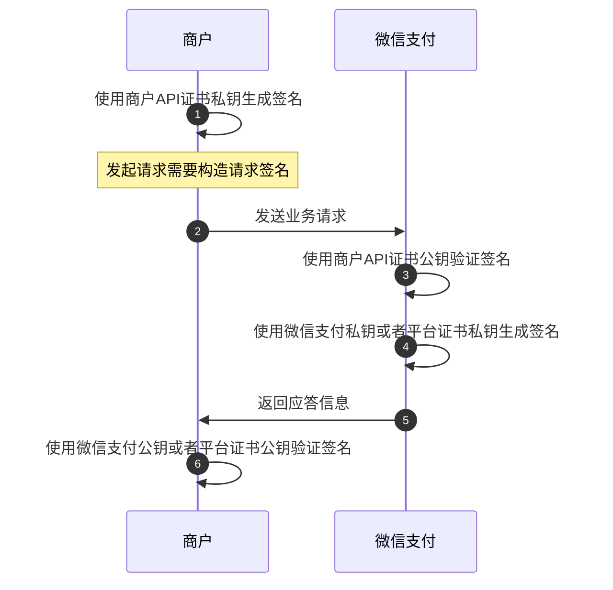

>更新时间：2024.11.21

## 概述

在微信支付APIv3的所有请求应答场景、接口回调场景、调起支付场景，开发者都需要进行签名验签。

## 1. 什么时候需要签名？如何签名？

以下2种场景需要构造签名



### 1.1 请求微信支付接口

商户调用微信支付接口的时候需要用到商户API证书（[申请商户API证书](https://pay.weixin.qq.com/doc/v3/merchant/4012072428.md)）构造请求签名，且根据请求参数类型的不同，签名方式有所差异，请参考一下的操作指引说明

（1）[请求参数里带Path参数（路径参数），如何计算签名](https://pay.weixin.qq.com/doc/v3/merchant/4012365334.md)

（2）[请求参数里带Body参数(包体参数），如何计算签名](https://pay.weixin.qq.com/doc/v3/merchant/4012365336.md)

（3）[请求参数里有Query（查询参数），如何计算签名](https://pay.weixin.qq.com/doc/v3/merchant/4012365337.md)

（4）[图片上传接口，如何计算签名](https://pay.weixin.qq.com/doc/v3/merchant/4012365335.md)

### 1.2 调起支付

商户在前端调起支付时，需要用到商户API证书（[申请商户API证书](https://pay.weixin.qq.com/doc/v3/merchant/4012072428.md)）构造调起支付签名，请根据需求参考对应的文档

（1）[JSAPI调起支付签名](https://pay.weixin.qq.com/doc/v3/merchant/4012365339.md)

（2）[APP调起支付签名](https://pay.weixin.qq.com/doc/v3/merchant/4012365340.md)

（3）[小程序调起支付签名](https://pay.weixin.qq.com/doc/v3/merchant/4012365341.md)

## 2. 什么时候需要验签？如何验签？

以下2种场景商户需要验签，验证请求是来自微信支付

| 微信支付应答商户的请求时，商户需要验签（验证请求是来自微信支付） | 接收微信支付的回调时，商户需要验签（验证请求是来自微信支付） |
| --- | --- |
| ```mermaid<br>sequenceDiagram<br>  autonumber<br>  participant p0 as 商户<br>  participant p1 as 微信支付<br>  p0->>p0: 使用商户API证书私钥生成签名<br>  p0->>p1: 发送业务请求<br>  p1->>p1: 使用商户API证书公钥验证签名<br>  p1->>p1: 使用微信支付私钥或者平台证书私钥生成签名<br>  Note over p1: 微信支付应答商户请求时，商户需要验签<br>  p1->>p0: 返回应答信息<br>  p0->>p0: 使用微信支付公钥或者平台证书公钥验证签名<br>``` | ```mermaid<br>sequenceDiagram<br>  autonumber<br>  participant p0 as 商户<br>  participant p1 as 微信支付<br>  p1->>p1: 使用APIv3密钥加密回调信息<br>  p1->>p1: 使用微信支付私钥或者平台证书私钥生成签名<br>  Note over p0: 接收微信支付回调时，需要验签<br>  p1->>p0: 发送回调信息<br>  p0->>p0: 使用微信支付公钥或者平台证书公钥验证签名<br>  p0->>p0: 使用APIv3密钥解密回调信息<br>  p0->>p1: 返回处理结果<br>``` |

### 2.1 接收微信支付应答

微信支付应答商户的请求时，商户需要验签。

（1）【推荐】如果你使用的是微信支付公钥，参考[微信支付公钥如何验签](https://pay.weixin.qq.com/doc/v3/merchant/4013053249.md)

（2）如果你使用的是平台证书模式，参考[如何使用平台证书验签](https://pay.weixin.qq.com/doc/v3/merchant/4013053420.md)

### 2.2 接收微信支付回调请求

接收微信支付的回调时，商户需要验签

（1）微信支付会使用APIv3密钥加密回调信息，商户需要使用APIv3密钥解密回调信息，参考[如何解密微信支付回调报文](https://pay.weixin.qq.com/doc/v3/merchant/4012071382.md)

（2）【推荐】如果你使用的是微信支付公钥，参考[如何使用微信支付公钥验签](https://pay.weixin.qq.com/doc/v3/merchant/4013053249.md)

（3）如果你使用的是平台证书模式，参考[如何使用平台证书验签名](https://pay.weixin.qq.com/doc/v3/merchant/4013053420.md)