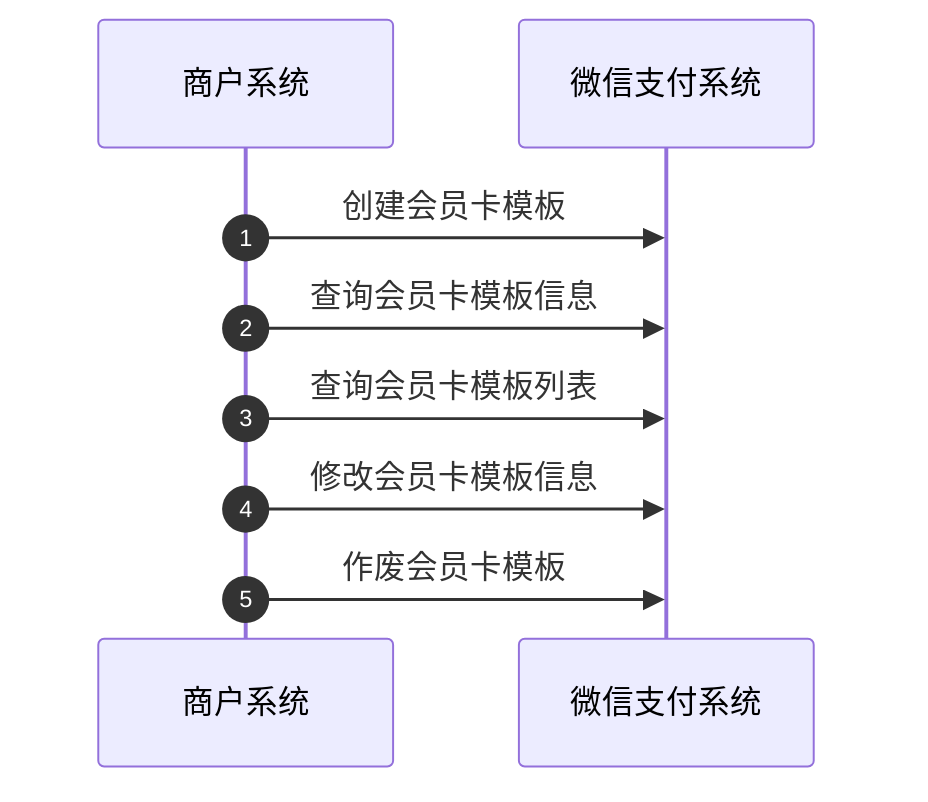
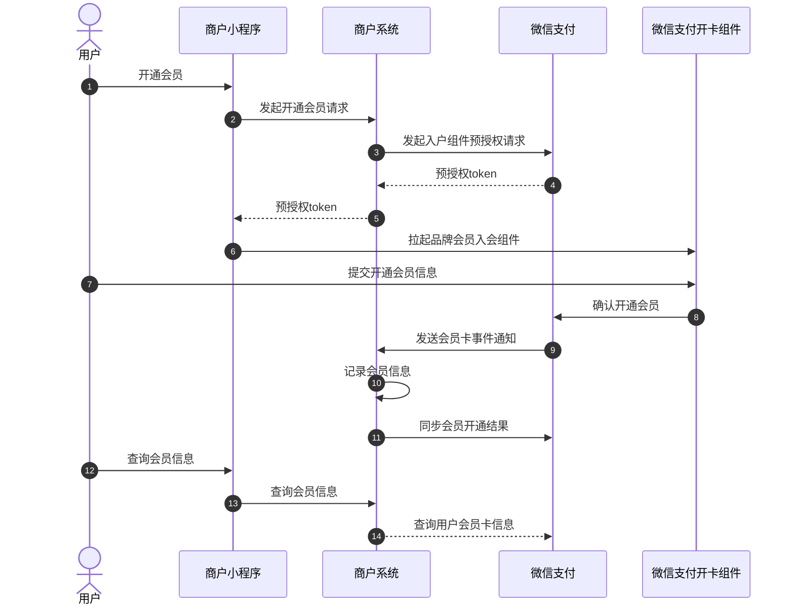
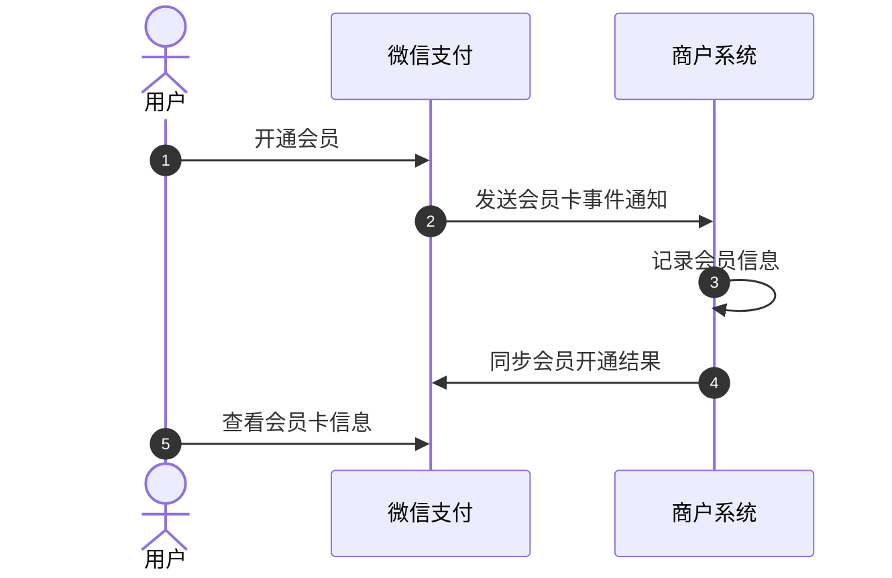
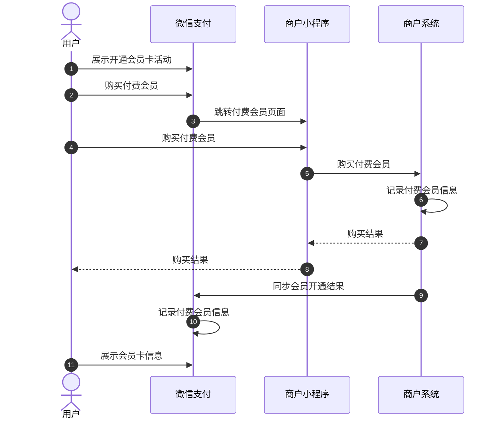
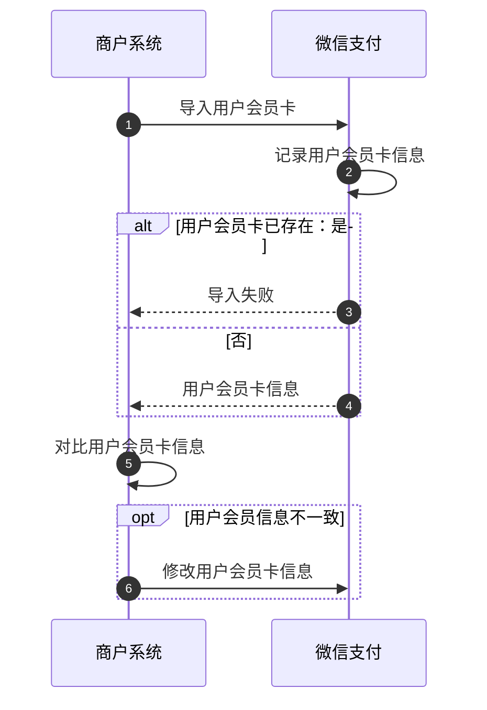
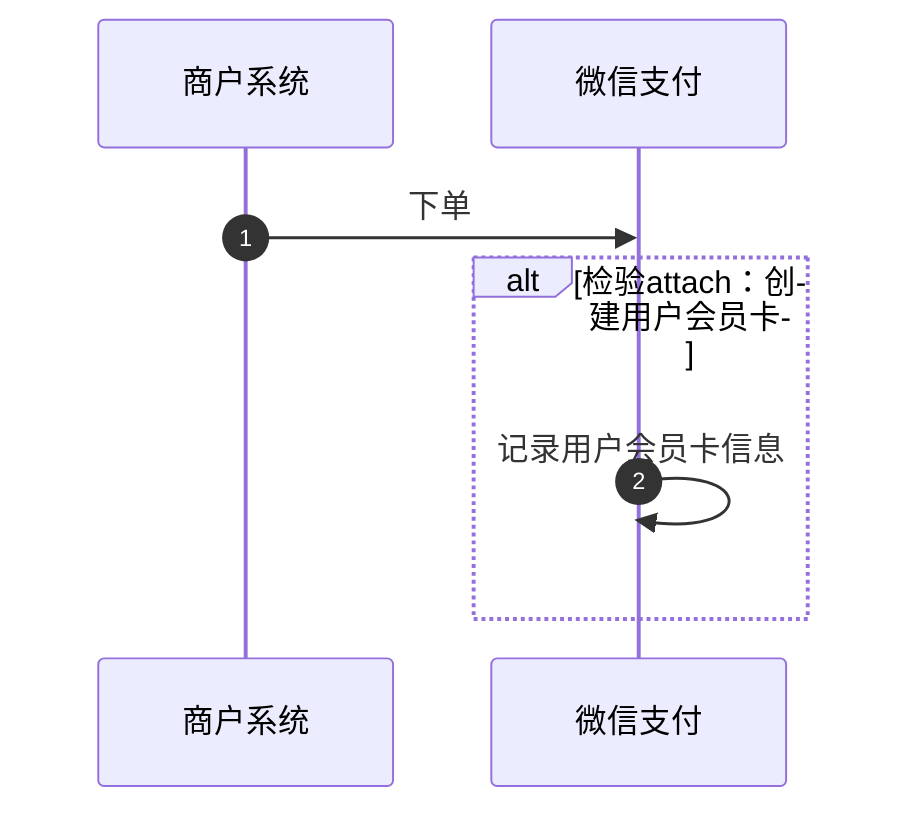
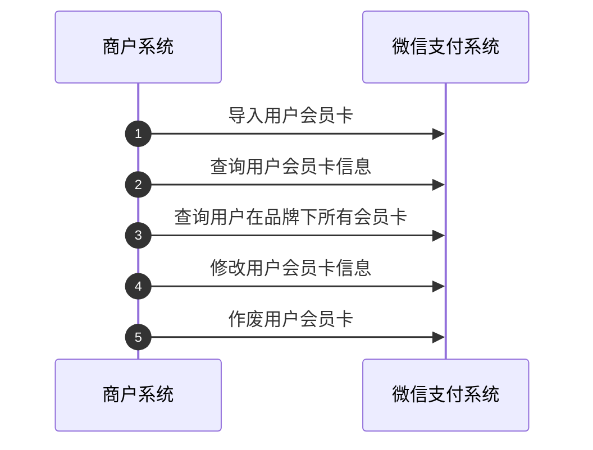
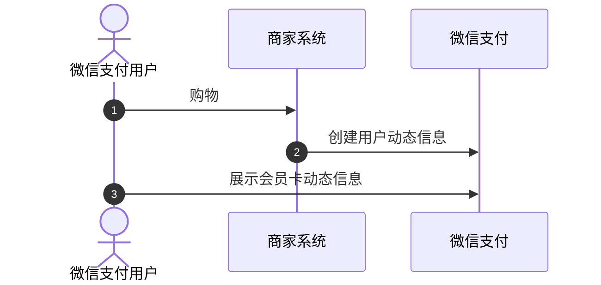
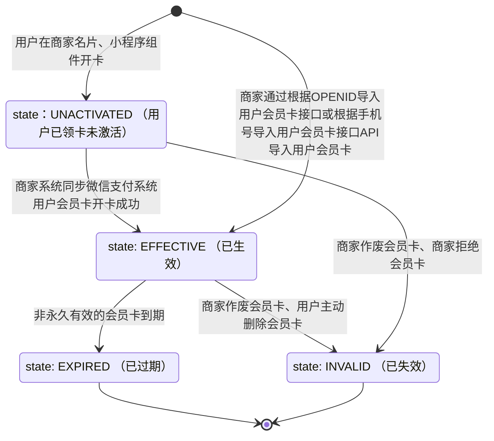

>更新时间：2026.10.12

## 1、开发前准备

### 1.1、熟悉微信支付接口规则

正式进入开发前，开发者需要先阅读[基本规则](https://pay.weixin.qq.com/doc/brand/4015407525.md)、[如何签名和验签](https://pay.weixin.qq.com/doc/brand/4015407568.md)了解调用微信支付接口的基本规则和签名、验签规则。

### 1.2、准备开发参数

在发起接口请求时，开发者还需传入一些必要参数，如brand\_id(品牌ID)、品牌API证书私钥、公钥等，获取方式详见：[品牌商户模式开发必要参数说明](https://pay.weixin.qq.com/doc/brand/4015415289.md)。

注意事项：

1、开发联调阶段，调用接口后，建议在日志中保留应答的HTTP头 `Request-ID` 值， `Request-ID` 作为[请求的唯一标识](https://pay.weixin.qq.com/doc/brand/4015407525.md#%E8%AF%B7%E6%B1%82%E7%9A%84%E5%94%AF%E4%B8%80%E6%A0%87%E8%AF%86)，在调用接口遇到问题时，可向微信侧提供该值用于快速定位到请求记录，协助排查问题原因。

2、品牌API接入示例可参考[快速调通第一个品牌API](https://pay.weixin.qq.com/doc/brand/4016151253.md)

## 2、整体业务开发流程概览

- 商家名片会员是商家名片的功能之一，在接入前需先[申请开通商家名片](https://pay.weixin.qq.com/doc/brand/4016401750.md)功能，再联系微信支付运营开通商家名片会员的权限，开通后即可创建会员卡模版。

- 创建会员卡模版后，可引导新用户入会或对存量会员信息进行导入，具体方式可参考下方概览图中的「用户入会」流程。

- 用户入会成功后，即可查询、修改、作废用户会员卡。

- 用户入会成功后，可在商家名片会员卡同步并展示[用户会员动态](https://pay.weixin.qq.com/doc/brand/4015562403.md#2.3.2%E3%80%81%E4%BC%9A%E5%91%98%E5%8D%A1%E5%8A%A8%E6%80%81)信息，具体方式可参考下方概览图中的「会员卡动态信息同步」流程：

## 3、详细步骤说明

### 3.1、管理会员卡模版

商户系统可以通过API管理会员卡模板：包括[创建](https://pay.weixin.qq.com/doc/brand/4015582711.md)、[查询列表](https://pay.weixin.qq.com/doc/brand/4015582712.md)、[查询详情](https://pay.weixin.qq.com/doc/brand/4015582715.md)、[修改](https://pay.weixin.qq.com/doc/brand/4015582722.md)、[作废](https://pay.weixin.qq.com/doc/brand/4015582724.md)等操作。

### 3.2、用户入会

3.2.1、3.2.2 两种方式要求会员卡模板「是否支持用户主动入会」为 true；为 false 的卡模板仅支持 3.2.3、3.2.4 两种方式。

#### 3.2.1、【新用户】通过商家小程序/H5入会

用户可通过小程序或H5页面进入微信支付提供的开卡组件发起入会流程，核心流程如下：

包括商户[发起预授权](https://pay.weixin.qq.com/doc/brand/4015582733.md)、[拉起组件](https://pay.weixin.qq.com/doc/brand/4015582734.md)、[接收事件通知](https://pay.weixin.qq.com/doc/brand/4015582700.md)、[同步开通结果](https://pay.weixin.qq.com/doc/brand/4015582750.md)、[查询用户会员卡信息](https://pay.weixin.qq.com/doc/brand/4015582716.md)等操作。

#### 3.2.2、【新用户】通过商家名片入会

商户通过[创建会员卡模板](https://pay.weixin.qq.com/doc/brand/4015582711.md)接口创建的会员卡模块如符合条件（卡模板状态为生效、 `valid_date_information` 在有效期内且该用户未参与过入会）在商家名片会展示入会入口。商家可以通过need\_pinned参数置顶某张卡模板。用户通过微信支付的商家名片发起入会流程时，核心流程如下：

包括商户[接收事件通知](https://pay.weixin.qq.com/doc/brand/4015582700.md)、[同步开通结果](https://pay.weixin.qq.com/doc/brand/4015582750.md)等操作。

##### 3.2.2.1 普通会员卡

注意：

普通会员，需完成 “ 会员开通” 闭环。用户在商家名片完成开通，然后由微信支付通知商户系统开通结果，最后由商户系统同步微信支付开通结果后才能结束流程。

##### 3.2.2.2 付费会员卡（暂未上线）

注意：

- 付费会员，需完成 “支付 \+ 会员开通” 闭环。用户在商家小程序完成支付和会员开通，然后由商户系统同步微信支付开通结果后才能结束流程。

- 付费会员，该功能暂未上线。

#### 3.2.3、【存量会员】通过API导入

针对存量会员，商家可通过用户的OpenID或手机号，将存量会员通过API导入至微信支付的商家名片，核心流程如下：

包括[导入用户会员卡](https://pay.weixin.qq.com/doc/brand/4015582744.md)、[修改用户会员卡信息](https://pay.weixin.qq.com/doc/brand/4015582719.md)等操作

注意：

- 通过API导入用户会员卡时，必须传入会员卡code字段（user\_card\_code）。

- 根据手机号导入用户会员卡，该功能暂未上线。

#### 3.2.4、【存量会员】通过下单同步入会

商家可通过在微信支付下单接口的attach字段传入实时动态内容来导入未开通会员的用户。下单用户若此前未开通会员卡，通过此方式可实时添加会员并自动生效一张会员卡，详细指引请参考：[实时动态传入的方式](https://pay.weixin.qq.com/doc/brand/4015562429.md#2.3%E3%80%81%E5%AE%9E%E6%97%B6%E5%8A%A8%E6%80%81%E4%BC%A0%E5%85%A5%E7%9A%84%E6%96%B9%E5%BC%8F)

### 3.3、管理用户会员卡

商户系统可以通过API管理用户会员卡：包括[导入](https://pay.weixin.qq.com/doc/brand/4015582744.md)、[查询列表](https://pay.weixin.qq.com/doc/brand/4015582718.md)、[查询详情](https://pay.weixin.qq.com/doc/brand/4015582716.md)、[修改](https://pay.weixin.qq.com/doc/brand/4015582719.md)、[作废](https://pay.weixin.qq.com/doc/brand/4015582726.md)等操作。

### 3.4、会员动态信息同步

a、商户系统可通过[下单同步用户实时动态](https://pay.weixin.qq.com/doc/brand/4015562429.md)能力导入会员卡实时动态信息。

b、商户系统可通过API导入会员卡异步动态信息。

注意：

该API用于记录在非微信支付渠道订单产生的会员动态信息。

### 3.5、用户会员卡状态流转图

以下2个状态为终态：

- 已过期

- 已失效

### 3.6、积分兑券能力接入步骤

#### 3.6.1 前置准备（创建积分兑券模版）

商家按照如下信息，提供给微信支付运营（后续将支持商家自己配置管理），上架每个品牌ID商家内的积分货架内容。

以下表格内容，每创建一次，将获得一个积分兑券模版ID，对应图示中一个红色圈起的模块。

| 字段 | 备注 | 图示 |
| --- | --- | --- |
| 商家brandID |  |  |
| 会员卡模版ID | 配置到哪张会员卡 |  |
| 消耗积分 | 兑换这一张券，需要消耗多少积分 |  |
| 总库存 | 在架有多少份这个「x积分兑换xxx券」的福利 |  |
| 用户兑换单日限额 | 用户每一天可以兑换多少次 每一次用户请求，微信支付都会问询商家是否可兑换。该字段仅作为一个前置拦截规则。 |  |
| 排序ID | 在积分货架上，当前积分兑券模版排序第几顺位。 |  |
| 商品券ID | 同品牌ID商家下，已创建好的商品券ID |  |

#### 3.6.2 商家系统内，潜在要做的准备

1. 商家要维护下单实时动态模版ID （这个ID 所有商户都一样，是微信给出来的），[支持的模版内容详见这里。](https://pay.weixin.qq.com/doc/brand/4015562429.md#2.2%E3%80%81%E5%AE%9E%E6%97%B6%E5%8A%A8%E6%80%81%E6%94%AF%E6%8C%81%E7%9A%84%E5%86%85%E5%AE%B9)

   1. 不同的动态模版ID内容不一样，积分兑券业务可以使用类别为「积分兑券」的模版。
2. 商家支付系统要根据openid查会员可用积分。

3. 商家需要根据当前下单顾客的积分数，去匹配积分兑券相关的动态模版ID拼接到下单接口的attach字段里。（如果商家需要在支付凭证cell展示引导用户积分兑券的内容时需要）

#### 3.6.3 接入积分兑券相关接口，进行调试

[用户积分兑券事件通知](https://pay.weixin.qq.com/doc/brand/4015879057.md)

[用户积分同步事件通知](https://pay.weixin.qq.com/doc/brand/4016096803.md)

[同步积分兑券结果](https://pay.weixin.qq.com/doc/brand/4015897310.md)

[同步积分余额](https://pay.weixin.qq.com/doc/brand/4015897319.md)

## 4、接口接入说明

|     |     |     |
| --- | --- | --- |
| 类型 | 接口名 | 接口说明 |
| 必须接入 | 创建会员卡模板 | 通过调用「[创建会员卡模板](https://pay.weixin.qq.com/doc/brand/4015582711.md)」接口可以创建一张会员卡模板，创建成功将获得会员卡模板ID。 |
| 必须接入 | 会员卡事件通知 | 当用户的会员卡发生变化时，微信支付商家名片会把相关[事件结果](https://pay.weixin.qq.com/doc/brand/4015582700.md)和用户信息发送给商户。 |
| 必须接入 | 同步会员开通结果 | 用户通过入会组件和商家名片开卡后，微信支付会回调通知给商家，且商家必须调用「[同步会员开通结果](https://pay.weixin.qq.com/doc/brand/4015582750.md)」接口把开卡结果同步给微信支付侧才算开卡成功（注意：通过API导入和下单同步等方式无需同步开卡结果）。在同步开卡结果时商家可修改部分会员卡信息。 |
| 按需接入 | 入会组件预授权 | 通过调用「[入会组件预授权](https://pay.weixin.qq.com/doc/brand/4015582733.md)」接口可以生成用于商家小程序或 H5 拉起入会组件的品牌预授权凭证。 |
| 按需接入 | H5/小程序拉起品牌会员入会组件 | 商户可基于自身需求选择H5（公众号端）或小程序的方式引导用户完成入会流程 - 通过调用「[H5拉起品牌会员入会组件](https://pay.weixin.qq.com/doc/brand/4015582734.md)」接口可使用微信支付侧提供的 JS 调起品牌会员入会组件，引导用户完成入会流程    - 通过调用「[小程序拉起品牌会员入会组件](https://pay.weixin.qq.com/doc/brand/4015582737.md)」接口可在小程序内使用微信支付提供的小程序方法调起品牌会员入会组件，引导用户完成入会流程 |
| 按需接入 | 查询会员卡模板列表 | 通过调用「[查询会员卡模板列表](https://pay.weixin.qq.com/doc/brand/4015582712.md)」接口可查询指定某品牌的所有会员卡模板列表。 |
| 按需接入 | 查询会员卡模板信息 | 通过调用「[查询会员卡模板信息](https://pay.weixin.qq.com/doc/brand/4015582715.md)」接口可查询指定会员卡模板的所有信息。 |
| 按需接入 | 修改会员卡模板信息 | 通过调用「[修改会员卡模板信息](https://pay.weixin.qq.com/doc/brand/4015582722.md)」接口可更新会员卡的信息，包括基本信息、储值信息、开卡信息等 |
| 按需接入 | 作废会员卡模板 | 通过调用「[作废会员卡模板](https://pay.weixin.qq.com/doc/brand/4015582724.md)」接口可作废会员卡模板。作废后，商家将无法通过任何渠道再投放该会员卡。 |
| 按需接入 | 查询用户会员卡信息 | 通过调用「[查询用户会员卡信息](https://pay.weixin.qq.com/doc/brand/4015582716.md)」接口可查询指定用户会员卡的信息，如会员积分、储值余额、开卡信息等。 |
| 按需接入 | 查询用户在品牌下所有会员卡 | 通过调用「[查询用户在品牌下所有会员卡](https://pay.weixin.qq.com/doc/brand/4015582718.md)」接口可查询用户在当前品牌下领取的会员卡列表。 |
| 按需接入 | 修改用户会员卡信息 | 通过调用「[修改用户会员卡信息](https://pay.weixin.qq.com/doc/brand/4015582719.md)」接口可更新指定用户的会员卡背景图、会员卡号、等级等信息。 |
| 按需接入 | 作废用户会员卡 | 通过调用「[作废用户会员卡](https://pay.weixin.qq.com/doc/brand/4015582726.md)」接口可将用户的会员卡设置为作废状态。 注意： - 设置卡券作废的操作不可逆，即无法将设置为作废的卡调回有效状态，商家须慎重调用该接口。    - 商家调用作废接口前须与顾客事先告知并取得同意，否则因此带来的顾客投诉，微信将会按照《微信运营处罚规则》进行处罚。 |
| 按需接入 | 根据OPENID导入用户会员卡 | 对于经营会员生意的商家来说，存量会员的注册渠道广泛，包括但不限于线下渠道、微信渠道、App及其他线上渠道。因而，在商家名片经营会员时会遇到两类问题： （1）存量会员的身份难统一识别； （2）在应用入会活动能力时，容易对存量（但未同步身份至商家名片侧的）老会员重复补贴。 因而，针对存量会员，商家可通过用户在微信公众号/小程序内的OpenID，调用「[根据OPENID导入用户会员卡](https://pay.weixin.qq.com/doc/brand/4015582744.md)」接口将存量会员通过接口导入至商家名片。 注意： 用户OpenID对应的AppID，需要和会员卡所属的品牌号绑定。 |
| 按需接入 | 创建用户动态信息 | 通过调用「[创建用户动态信息](https://pay.weixin.qq.com/doc/brand/4015582679.md)」接口可同步非微信支付渠道的会员动态信息到微信支付商家名片会员。 |
| 按需接入 | 图片上传 | 通过调用「[图片上传](https://pay.weixin.qq.com/doc/brand/4015680641.md)」接口上传图片后可获得图片URL地址。图片URL可在微信支付商家名片会员相关的API使用，包括会员卡模板、用户会员卡等。 |

积分兑券-需要接入的接口

前提是商家已经接入了名片会员， [创建会员卡模板](https://pay.weixin.qq.com/doc/brand/4015582711.md)，同时接入了商品券。

| 序号 | 必要性 | 接口目的 | 接口（可点击查看接口详情） | 备注 |
| --- | --- | --- | --- | --- |
| 1 | 必接 | 微信支付通知商户，用户在C端点了兑换按钮 | [用户积分兑券事件通知](https://pay.weixin.qq.com/doc/brand/4015879057.md) | 建议在3秒内回传该通知，否则用户界面可能不再等待响应，导致用户无法及时获知兑换结果，影响体验。  |
| 2 | 必接 | 用户进入有积分余额展示的页面时，微信支付会向商家查询用户的当前积分余额， 以便用户清晰了解自己可兑换的权益。 | [用户积分同步事件通知](https://pay.weixin.qq.com/doc/brand/4016096803.md) |  |
| 3 | 必接 | 商家回调告知微信支付，是否可以兑券 | [同步积分兑券结果](https://pay.weixin.qq.com/doc/brand/4015897310.md) |  |
| 4 | 看商家需求 接了用户体验更好 | 商家异步通知微信支付，当前用户积分值 | [同步积分余额](https://pay.weixin.qq.com/doc/brand/4015897319.md) |  |
| 5 | 看商家需求 接了积分兑券效果更好 | 如果想要在支付后的链路将用户可兑换的内容告知用户， 需要接入下单同步用户实时动态，在微信支付下单接口的attach字段内 按照下单同步用户实时动态的内容传入 | [下单同步用户实时动态](https://pay.weixin.qq.com/doc/brand/4015562429.md) |   |