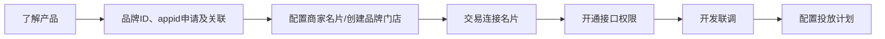

>更新时间：2026.10.20

接入流程

流程说明

| 环节 | 步骤 | 执行方 | 是否必须 |
| --- | --- | --- | --- |
| 了解产品 | 品牌方阅读[产品介绍文档](https://pay.weixin.qq.com/doc/brand/4015782176.md)，了解摇一摇有优惠产品特性。 | 品牌方 | 是 |
| 品牌ID、appid申请及关联 | 品牌方按自身需求，参考以下注册指引注册[公众平台](https://mp.weixin.qq.com/)或[开放平台](https://open.weixin.qq.com/)账号，以获取appid： - 服务号、政府或媒体类型的公众号：参考指引[注册服务号/公众号](https://kf.qq.com/product/weixinmp.html#hid=87)类型的公众平台账号；    - 小程序：参考指引[注册小程序](https://kf.qq.com/faq/170109iQBJ3Q170109JbQfiu.html)类型的公众平台账号；    - 移动应用：先参考指引[注册开放平台账号](https://kf.qq.com/faq/170811QrE3En170811bUNRJb.html)，再参考指引[创建移动应用](https://developers.weixin.qq.com/doc/oplatform/Mobile_App/guideline/create.html)。 | 品牌方 | 是 |
| 品牌ID、appid申请及关联 | 公众账号或开放平台账号认证（未认证的账号无法绑定品牌方）： - 服务号、政府或媒体类型的公众号：参考[服务号/公众号认证指引](https://kf.qq.com/product/weixinmp.html#hid=99)完成公众平台账号认证；    - 小程序：参考[小程序认证指引](https://kf.qq.com/faq/170109by2mQB170109zUFfqe.html)完成公众平台账号认证；    - 移动应用：参考[开放平台账号认证指引](https://kf.qq.com/faq/170824URbmau170824r2uY7j.html)完成开放平台账号认证。 | 品牌方 | 是 |
| 品牌ID、appid申请及关联 | 品牌方参考[brand\_id申请指引](https://pay.weixin.qq.com/doc/brand/4015415286.md)在[品牌经营平台](https://pay.weixin.qq.com/xdc/brandhomeweb/brand/home#/)申请brand\_id(品牌ID)。 | 品牌方 | 是 |
| 品牌ID、appid申请及关联 | 品牌方完成brand\_id与appid的绑定目前有两种路径，可选择其中之一进行关联，appid关联的前提为已通过微信认证： - 路径一：小程序、服务号、公众号、APP类型的都可以按以下步骤进行关联：      - 步骤1：品牌方在【[品牌经营平台](https://pay.weixin.qq.com/xdc/brandhomeweb/brand/home#/)-账号管理-下单appid管理】页面，点击“关联appid”。        - 步骤2：品牌经营平台完成关联后，将在次日生效，请耐心等待。 - 路径二：小程序、APP类型的appid，如果是用于支付交易的appid，可通过“交易连接名片”功能进行关联，具体步骤请参考下文“交易连接名片”部分。 | 品牌方 | 是 |
| 配置商家名片/创建品牌门店 | 品牌方需先完成[商家名片的配置](https://pay.weixin.qq.com/doc/brand/4016401750.md)，或创建[品牌门店](https://pay.weixin.qq.com/doc/brand/4016626151.md)后才能创建投放计划。（至少完成其中一个） 1、商家名片目前只支持通过[品牌经营平台](https://pay.weixin.qq.com/xdc/brandhomeweb/brand/home#/)配置。在配置商家名片时，需进行商家客服的配置。 2、品牌门店目前支持通过两种方式创建： - 方式一：品牌方通过[品牌门店API](https://pay.weixin.qq.com/doc/brand/4016626206.md)创建品牌门店。    - 方式二：品牌方通过[品牌经营平台管理品牌门店](https://pay.weixin.qq.com/doc/brand/4016689815.md)指引创建品牌门店。 | 品牌方 | 是 |
| 交易连接名片 | 交易连接名片规则配置完成后，用户在相应交易场景支付成功后，点击微信支付公众号向用户下发的支付凭证，将跳转商家名片。 交易连接名片规则是判断“哪个支付凭证可跳转商家名片”的依据。 配置路径：品牌方在【品牌经营平台-商家名片-交易链接名片】页面，点击“添加”关联对应交易类型的appid。 注意： 1、配置“交易连接名片”的前提是品牌已配置“商家名片” 2、配置成功的连接规则将在6小时内生效 | 品牌方 | 否 |
| 开通接口权限 | 品牌方自带“商品券”接口调用权限，但如果需要使用商品券的“发券组件”、“核销组件”功能，需联系微信支付运营申请权限。 | 品牌方 | 是 |
| 开发联调 | 品牌方获取[开发参数](https://pay.weixin.qq.com/doc/brand/4015415289.md)，进入开发流程：对接“[商品券](https://pay.weixin.qq.com/doc/brand/4016060894.md)”功能，创建商品券。 注意：目前投放计划不支持配置核销方式（ `coupon_usage_method_list`）为“线下滴码核销”的商品券批次。 | 品牌方 | 是 |
| 开发联调 | 按照自身需求选择性接入“[核销组件](https://pay.weixin.qq.com/doc/brand/4016105616.md)”功能。 该功能为微信支付平台提供的标准化核销组件，用于提升用户领券率与领取核销率。 | 品牌方 | 否 |
| 开发联调 | 按照自身需求选择性接入“[品牌门店](https://pay.weixin.qq.com/doc/brand/4015782988.md)”功能。 该功能可基于门店位置更精准地投放商品券，提升领券转化率，从而提升品牌和活动可拿到的曝光量。 | 品牌方 | 否 |
| 配置投放计划 | 接入完成后，品牌方可通过以下三种方式创建投放计划： - 方式一：品牌方可通过[品牌经营平台管理投放计划](https://pay.weixin.qq.com/doc/brand/4016080826.md)指引创建投放计划。    - 方式二：品牌方联系微信支付运营协助创建投放计划。    - 方式三：品牌方可调用[投放计划 API](https://pay.weixin.qq.com/doc/brand/4018381114.md)创建投放计划。 | 品牌方 | 是 |

注意事项：

1、开发联调阶段，调用接口后，建议在日志中保留应答的HTTP头 `Request-ID` 值， `Request-ID` 作为[请求的唯一标识](https://pay.weixin.qq.com/doc/brand/4015407525.md#%E8%AF%B7%E6%B1%82%E7%9A%84%E5%94%AF%E4%B8%80%E6%A0%87%E8%AF%86)，在调用接口遇到问题时，可向微信侧提供该值用于快速定位到请求记录，协助排查问题原因。

2、品牌API接入示例可参考[快速调通第一个品牌API](https://pay.weixin.qq.com/doc/brand/4016151253.md)